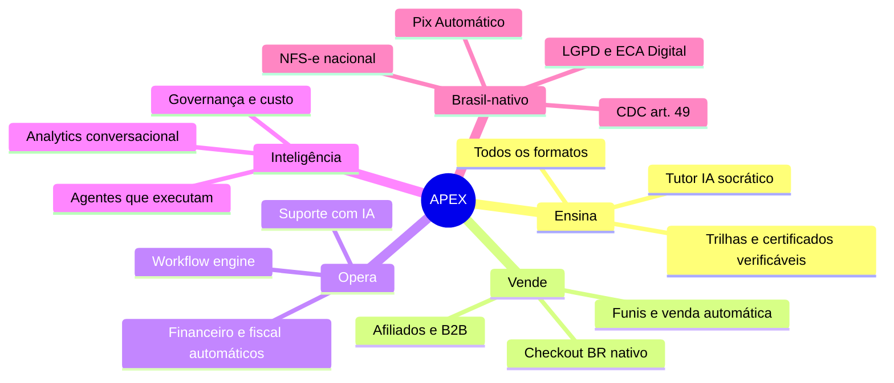

# 03 — Visão de Produto e Estratégia

> **APEX Plataforma de Cursos Livres** · Documento 03 · v1.0 · 21/10/2026 · Status: **Rascunho para validação**

## 1. Visão, missão e promessa

| | |
|---|---|
| **Visão** | Ser a plataforma brasileira de referência em educação livre, onde qualquer pessoa chega ao seu **ápice** profissional e qualquer especialista transforma conhecimento em negócio — com a operação rodando em piloto automático inteligente. |
| **Missão** | Entregar aprendizagem de qualidade, vender com ética e operar com o mínimo de esforço humano, usando IA como colega de equipe em cada etapa. |
| **Promessa ao aluno** | *Aprenda no seu ritmo, com um tutor que nunca dorme, e tenha provas reais do que aprendeu.* |
| **Promessa ao instrutor/parceiro** | *Você ensina; a APEX cria, vende, cobra, emite nota, atende e repassa.* |
| **Promessa ao operador** | *Cada tarefa repetitiva é um fluxo automatizado, auditável e com aprovação quando necessário.* |
| **Tagline sugerida** | **"Seu ápice começa aqui."** (alternativas: "Aprender no seu ápice." · "O próximo nível do conhecimento.") |

## 2. Os cinco pilares (como a APEX se diferencia)

| Pilar | O que significa | Evidência de necessidade ([Doc 01](01-pesquisa-benchmark.md)) |
|---|---|---|
| **Ensina** | LMS completo + múltiplos formatos de produto educacional sob um só catálogo | LearnWorlds sem ao vivo nativo evidente; Skool com cursos básicos |
| **Vende** | Comércio, funil, CRM e afiliados **no mesmo dado** do aluno | Mercado separa marketplace, área de membros e CRM |
| **Opera** | Back-office automatizado, auditável | Docebo traz IA p/ admin, mas não resolve comércio/fiscal BR |
| **Inteligência** | IA que **executa** com governança, não só sugere | Hotmart (agentes), Kajabi (limitações apontadas) |
| **Brasil-nativo** | Conformidade e meios de pagamento locais desde o dia 1 | Marco legal 2025–2026 (ECA Digital, NFS-e nacional, Pix Automático) |

## 3. Modelo de negócio (hipótese inicial)

> Decisão registrada como **ADR-001**: operação própria com arquitetura **multi-tenant-ready**; marketplace e white-label só após validar o núcleo. **Premissa a validar com o patrocinador.**

### 3.1 Canvas simplificado

| Bloco | Descrição |
|---|---|
| **Segmentos** | (1) Aprendizes adultos (requalificação/upskilling); (2) jovens 18+ em início de carreira; (3) empresas/RH (B2B); (4) instrutores/especialistas parceiros; (5) afiliados |
| **Proposta de valor** | Ver §1 e §2 |
| **Canais** | SEO de cursos livres, mídia paga (Meta/Google/TikTok), e-mail/WhatsApp, webinars e workshops como motor de aquisição, afiliados, parcerias B2B, conteúdo orgânico |
| **Relacionamento** | Tutor IA 24/7, comunidade, mentorias, régua de sucesso do aluno, suporte híbrido IA+humano |
| **Receitas** | Ver §3.2 |
| **Recursos-chave** | Plataforma, catálogo, marca, dados, relacionamento com instrutores, agentes de IA |
| **Atividades-chave** | Produção de conteúdo, aquisição, operação automatizada, compliance, evolução da IA |
| **Parceiros** | PSP, provedor de vídeo, provedor de ao vivo, ESP/BSP (e-mail/WhatsApp), emissor fiscal, provedores de LLM, instrutores |
| **Custos** | Pessoas, infraestrutura (vídeo, ao vivo, IA), meios de pagamento, mídia paga, impostos, conteúdo |

### 3.2 Fontes de receita

| # | Fonte | Descrição | Fase |
|---|---|---|---|
| R1 | **Venda direta** de cursos, e-books, workshops, webinars pagos, mentorias, kits | Catálogo próprio e de instrutores parceiros (revenue share) | 1 |
| R2 | **APEX Pass** (assinatura) | Acesso a um conjunto do catálogo + comunidade + descontos | 2 |
| R3 | **B2B / Corporativo** | Licenças por assento, trilhas customizadas, relatórios, faturamento | 3 |
| R4 | **Certificações / exames** | Exame avulso e selos (Open Badges) | 3 |
| R5 | **Créditos de IA** | Pacotes para instrutores (Studio) e alunos (Tutor avançado) | 2–3 |
| R6 | **Marketplace de instrutores** | *Take rate* sobre vendas de terceiros | 4 |
| R7 | **White-label / SaaS** | Plano para escolas e criadores usarem o motor APEX | 4 |
| R8 | **Anúncios/patrocínio** | Eventos e conteúdos patrocinados (com transparência) | 4 |

## 4. Personas e *Jobs To Be Done*

> Arquétipos **hipotéticos**, a validar com pesquisa qualitativa (ação no Doc 19, B-06). Nomes fictícios.

| ID | Persona | Contexto | Job principal (JTBD) | Dor atual | O que a APEX entrega |
|---|---|---|---|---|---|
| P1 | **Marina, 32** — Profissional em transição | Trabalha, estuda à noite no celular | "Quando preciso mudar de área, quero uma trilha curta e prática para ter *evidência* do que aprendi" | Cursos soltos, sem caminho nem prova | Trilhas, tutor IA, certificado verificável, pagamento por Pix/parcelado |
| P2 | **Rafael, 19** — Início de carreira | Orçamento curto, gosta de desafios | "Quero aprender barato e provar competência" | Evasão, falta de motivação | Gamificação, comunidade, cursos de entrada, bundles |
| P3 | **Helena, 41** — Gestora de RH (B2B) | Treina equipes | "Quero capacitar 50 pessoas e ver o resultado sem planilhas" | Gestão manual, sem relatório | Compra de assentos, painel de equipe, faturamento, SSO |
| P4 | **Prof. Carlos, 50** — Instrutor especialista | Pouca familiaridade técnica | "Quero publicar meu curso e receber sem lidar com tecnologia" | Complexidade de plataforma, impostos, suporte | APEX Studio, contrato e KYC digitais, repasse automático, painel |
| P5 | **Bianca, 27** — Operações/Admin | Equipe enxuta | "Quero que tarefas repetitivas aconteçam sozinhas" | Retrabalho, erros, tarefas dispersas | Workflow engine, copiloto de operação, alertas |
| P6 | **Diego, 29** — Growth/Marketing | Gerencia funis e anúncios | "Quero lançar uma campanha e ver o ROI real por canal" | Dados fragmentados | LP builder, funis, CAPI, atribuição, experimentos |
| P7 | **Paula, 35** — Suporte/Sucesso do aluno | Atende dúvidas | "Quero resolver o que importa e deixar o resto para a IA" | Volume de dúvidas repetidas | Helpdesk com IA, base de conhecimento viva |
| P8 | **Tiago, 30** — Afiliado | Divulga produtos | "Quero links, materiais e comissão transparente" | Falta de confiança no tracking | Painel de afiliado, pagamento previsível |
| P9 | **Roberto, 45** — Responsável legal | Filho de 14–17 anos *(Fase 2)* | "Quero autorizar e acompanhar com segurança" | Privacidade e segurança | Conta de responsável, consentimento e controles |

## 5. Princípios de produto

1. **Automação com governança** — todo fluxo automatizado tem *dono, log, limite e botão de pausa*.
2. **Humano no circuito onde há risco** — dinheiro, dados pessoais, menores e promessas comerciais exigem política de aprovação.
3. **Honestidade educacional** — nunca sugerir equivalência com ensino regulado (graduação, pós, técnico) em cursos livres; o produto *impede* isso por regra.
4. **Dado único** — aluno, comprador, lead e participante são a mesma pessoa em um só perfil.
5. **Mobile-first, acessível** — WCAG 2.2 AA como meta; legendas em todos os vídeos.
6. **Medir antes de escalar** — toda mudança relevante vai atrás de *feature flag* e métrica.
7. **Sem padrões enganosos** — sem escassez falsa, contagem regressiva fictícia, cancelamento difícil ou depoimentos inventados.
8. **Substituível por design** — PSP, vídeo, ao vivo, e-mail e LLM ficam atrás de *adapters*; nenhuma dependência de fornecedor é irreversível.
9. **Custo de IA é métrica de produto** — orçamento por agente, por aluno e por tenant.
10. **Português do Brasil primeiro** — linguagem, formatos, moeda, fuso, documentos e fiscal.

## 6. Mapa do produto (módulos)

| Código | Módulo | Resumo |
|---|---|---|
| **IAM** | Identidade e Acesso | Contas, papéis, 2FA, SSO, consentimentos, verificação de idade |
| **CAT** | Catálogo e Produtos | Todos os formatos, ofertas, preços, bundles, páginas públicas e SEO |
| **LMS** | Aprendizagem | Cursos, módulos, aulas, trilhas, turmas, avaliações, certificados |
| **MED** | Conteúdo e Mídia | Upload, transcodificação, player, DRM/marca d'água, e-book reader, legendas |
| **LIV** | Ao Vivo e Eventos | Webinars, workshops, eventos, replays, presença, agenda |
| **ENG** | Comunidade e Engajamento | Espaços, fóruns, gamificação, mentorias, notificações |
| **PAY** | Checkout e Pagamentos | Carrinho, pedidos, pagamentos, assinaturas, cupons, reembolsos, split |
| **MKT** | Marketing e Growth | LPs, funis, e-mail/WhatsApp, afiliados, SEO, atribuição, experimentos |
| **CRM** | CRM e Vendas | Contatos, pipelines, scoring, caixa de entrada omnichannel, B2B |
| **AIX** | APEX Intelligence | Gateway de IA, RAG, agentes, avaliação, guardrails, custos |
| **OPS** | Operações e Back-office | Workflow engine, financeiro, fiscal, suporte, secretaria, instrutores, compliance |
| **DAT** | Dados e Analytics | Eventos, métricas, BI, previsões, relatórios automáticos |
| **PLT** | Plataforma e Integrações | API pública, webhooks, multi-tenant, feature flags, observabilidade |

## 7. Estratégia de entrada no mercado (resumo — detalhes no [Doc 18](18-go-to-market.md))

1. **Âncora de aquisição:** webinars e workshops ao vivo gratuitos/baixo custo → captação → oferta de curso/trilha (funil evergreen).
2. **Catálogo inicial enxuto e forte:** poucos cursos-âncora em 2–3 áreas com maior demanda validada (a definir por pesquisa de demanda e SEO — ação B-07).
3. **Instrutores convidados** antes do marketplace aberto: contrato e repasse automatizados desde o início.
4. **Tutor IA como diferencial visível** na primeira experiência (primeira aula + pergunta).
5. **Prova social verificável** desde cedo: certificados com validação pública e avaliações de compradores verificados.

## 8. O que a APEX **não** é (limites de escopo)

- **Não** é instituição de ensino regulada (graduação, pós-graduação, técnico, EJA). Não emite diploma, não promete equivalência e não usa termos como "MBA", "pós-graduação" ou "reconhecido pelo MEC" em cursos livres.
- **Não** habilita ao exercício de profissão regulamentada (conselhos profissionais). Cursos nessas áreas exigem revisão jurídica específica antes de publicar.
- **Não** é rede social aberta; a comunidade é associada a produtos e tem moderação.
- **Não** treina modelos de IA com dados de alunos sem base legal e transparência (ver Doc 08 e 16).

## 9. Hipóteses críticas a validar

| ID | Hipótese | Como validar | Critério |
|---|---|---|---|
| H-01 | Webinar/workshop ao vivo é o melhor motor de aquisição para cursos livres no nosso público | Teste de funil com 3 temas | CPL e taxa webinar→compra |
| H-02 | Tutor IA aumenta a conclusão | Teste A/B (com/sem tutor) | +X p.p. de conclusão |
| H-03 | Agente de vendas por WhatsApp converte leads qualificados sem prejudicar a marca | Piloto com HITL | Conversão ≥ humano com NPS ≥ |
| H-04 | Instrutores aderem a um modelo de repasse automático com contrato digital | Entrevistas + piloto com 5 instrutores | ≥ 3 publicam em 60 dias |
| H-05 | Pix Automático reduz inadimplência de assinatura vs. cartão | Piloto APEX Pass | Churn involuntário |
| H-06 | Há demanda B2B por trilhas curtas com faturamento | 10 entrevistas de RH | ≥ 3 pilotos |

> Os critérios numéricos serão calibrados na Fase 0 (Doc 19).
