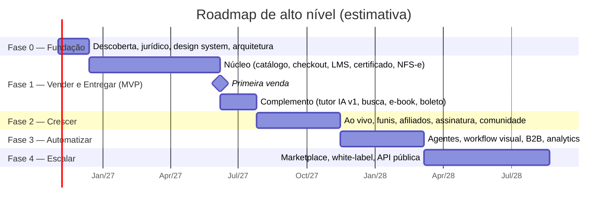

# 04 — PRD: Documento de Requisitos de Produto

> **APEX Plataforma de Cursos Livres** · Documento 04 · v1.0 · 21/10/2026 · Status: **Rascunho para validação**
> Complementos: requisitos detalhados no [Doc 05](05-requisitos-funcionais.md) e [Doc 06](06-requisitos-nao-funcionais.md).

## 1. Contexto e problema

Criadores de conteúdo e instituições de cursos livres no Brasil hoje montam sua operação **costurando** 5 a 8 ferramentas (marketplace de pagamento, área de membros, e-mail, CRM, ferramenta de lives, helpdesk, emissor de nota), o que gera:

- dados fragmentados do aluno/comprador (sem visão única);
- trabalho manual recorrente (liberação de acesso, nota fiscal, reembolso, repasse, suporte);
- IA usada como "chatbot" isolado, não como equipe;
- risco jurídico (reembolso, LGPD, menores, alegações de certificado) gerido de forma artesanal.

**Problema a resolver:** *entregar uma plataforma única que ensine, venda e opere um negócio de cursos livres com o mínimo de intervenção humana, em conformidade com a legislação brasileira.*

## 2. Objetivos e métricas

> Todas as metas são **propostas** e serão calibradas após 90 dias de dados reais.

### 2.1 North Stars

| North Star | Definição | Meta proposta (12 meses pós-lançamento) |
|---|---|---|
| **WAL-P** — Alunos Ativos Semanais com Progresso | Nº de alunos que concluíram ≥ 1 aula/atividade na semana | Crescimento sustentado; baseline na Fase 1 |
| **RA%** — Receita Automatizada | % da receita proveniente de pedidos sem toque humano (compra→pagamento→acesso→NF) | ≥ 90% |

### 2.2 Árvore de métricas

| Área | Métrica | Meta proposta |
|---|---|---|
| Aquisição | CPL, CAC, ROAS por canal | LTV/CAC ≥ 3 |
| Ativação | % que inicia a 1ª aula em ≤ 24 h após a compra | ≥ 70% |
| Engajamento | Taxa de conclusão de cursos pagos | ≥ 40% (cursos curtos) |
| Satisfação | NPS · CSAT do tutor IA | NPS ≥ 60 · CSAT ≥ 4,3/5 |
| Retenção | Churn mensal do APEX Pass (voluntário / involuntário) | ≤ 6% total |
| Comercial | Taxa de reembolso (7 dias) · *chargeback* | ≤ 5% · ≤ 0,5% |
| Operação | Tickets resolvidos sem humano · 1ª resposta | ≥ 60% (F3: ≥ 70%) · ≤ 1 min (IA) / ≤ 2 h (humano) |
| Fiscal | NFS-e emitida automaticamente | 100% dos pedidos elegíveis |
| Conteúdo | Tempo do roteiro ao curso publicado (com Studio) | ≤ 3 dias para curso curto |
| IA | Taxa de erro factual no conjunto de teste (*golden set*) | ≤ 2% |
| IA | Custo de IA por aluno ativo/mês | Orçamento definido na Fase 1 |
| Plataforma | Disponibilidade · p95 de API | 99,9% · ≤ 400 ms |

## 3. Escopo

### 3.1 Dentro do escopo (visão completa, em fases)

13 módulos (ver [Doc 03](03-visao-produto-estrategia.md) §6): IAM, CAT, LMS, MED, LIV, ENG, PAY, MKT, CRM, AIX, OPS, DAT, PLT.

**Formatos de produto:** curso gravado, curso em turma, trilha, e-book, webinar (ao vivo e *evergreen*), workshop ao vivo, mentoria, assinatura (APEX Pass), desafio, comunidade, evento, certificação/exame, kit/bundle, cartão-presente, licença corporativa (detalhes no [Doc 07](07-catalogo-formatos-produto.md)).

### 3.2 Fora do escopo (por ora)

| Item | Motivo |
|---|---|
| Cursos regulados (graduação, pós, técnico, EJA) | Exigem credenciamento e conformidade MEC; fora do posicionamento |
| Produtos físicos / logística | Sem necessidade para cursos livres |
| App nativo iOS/Android na Fase 1 | PWA cobre; app nativo avaliado na Fase 3 |
| Operação internacional (multi-moeda/idioma) | Arquitetura preparada; execução na Fase 4 |
| Videoconferência genérica | Apenas sessões educacionais |

## 4. Épicos e priorização (MoSCoW)

| Épico | Nome | Módulos | MoSCoW | Fase |
|---|---|---|---|---|
| EP-01 | Conta, acesso e consentimento | IAM | Must | 1 |
| EP-02 | Catálogo multiformato e páginas públicas/SEO | CAT | Must | 1 |
| EP-03 | Núcleo de aprendizagem (cursos, progresso, avaliações, certificado) | LMS, MED | Must | 1 |
| EP-04 | Checkout, pagamentos e acesso automático | PAY | Must | 1 |
| EP-05 | Operação mínima automatizada (NFS-e, reembolso, e-mails, painel admin) | OPS | Must | 1 |
| EP-06 | Tutor IA v1 + gateway de IA | AIX | Must | 1 |
| EP-07 | Webinars e workshops ao vivo | LIV | Should | 2 |
| EP-08 | Marketing: LPs, funis, e-mail, recuperação, afiliados | MKT, PAY | Should | 2 |
| EP-09 | Assinatura (APEX Pass) e Pix Automático | PAY | Should | 2 |
| EP-10 | Comunidade e gamificação | ENG | Should | 2 |
| EP-11 | CRM e caixa de entrada omnichannel (WhatsApp) | CRM | Should | 2 |
| EP-12 | APEX Studio (criação com IA) e créditos de IA | AIX | Should | 2 |
| EP-13 | Workflow engine visual e agentes de operação/vendas/suporte | OPS, AIX, CRM | Should | 3 |
| EP-14 | B2B, mentorias, certificações e credenciais verificáveis | PAY, LMS | Could | 3 |
| EP-15 | Analytics conversacional e previsões | DAT, AIX | Could | 3 |
| EP-16 | Marketplace de instrutores, white-label e API pública | PLT, PAY | Could | 4 |
| EP-17 | Menores (conta de responsável) e ECA Digital | IAM, ENG | Should* | 2–3 |

\* Condicionado à decisão de público (ADR-010). Se o público for 18+ no lançamento, o EP-17 desce para *Could*.

## 5. Escopo por fase (resumo)

> As durações são **estimativas de planejamento** (detalhe e premissas no [Doc 19](19-roadmap-backlog-equipe.md)); a data de início é ilustrativa.
>
> **A Fase 1 foi reestimada de baixo para cima.** A estimativa inicial de 17 semanas **não se sustentou**: o backlog da Fase 1 soma **619 pessoas-dia** e, com 6 engenheiros, leva **~32 semanas** (~25 até a primeira venda). Fechar em 17 semanas exigiria ~11 engenheiros. Total do roadmap: **~94 semanas (~22 meses)**. A decisão entre prazo, equipe e escopo está em aberto (Q-09).

### Critérios de saída por fase

| Fase | Critérios de saída (resumo) |
|---|---|
| **0** | Marca consultada no INPI · contas de PSP/vídeo/e-mail abertas · design system v0 · arquitetura e ADRs aprovados · análise do site de referência concluída (Doc 02) · política de reembolso e termos revisados por advogado |
| **1** | Fluxo ponta a ponta (cadastro → compra → acesso → aula → avaliação → certificado → NFS-e) em produção com ≥ 3 cursos reais · tutor IA com *golden set* ≥ meta · testes de segurança concluídos · LGPD operacional (DSAR, consentimentos) |
| **2** | Primeiro webinar/workshop ao vivo com ≥ 200 participantes sem incidentes · funil evergreen rodando · assinatura com Pix Automático/cartão · afiliados com pagamento automático |
| **3** | ≥ 60% dos tickets resolvidos por IA · ≥ 5 fluxos operacionais no workflow engine · piloto B2B concluído |
| **4** | Primeiro instrutor externo vende sem intervenção da equipe · API pública documentada |

## 6. Requisitos de alto nível por épico

| Épico | Resultado esperado | Requisitos-chave (ver Doc 05) |
|---|---|---|
| EP-01 | Cadastro/login seguro e consentido | RF-IAM-001…022 |
| EP-02 | Qualquer formato aparece em vitrine indexável | RF-CAT-001…025 |
| EP-03 | Aluno conclui curso e obtém certificado verificável | RF-LMS-001…040, RF-MED-001…020 |
| EP-04 | Compra com Pix/cartão/boleto libera acesso em segundos | RF-PAY-001…030, RF-PAY-040…046 |
| EP-05 | Admin opera sem planilhas | RF-OPS-001, 002, 009…010, 022, 029…032, 035 (e demais do módulo OPS na Fase 2) |
| EP-06 | Aluno tira dúvidas com citações das aulas | RF-AIX-001…011, 015…016, 018, 024 |
| EP-07 | Evento ao vivo com inscrição, lembretes, replay e presença | RF-LIV-001…030 |
| EP-08 | Campanha ponta a ponta criada e medida na plataforma | RF-MKT-001…025, RF-PAY-019…021 |
| EP-09 | Cobrança recorrente com recuperação | RF-PAY-031…039 |
| EP-10 | Engajamento e retenção | RF-ENG-001…020 |
| EP-11 | Lead tratado do primeiro contato ao fechamento | RF-CRM-001…019 |
| EP-12 | Instrutor cria conteúdo com IA e revisão | RF-AIX-013, 017, 020…023, 025 |
| EP-13 | Fluxos operacionais configuráveis e agentes governados | RF-OPS-001…008, RF-AIX-028…038 |
| EP-14 | B2B, mentorias, certificações e credenciais | RF-PAY-039, RF-LIV-026, RF-LMS-018, RF-CRM-013 |
| EP-15 | Analytics conversacional e previsões | RF-DAT-001…012, RF-AIX-034…035 |
| EP-16 | Marketplace, white-label e API pública | RF-PLT-002, 005, 009, 010, 018 |
| EP-17 | Menores e ECA Digital | RF-IAM-014…015, RF-ENG-006 |

> Um requisito pode servir a mais de um épico. A fonte da verdade é o [Doc 05](05-requisitos-funcionais.md).

## 7. Premissas, dependências e restrições

**Premissas**
- A1: Operação própria inicial, com instrutores convidados (ADR-001).
- A2: Público-alvo principal 18+ no lançamento (ADR-010).
- A3: Contratação de PSP, provedor de vídeo, provedor de ao vivo, ESP e emissor fiscal como serviços (ADR-003).
- A4: Equipe-núcleo descrita no Doc 19.

**Dependências externas**
- D1: Aprovação do PSP e dos meios (Pix, Pix Automático, cartão, boleto).
- D2: Verificação de domínio e *templates* aprovados no canal WhatsApp Business.
- D3: Emissor de NFS-e padrão nacional (obrigatório para optantes do Simples a partir de 01/11/2026, conforme fontes consultadas — confirmar com contador).
- D4: Registro/consulta de marca no INPI.

**Restrições**
- R1: LGPD, CDC, Marco Civil, ECA Digital, LBI (ver Doc 16).
- R2: Política de rede e *data residency* conforme contratos de IA/nuvem.
- R3: Custo unitário de IA e vídeo limitado por orçamento por agente/aluno.

## 8. Riscos principais (visão PRD)

| ID | Risco | Prob. | Impacto | Mitigação |
|---|---|---|---|---|
| R-01 | Alucinação do tutor IA gerando orientação errada | Média | Alto | RAG com citação obrigatória, *golden set*, escalonamento, avisos |
| R-02 | Alegação indevida de validade do certificado | Média | Alto | Guardião de Compliance bloqueia termos proibidos; revisão jurídica |
| R-03 | Fraude/chargeback em cartão | Média | Médio | Antifraude do PSP, regras, 3DS, monitoramento |
| R-04 | Pirataria de vídeo | Alta | Médio | URL assinada + DRM + marca d'água + detecção de compartilhamento |
| R-05 | Dependência de fornecedor (PSP/IA/vídeo) | Média | Alto | Adapters, multi-provedor, contratos com saída |
| R-06 | Custo de IA fora de controle | Média | Alto | Orçamento por agente, cache, roteamento de modelos, créditos |
| R-07 | Restrições de plataforma (WhatsApp/Meta) em IA | Média | Médio | Escopo de atendimento (não "chatbot geral"), opt-in, monitorar política |
| R-08 | Dados de menores | Baixa | Muito alto | Público 18+ no início; conta de responsável na Fase 2 |
| R-09 | Mudanças regulatórias (IA, ECA Digital, reforma tributária) | Alta | Médio | Monitor regulatório (agente + jurídico), arquitetura configurável |
| R-10 | Colisão de marca "APEX" | Média | Alto | Busca de anterioridade INPI (classes 9, 35, 41, 42) antes de investir |
| R-11 | Escopo excessivo: o backlog da Fase 1 já excede a capacidade prevista (619 pessoas-dia; ~32 semanas com 6 engenheiros) | **Alta (confirmada)** | Alto | Núcleo × complemento; *buy-over-build*; portões de decisão (Doc 17 §6); decisão Q-09 |
| R-12 | Aderência ao site de referência não verificada | Média | Médio | Concluir Doc 02 na Fase 0 |

## 9. Critérios de lançamento (Go/No-Go da Fase 1)

- [ ] Fluxo ponta a ponta validado em produção com compras reais de baixo valor.
- [ ] Reembolso de 7 dias automatizado e testado.
- [ ] NFS-e emitida automaticamente (ou rotina contábil validada por contador).
- [ ] DSAR (acesso/exclusão) executável em ≤ 15 dias com roteiro e logs.
- [ ] Teste de invasão (pentest) sem achados críticos/altos abertos.
- [ ] Monitoramento, alertas e *runbooks* ativos; *backup* restaurado em teste.
- [ ] Termos de Uso, Privacidade, Reembolso e Cookies publicados e revisados por advogado.
- [ ] Acessibilidade: auditoria WCAG 2.2 AA nas jornadas críticas sem bloqueadores.
- [ ] Tutor IA: *golden set* e testes de segurança (injeção de prompt) aprovados.

## 10. Questões abertas (precisam de decisão do patrocinador)

| ID | Pergunta | Impacto | Responsável | Prazo sugerido |
|---|---|---|---|---|
| Q-01 | A APEX será operação própria, marketplace ou white-label? (ADR-001) | Escopo e arquitetura | Patrocinador | Fim da Fase 0 |
| Q-02 | Público inicial: 18+ ou inclui menores? (ADR-010) | EP-17, jurídico | Patrocinador + jurídico | Início da Fase 0 |
| Q-03 | Quais áreas/cursos iniciais? | Catálogo e GTM | Produto + pedagógico | Fase 0 |
| Q-04 | Regime tributário e CNAE da operadora | Fiscal | Contador | Fase 0 |
| Q-05 | Orçamento e equipe disponíveis | Cronograma | Patrocinador | Fase 0 |
| Q-06 | A APEX se ligará à marca/ecossistema "ApeX" já existente no repositório? | Identidade, domínio | Patrocinador | Fase 0 |
| Q-07 | Resultado da análise do site de referência (Doc 02) | Escopo | Produto | Fase 0 |
| Q-08 | Idiomas/moedas fora do pt-BR/BRL são requisito de curto prazo? | Arquitetura | Patrocinador | Fase 0 |
| Q-09 | Como equilibrar prazo, equipe e escopo da Fase 1? Opções: **(a)** aceitar ~32 semanas com 6 engenheiros; **(b)** ampliar a equipe (~11 engenheiros para 17 semanas); **(c)** cortar escopo e comprar mais componentes (Doc 19 §5) | Cronograma, caixa (Doc 17), risco | Patrocinador + TL | Fase 0 |
