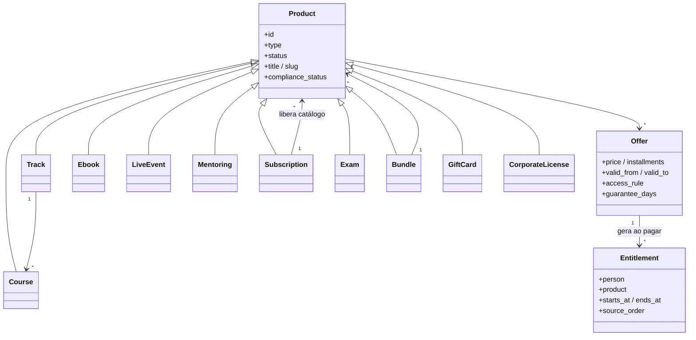
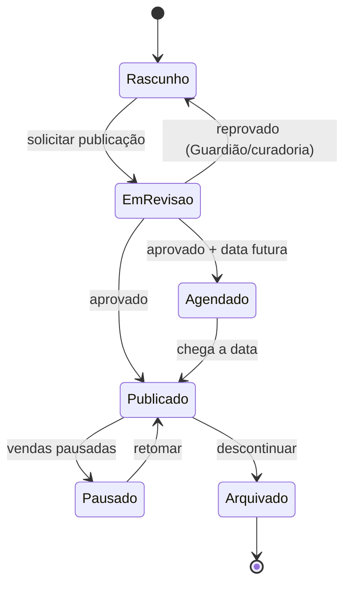

# 07 — Catálogo de Formatos de Produto Educacional

> **APEX Plataforma de Cursos Livres** · Documento 07 · v1.0 · 21/10/2026 · Status: **Rascunho para validação**

A APEX vende **produtos educacionais** em formatos distintos sob **um único catálogo, um checkout e um perfil de aluno**. Este documento define cada formato, suas regras e o que muda no sistema (módulos e requisitos relacionados no [Doc 05](05-requisitos-funcionais.md)).

## 1. Visão geral

**Princípio:** a compra gera um **direito de acesso (*entitlement*)**. O que o direito libera depende do tipo de produto. Isso permite combinar formatos (kit, assinatura, trilha) sem lógica especial no checkout.

## 2. Matriz de formatos

| # | Formato | Entrega | Pagamento | Certificado | Ao vivo? | Fase |
|---|---|---|---|---|---|---|
| F-01 | **Curso gravado** (autoestudo) | Plataforma (vídeo/texto/quiz) | Único / assinatura | Conclusão | Não | 1 |
| F-02 | **Curso em turma** (coorte) | Plataforma + encontros | Único / parcelado | Conclusão | Parcial | 2 |
| F-03 | **Trilha / programa** | Sequência de cursos | Único / parcelado / assinatura | Trilha | Opcional | 2 |
| F-04 | **E-book** | Leitor web + download | Único | — | Não | 1 |
| F-05 | **Webinar** (ao vivo e *evergreen*) | Sala ao vivo + replay | Grátis / pago | Participação | Sim | 2 |
| F-06 | **Workshop ao vivo** | Sala interativa + materiais | Pago (lotes) | Participação / conclusão | Sim | 2 |
| F-07 | **Mentoria / plantão** | Agenda + sala | Sessão / pacote | Opcional | Sim | 3 |
| F-08 | **Assinatura (APEX Pass)** | Acesso a catálogo/comunidade | Recorrente | Conforme item | Opcional | 2 |
| F-09 | **Desafio / bootcamp** | Sequência diária + comunidade | Grátis / pago | Conclusão | Parcial | 2 |
| F-10 | **Comunidade** | Espaço + eventos | Assinatura / bônus | — | Opcional | 2 |
| F-11 | **Evento / summit** (multissessão) | Programação + replays | Ingresso / passe | Participação | Sim | 3 |
| F-12 | **Certificação / exame** | Prova + emissão | Único | Certificação | Opcional | 3 |
| F-13 | **Kit / bundle** | Vários produtos | Único | Por item | — | 2 |
| F-14 | **Recursos digitais** (templates, planilhas, prompts) | Download | Único | — | Não | 2 |
| F-15 | **Cartão-presente / créditos** | Código | Único | — | — | 3 |
| F-16 | **Licença corporativa (B2B)** | Assentos + painel | Faturado | Por aluno | Opcional | 3 |

## 3. Fichas dos formatos

### F-01 · Curso gravado (autoestudo)

| Item | Regra |
|---|---|
| **Quando usar** | Conhecimento estruturado, consumo no ritmo do aluno |
| **Estrutura** | Curso → módulos → aulas (vídeo, texto, áudio, PDF, quiz, tarefa) |
| **Campos obrigatórios** | Título, resumo, objetivos de aprendizagem (verbo mensurável), público, nível, carga horária estimada, pré-requisitos, instrutor, política de reembolso, critérios de conclusão |
| **Acesso** | Vitalício, X meses, ou até data; *drip* opcional |
| **Certificado** | Conclusão: progresso ≥ 100% das aulas obrigatórias + nota mínima (padrão 70%) quando houver prova. Curso sem prova → **Certificado de Participação** |
| **Automação típica** | Boas-vindas → lembrete de início (24 h) → reengajamento (7 dias sem acesso) → pedido de avaliação (50% e 100%) → upsell de trilha |
| **Métricas** | Ativação 24 h, conclusão, NPS, tempo até 1ª aula, taxa de reembolso |
| **Compliance** | Guardião de Compliance; sem termos de ensino regulado; legendas obrigatórias |
| **Requisitos** | RF-CAT, RF-LMS, RF-MED |

### F-02 · Curso em turma (coorte)

| Item | Regra |
|---|---|
| **Diferença do F-01** | Datas de início/fim, ritmo guiado, tutor/instrutor presente, encontros ao vivo, comunidade da turma |
| **Campos extras** | Calendário, limite de vagas, lista de espera, tutor, regras de presença |
| **Certificado** | Conclusão com presença mínima configurável (ex.: 75%) + atividades |
| **Automação** | Lembretes de encontro, controle de presença, resumo da semana por IA, alerta de evasão |
| **Requisitos** | RF-LMS-006, RF-LIV, RF-ENG |

### F-03 · Trilha / programa

| Item | Regra |
|---|---|
| **Estrutura** | Sequência de cursos (obrigatórios/optativos) com pré-requisitos e **projeto final** opcional |
| **Preço** | Pacote com desconto; liberação sequencial; parcelamento sobre o total |
| **Certificado** | Certificado de Trilha ao concluir todos os itens obrigatórios; os certificados individuais permanecem |
| **Reembolso** | Regras do pacote (ver §4.4); estorno proporcional apenas fora do prazo de arrependimento e conforme política |
| **Nomenclatura** | Usar "trilha", "programa", "formação livre". **Não** usar "pós-graduação", "MBA", "curso técnico" |

### F-04 · E-book

| Item | Regra |
|---|---|
| **Formatos** | EPUB/PDF; leitor web com anotações e progresso |
| **Proteção** | Marca d'água por comprador (nome/e-mail) no PDF baixável; limite de downloads; sem DRM pesado na Fase 1 |
| **Entrega** | Imediata após pagamento; reenvio no painel |
| **Fiscal** | Tratamento tributário próprio (livro digital × serviço) — **definir com contador** (Doc 16 §8) |
| **Reembolso** | 7 dias (CDC art. 49) — política igual aos demais produtos digitais |
| **Extras** | Versão em áudio (TTS com rótulo "voz sintética") — Fase 3 |

### F-05 · Webinar (ao vivo e *evergreen*)

| Item | Regra |
|---|---|
| **Papel** | **Motor de aquisição** (gratuito) e produto pago de curta duração |
| **Ao vivo** | Sala com chat, Q&A, enquetes, *momento da oferta*; replay automático |
| **Evergreen** | Gravação servida em horários recorrentes; chat moderado; **rótulo "gravação" visível**; ofertas temporizadas por *tempo real do espectador* |
| **Inscrição** | Captura com consentimento; lembretes D-1, H-1 e H-10min; ICS |
| **Certificado** | Participação por presença mínima (padrão 75%) |
| **Métricas** | Inscritos → comparecimento → permanência → clique na oferta → compra; custo por inscrito |
| **Compliance** | Sem escassez falsa; sem simular "ao vivo" de forma enganosa; depoimentos reais |
| **Requisitos** | RF-LIV-001…030, RF-MKT |

### F-06 · Workshop ao vivo

| Item | Regra |
|---|---|
| **Formato** | Turma pequena (ex.: 15–60), prática guiada, *breakouts*, entrega de artefato |
| **Preço** | Lotes de ingresso; capacidade rígida; lista de espera |
| **Entrega** | Materiais prévios, sala, gravação (opcional), pós-evento com resumo e próximos passos |
| **Certificado** | Participação ou conclusão (se houver atividade avaliada) |
| **Cancelamento** | Remarcação/reembolso conforme política; reembolso integral em 7 dias da compra ou se o evento for cancelado pela APEX |

### F-07 · Mentoria / plantão

| Item | Regra |
|---|---|
| **Modelos** | 1:1 por sessão; pacote de N sessões; grupo (*office hours*) |
| **Agenda** | Disponibilidade do mentor, fuso, reagendamento até X h antes, *no-show* |
| **Pagamento** | Por sessão/pacote; repasse ao mentor após a sessão |
| **Dados** | Notas privadas; gravação somente com consentimento de ambos |
| **Compliance** | Sem aconselhamento de profissão regulamentada sem habilitação do mentor (ver Doc 16) |

### F-08 · Assinatura (APEX Pass)

| Item | Regra |
|---|---|
| **Conceito** | Acesso recorrente a um conjunto do catálogo, comunidade e eventos |
| **Meios** | Cartão; **Pix Automático**; boleto recorrente (se aplicável) |
| **Ciclos** | Mensal, trimestral, anual; *trial* opcional; upgrade/downgrade proporcional; pausa |
| **Cancelamento** | Em ≤ 2 cliques, pelo mesmo canal da contratação; efeito ao fim do ciclo pago |
| **Inadimplência** | Carência configurável → acesso reduzido → suspensão; recuperação por *dunning* |
| **Certificados** | Emitidos por item concluído, **durante** a assinatura; certificados já emitidos permanecem válidos |
| **Repasse a instrutores** | Pool por consumo/conclusão (regra definida no contrato do instrutor) |
| **Avisos** | Lembrete antes da renovação e transparência de preço (Doc 16 §4) |

### F-09 · Desafio / bootcamp

| Item | Regra |
|---|---|
| **Formato** | 5–30 dias, uma missão por dia, check-ins, comunidade, prêmios |
| **Uso** | Aquisição (gratuito) ou retenção (assinantes) |
| **Gamificação** | Pontos/selos/ranking; *streaks* **desativadas por padrão para menores** |
| **Certificado** | Conclusão por missões cumpridas |

### F-10 · Comunidade

| Item | Regra |
|---|---|
| **Escopo** | Espaços associados a produto, turma ou assinatura; regras e moderação |
| **Moderação** | IA para pré-triagem + humanos; denúncia; banimento; auditoria |
| **Privacidade** | Perfil público opcional; nome de exibição; controle de visibilidade |
| **Monetização** | Incluída em produtos/assinaturas; espaços pagos (Fase 3) |

### F-11 · Evento / summit

| Item | Regra |
|---|---|
| **Estrutura** | Várias sessões/palestrantes; trilhas; passe geral × ingresso por sessão |
| **Ingresso** | Lotes, cortesias, QR, transferência |
| **Pós-evento** | Replays por sessão, pacote de bônus, ofertas |
| **Patrocínio** | Cotas com transparência publicitária (Fase 4) |

### F-12 · Certificação / exame

| Item | Regra |
|---|---|
| **Fluxo** | Inscrição → prova (tempo, tentativas) → nota → emissão |
| **Integridade** | Banco de questões, aleatorização, janela de tempo, detecção de padrões; proctoring leve (opcional) |
| **Emissão** | Certificado com validação pública e, opcionalmente, **Open Badge 3.0** |
| **Linguagem** | "Certificação APEX de competência em X". **Não** sugerir habilitação profissional regulamentada |

### F-13 · Kit / bundle

| Item | Regra |
|---|---|
| **Composição** | 2+ produtos; preço próprio; liberação conjunta ou sequencial |
| **Reembolso** | Pacote inteiro no prazo de 7 dias; depois, regras do contrato |
| **Fiscal** | Rateio por item para fins de NFS-e/receita e repasse |

### F-14 · Recursos digitais

Templates, planilhas, *prompts*, checklists. Entrega por download com marca d'água quando aplicável; licença de uso explícita (pessoal/comercial).

### F-15 · Cartão-presente / créditos

Código de resgate com validade e regras claras (o prazo de validade deve respeitar a legislação consumerista — **validar com o jurídico**); saldo na carteira do usuário; sem saque.

### F-16 · Licença corporativa (B2B)

| Item | Regra |
|---|---|
| **Compra** | Cotação → proposta → aceite eletrônico → faturamento (boleto/PIX/cartão corporativo) |
| **Assentos** | Atribuição por e-mail/SSO; reatribuição; relatório por equipe |
| **Entrega** | Catálogo restrito, trilhas customizadas, marca da empresa (Fase 4) |
| **Contrato** | Termo B2B com SLA, LGPD (controlador/operador) e prazo |

## 4. Regras transversais de produto

### 4.1 Estados

- **Arquivar** não revoga acesso de quem já comprou (salvo exceção contratual/jurídica).
- Alterações **materiais** (preço, carga horária, formato, promessa) em produto vendido geram nova versão e comunicação aos compradores quando afetam o contratado.

### 4.2 Nomenclatura (Guardião de Compliance)

| Categoria | Exemplos | Regra |
|---|---|---|
| **Proibidos em cursos livres** | "graduação", "pós-graduação", "MBA", "mestrado", "doutorado", "curso técnico", "diploma", "reconhecido pelo MEC", "válido em todo o território nacional" | Bloqueio automático |
| **Exigem revisão jurídica** | Áreas de profissão regulamentada (saúde, direito, engenharia, contabilidade etc.), "habilita", "credencia", "licencia", "autorizado" | Fila de revisão |
| **Promessas de resultado** | "ganhe R$ X em Y dias", "garantia de emprego", "renda garantida" | Bloqueio ou reescrita sugerida |
| **Permitidos** | "curso livre", "formação livre", "certificado de conclusão/participação", "trilha de aprendizagem", "qualificação profissional (FIC)" | OK com revisão pedagógica |

> Lista de termos mantida em dado de configuração (não em código) e revisada pelo jurídico trimestralmente. Detalhes legais no [Doc 16](16-juridico-compliance.md).

### 4.3 Matriz de certificação

| Formato | Tipo de certificado | Critério padrão | Pode customizar? |
|---|---|---|---|
| Curso gravado com prova | Conclusão | 100% obrigatório + nota ≥ 70% | Nota e itens obrigatórios |
| Curso gravado sem prova | Participação | 100% das aulas obrigatórias | Sim |
| Curso em turma | Conclusão | Presença ≥ 75% + atividades | Sim |
| Trilha | Trilha | Todos os cursos obrigatórios | Sim |
| Webinar/workshop | Participação | Permanência ≥ 75% | Sim |
| Exame | Certificação | Nota mínima definida no exame | Sim |
| Desafio | Conclusão | Missões cumpridas | Sim |

Todo certificado: **código único + QR + página pública de verificação + possibilidade de revogação**, texto claro sobre a natureza de **curso livre** e a carga horária **estimada/cumprida**.

### 4.4 Política de reembolso (padrão)

| Situação | Regra |
|---|---|
| Até 7 dias corridos da compra | Reembolso integral automático (CDC art. 49), independentemente do progresso |
| Garantia estendida (opcional por produto) | Prazo adicional configurável (ex.: 15/30 dias), com critérios claros exibidos antes da compra |
| Evento cancelado pela APEX | Reembolso integral ou remarcação à escolha do consumidor |
| Fora dos prazos | Conforme contrato e legislação, com análise caso a caso (fila do suporte) |

> Racional: a posição mais conservadora e favorável ao consumidor reduz risco jurídico e de *chargeback*; é consistente com os requisitos RF-PAY-010 e RF-PAY-022.

### 4.5 Preços e ofertas

- **Preço sempre final**, com parcelamento exibido de forma clara (com ou sem juros, informando o CET quando houver juros).
- **Ofertas** são entidades separadas do produto (vigência, público, canal, afiliado).
- **Cupons** e **escassez** só quando verdadeiros (RF-MKT-021).
- **Preço de referência ("de/por")** só quando o preço anterior tiver sido efetivamente praticado (evitar publicidade enganosa).

## 5. Campos mínimos por tipo (resumo para modelagem)

| Campo | Curso | Trilha | E-book | Webinar | Workshop | Mentoria | Assinatura | Exame |
|---|---|---|---|---|---|---|---|---|
| Objetivos de aprendizagem | ● | ● | ○ | ● | ● | ○ | — | ● |
| Carga horária | ● | ● | ○ | ● | ● | ○ | — | ○ |
| Pré-requisitos | ○ | ○ | — | ○ | ○ | — | — | ○ |
| Data/hora | — | — | — | ● | ● | ● | — | ○ |
| Capacidade | — | — | — | ○ | ● | ● | — | ○ |
| Instrutor(es) | ● | ● | ● | ● | ● | ● | ○ | ○ |
| Arquivos | ○ | — | ● | ○ | ○ | — | — | — |
| Regras de certificado | ● | ● | — | ● | ● | ○ | — | ● |
| Itens incluídos | — | ● | — | — | — | — | ● | — |

● obrigatório · ○ opcional · — não se aplica

## 6. Evolução

- Novos formatos entram por **tipo de produto + esquema de campos + regra de *entitlement***; o checkout e o ledger não mudam.
- Formatos candidatos pós-Fase 4: **simulados**, **cursos com projeto avaliado por banca**, **conteúdo patrocinado**, **audiobooks**, **trilhas por IA sob demanda** (com revisão pedagógica).
