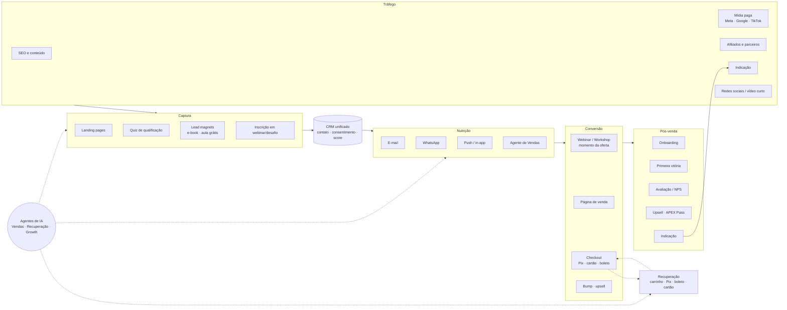
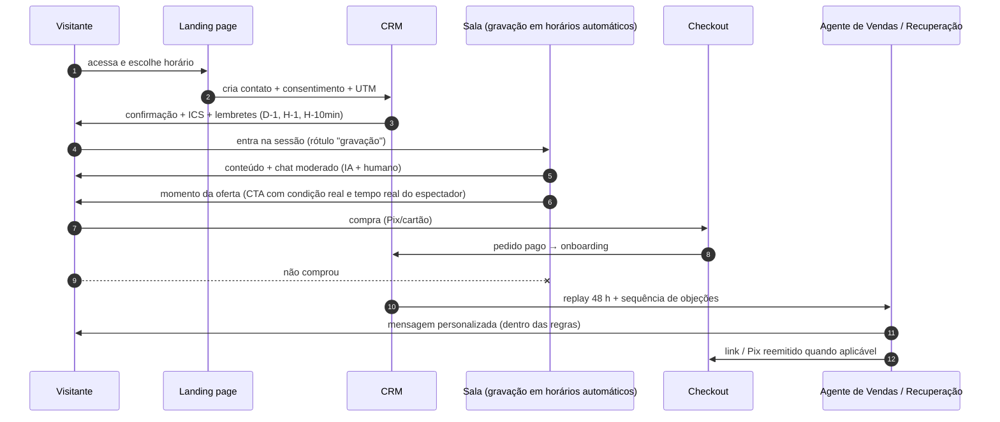

# 09 — Marketing, Vendas e Captação (Motor de Crescimento e Venda Automática)

> **APEX Plataforma de Cursos Livres** · Documento 09 · v1.0 · 21/10/2026 · Status: **Rascunho para validação**
> Requisitos: RF-MKT, RF-CRM, RF-PAY, RF-LIV no [Doc 05](05-requisitos-funcionais.md) · Agentes: [Doc 08](08-ia-arquitetura-e-agentes.md) · Jurídico: [Doc 16](16-juridico-compliance.md).
> **Aviso:** cadências, limiares e metas abaixo são **hipóteses de partida para testar**, não resultados conhecidos.

## 1. Conceito: "venda automática" responsável

*Venda automática* na APEX significa que **um estranho pode virar aluno pagante sem intervenção humana** — da descoberta ao acesso e à nota fiscal — com humanos apenas em exceções e em vendas complexas (B2B). Isso exige:

1. **Captura** em múltiplas portas (páginas, quiz, eventos, conteúdo gratuito, afiliados).
2. **Dado único** (CRM = LMS = checkout) para personalizar e medir.
3. **Nutrição** multicanal (e-mail, WhatsApp, push) com consentimento.
4. **Evento de conversão** (webinar, workshop, desafio, aula experimental) onde a oferta é apresentada.
5. **Checkout BR nativo** (Pix primeiro) com *bump*, *upsell*, garantia e recuperação.
6. **Pós-venda automático** (onboarding, primeira vitória, avaliação, upsell, indicação).
7. **Integridade comercial**: sem práticas enganosas (§13).

## 2. Arquitetura do motor de crescimento

## 3. Playbooks de funil

> Cada funil é um **modelo instalável** (RF-MKT-004) com etapas, gatilhos, mensagens-base, métricas e painel pronto. Os números D0/D1… são *sugestões iniciais a testar*.

### 3.1 Resumo dos funis

| ID | Funil | Objetivo | Porta de entrada | Conversão | Fase |
|---|---|---|---|---|---|
| FN-01 | **Lead Magnet → Curso de entrada** | Captar a baixo custo e vender produto de entrada | E-book, aula grátis, quiz | Sequência de e-mail/WhatsApp + oferta | 2 |
| FN-02 | **Webinar ao vivo → Oferta** | Aquisição com alta confiança | Inscrição em webinar | Momento da oferta + replay 48 h | 2 |
| FN-03 | **Webinar evergreen (venda perpétua)** | Escalar sem equipe presente | Anúncios/SEO/afiliados | Sessão gravada just-in-time + oferta temporizada real | 2 |
| FN-04 | **Desafio de 5 dias** | Engajar e vender trilha/assinatura | Inscrição no desafio | Oferta no dia 4–5 | 2 |
| FN-05 | **Lançamento** (semente / aberto) | Pico de receita em janela | Lista de espera | Pré-lançamento → carrinho aberto → fechamento (data real) | 2–3 |
| FN-06 | **Aula experimental / trial** | Reduzir fricção de decisão | Página do produto | Experimentar → aprender → converter | 2 |
| FN-07 | **APEX Pass (assinatura)** | Receita recorrente | Qualquer funil | Oferta de assinatura no pós-compra e no catálogo | 2 |
| FN-08 | **B2B consultivo** | Contratos com empresas | Inbound (LP B2B), outbound assistido | Diagnóstico → proposta → pilot | 3 |
| FN-09 | **Reativação (win-back)** | Recuperar base inativa | Segmentos por inatividade | Oferta personalizada | 3 |
| FN-10 | **Indicação e afiliados** | Aquisição de terceiros | Link/cupom | Comissão ou recompensa | 2 |

### 3.2 FN-01 — Lead Magnet → Curso de entrada (cadência inicial)

| Quando | Canal | Conteúdo | Objetivo |
|---|---|---|---|
| D0 (imediato) | E-mail (+ WhatsApp se opt-in) | Entrega do material + próximo passo | Ativação |
| D1 | E-mail | Dica prática relacionada + convite à comunidade | Engajar |
| D2 | WhatsApp (opt-in) | Pergunta de qualificação ("qual seu objetivo?") | Segmentar |
| D3 | E-mail | História de aluno (depoimento real com consentimento) | Prova social |
| D4 | E-mail | Apresentação do curso de entrada (benefícios, programa, garantia de 7 dias) | Oferta |
| D5 | E-mail + WhatsApp | Resposta às principais objeções (FAQ) | Reduzir fricção |
| D6 | E-mail | Última chamada **somente se** houver condição real (ex.: bônus com data efetiva) | Decisão |
| D7+ | — | Quem não comprou entra em nutrição leve (1 e-mail/semana) ou é descadastrado se inativo | Higiene de lista |

### 3.3 FN-03 — Webinar evergreen (venda automática perpétua)

**Regras de integridade (obrigatórias):** a sessão é **claramente identificada como gravação**; a "oferta com prazo" só existe se o prazo for **real e aplicado**; o chat não finge participantes; depoimentos são de pessoas reais com autorização.

### 3.4 Régua de recuperação (carrinho/pagamento)

| Situação | Gatilho | Mensagens (sugestão) | Canais | Limite |
|---|---|---|---|---|
| **Checkout abandonado** | 30 min sem concluir | 1) lembrete com resumo e link; 2) em 24 h, dúvidas frequentes e garantia; 3) em 72 h, última mensagem (sem pressão falsa) | E-mail, WhatsApp (opt-in), push | Máx. 3 contatos / 7 dias |
| **Pix expirado** | expiração | Reemissão em 1 clique + lembrete em 2 h | WhatsApp/e-mail | 2 reemissões |
| **Boleto a vencer** | D-1 e D0 | Lembrete + opção de trocar por Pix | E-mail/WhatsApp | 2 |
| **Cartão recusado** | imediato | Explicação genérica + tentar outro cartão/Pix; *retry* inteligente em recorrências | In-app, e-mail | 3 tentativas |
| **Assinatura em atraso** | D+1, D+3, D+7 | Atualizar meio de pagamento; carência; aviso de suspensão | E-mail/WhatsApp | Conforme política |

**Agente de Recuperação (AG-05):** personaliza a mensagem, responde dúvidas simples, oferece ajuda humana; cupom apenas dentro de limite pré-aprovado.

## 4. Páginas de venda, conteúdo e SEO

### 4.1 Construtor de páginas (RF-MKT-001…003)

- **Blocos:** herói, benefícios, programa (módulos), instrutor, prova social, FAQ, garantia, oferta, rodapé legal. **Templates** por formato (curso, e-book, webinar, workshop, assinatura).
- **Geração por IA** a partir do cadastro do produto (título, objetivos, público) → rascunho de página → **Guardian** → revisão humana.
- **Desempenho:** orçamento de JS e imagens; renderização no servidor; *lazy loading*; meta de LCP ≤ 2,5 s no móvel.
- **Acessibilidade e legal:** contraste, alt text, rodapé com CNPJ, política de reembolso visível, informações pré-contratuais.
- **Experimentação:** A/B de título/herói/oferta com amostra mínima e parada por significância.

### 4.2 SEO e visibilidade em respostas de IA

| Frente | Prática |
|---|---|
| **Técnico** | `Course`, `Event`, `Product/Offer`, `VideoObject`, `FAQPage`; sitemap; canonical; Core Web Vitals; páginas de categoria e de instrutor |
| **Conteúdo** | Blog e páginas-guia por tema/carreira/competência com conteúdo **útil e original**; interligação interna sugerida por IA (aprovada por humano) |
| **Programático com qualidade** | Páginas por tema/competência geradas a partir de dados reais do catálogo (ementa, perguntas frequentes, trilha); **proibido** gerar páginas "finas" em massa |
| **Visibilidade em respostas de IA (GEO)** | Perguntas e respostas estruturadas, marcação de FAQ, páginas claras e citáveis, `llms.txt` como apoio; monitorar menções |
| **Vídeo** | Cortes das aulas/webinars para YouTube/Shorts/Reels/TikTok com CTA e UTM; legendas |
| **Métricas** | Impressões, cliques, posições, leads orgânicos, receita atribuída |

## 5. Checkout e conversão

| Prática | Detalhe | RF |
|---|---|---|
| **Pix primeiro** | Pix em destaque (aprovação instantânea, sem fraude de cartão); cartão com parcelamento; boleto como alternativa | RF-PAY-003…005 |
| **Uma página, mobile-first** | Campos mínimos; máscara e validação de CPF; autopreenchimento; compra sem cadastro prévio | RF-PAY-001…002 |
| **Order bump** | 1 oferta complementar de baixo atrito, relevante ao produto | RF-PAY-008 |
| **Upsell/downsell** | 1 clique pós-compra, sem repetir pagamento | RF-PAY-009 |
| **Garantia e transparência** | 7 dias CDC sempre visíveis; resumo de compra com preço final e acesso | RF-PAY-010, 012 |
| **Prova social** | Avaliações verificadas e número de alunos **reais** | RF-CAT-013 |
| **Confiança** | Selos de pagamento seguro, CNPJ, canal de atendimento | — |
| **Pós-compra** | Página "obrigado" com próximos passos (acesso, comunidade, agenda), não apenas upsell | RF-PAY-018 |
| **Atribuição** | Evento `Purchase` por CAPI (servidor) com deduplicação | RF-PAY-026 |

## 6. Afiliados, coprodução e parcerias

| Elemento | Definição inicial |
|---|---|
| **Cadastro** | Aprovação manual no início; termos de afiliação (Doc 16); KYC mínimo para pagamento |
| **Atribuição** | Janela de *cookie* configurável (sugestão de partida: 30 dias), último clique por padrão, regras de conflito entre afiliados e cupom |
| **Comissão** | % por produto, fixa, recorrente (assinatura) e escalonada por desempenho |
| **Pagamento** | Após o prazo de garantia (7 dias) + margem; extrato transparente; estorno proporcional em reembolso |
| **Antifraude** | Autocompra, cupom-spam, *brand bidding*, tráfego incentivado, cliques suspeitos, domínios falsos |
| **Kit do afiliado** | Criativos aprovados pelo Guardian, copy, vídeos, UTMs prontos, painel com cliques e conversões |
| **Gamificação** | Níveis e ranking (sem práticas abusivas) |
| **Coprodução** | Divisão de receita no *split* por produto, com contrato |
| **Influenciadores** | Identificação publicitária obrigatória; briefing com claims permitidos |
| **Parcerias B2B/B2B2C** | Associações, empresas, instituições e comunidades — cupom/link institucional e relatório |

## 7. CRM, lead scoring e vendas assistidas

### 7.1 Modelo de scoring inicial (regras, explicável)

| Sinal | Pontos (sugestão) |
|---|---|
| Compareceu a webinar/workshop | +20 |
| Permaneceu ≥ 50% da sessão | +15 |
| Abriu/Clicou e-mail de oferta | +5 / +10 |
| Visitou página de preço/checkout | +15 |
| Iniciou checkout | +30 |
| Respondeu pergunta de qualificação | +10 |
| Cargo/objetivo alinhado ao produto | +10 |
| Inatividade > 14 dias | −15 |
| Descadastro/reclamação | exclui da cadência |

Evolução: modelo preditivo (RF-CRM-005) treinado com conversões reais, **com explicabilidade** e sem uso de atributos sensíveis.

### 7.2 Pipelines

| Pipeline | Etapas |
|---|---|
| **B2C assistido** | Novo → Qualificado → Proposta/Link enviado → Em decisão → Ganho/Perdido (motivo) |
| **B2B** | Lead → Diagnóstico → Proposta → Piloto → Contrato → Renovação |
| **Parcerias/Instrutores** | Prospect → Conversa → Teste de conteúdo → Contrato → Publicado |

### 7.3 SLA e roteamento

- Lead **quente** (score alto ou checkout iniciado): primeiro contato em **≤ 5 min** (agente) e humano em **≤ 1 h útil** quando solicitado.
- Roteamento por produto, idioma/horário e carga; rodízio com *capacity*.

### 7.4 Playbook de objeções (respostas-base aprovadas pelo jurídico/marketing)

| Objeção | Abordagem (sem promessa) |
|---|---|
| "Está caro" | Mostrar parcelamento/Pix, trilha de entrada, garantia de 7 dias, o que está incluído |
| "Não tenho tempo" | Carga horária realista, microlições, acesso no celular, plano de estudo semanal do tutor |
| "Vai funcionar para mim?" | Perfil indicado/não indicado, pré-requisitos, aula grátis, **sem garantir resultado** |
| "O certificado vale?" | Curso livre: comprova a conclusão e a carga horária; **não substitui graduação/pós/técnico**; validação pública do certificado |
| "Não confio" | CNPJ, política de reembolso, avaliações verificadas, canal humano |

## 8. Canais pagos e atribuição

| Item | Prática |
|---|---|
| **Plataformas** | Meta, Google (Search/YouTube), TikTok; LinkedIn para B2B |
| **Rastreamento** | UTMs obrigatórias; *first-party* ID; conversões por servidor (Meta CAPI, Google conversões aprimoradas, TikTok Events API); consentimento aplicado (Consent Mode) |
| **Modelos de atribuição** | Último clique, primeiro clique, multi-toque; comparar com **teste de incrementalidade** (geo/holdout) para investimentos relevantes |
| **Criativos** | IA gera variações; **Guardian** valida claims; humano aprova; biblioteca por ângulo/persona |
| **Regras automáticas** | Ex.: pausar anúncio com CPA > limite por N dias, escalar com ROAS > meta — **sob aprovação** (nível 1) |
| **Orçamento** | Alocação por canal com limites de gasto diário e alerta de anomalia |
| **Políticas** | Respeitar políticas de anúncios das plataformas e o código do CONAR; evitar alegações de renda/emprego |

## 9. E-mail, WhatsApp e demais canais

| Canal | Regras |
|---|---|
| **E-mail** | SPF/DKIM/DMARC; subdomínio de marketing; aquecimento; reclamação < 0,1%; descadastro em 1 clique; segmentação por engajamento; limpeza de inativos |
| **WhatsApp** | Somente contatos com *opt-in*; modelos aprovados; janela de 24 h para mensagens livres; monitorar qualidade do número; opção "parar"; humano disponível |
| **Push/in-app** | Preferências e limites; foco em aprendizagem (lembretes), não só vendas |
| **SMS** | Opcional, baixo uso (alertas críticos) |
| **Frequência** | Cap por contato/semana e por canal; priorização por valor ao usuário |

## 10. Prova social e reputação

- **Avaliações verificadas** (apenas compradores); pedido automático após marco de progresso (50%/100%).
- **Depoimentos** com consentimento e sem edição que altere sentido; **vídeo-depoimento** sob termo de uso de imagem.
- **NPS → ação:** promotores recebem convite para avaliar/indicar; detratores abrem ticket de recuperação.
- **Reputação externa:** monitorar menções e plataformas de reclamação; **responder em prazo**, com resolução rastreada.

## 11. Experimentação

| Prática | Detalhe |
|---|---|
| **Backlog** | Hipótese → métrica → tamanho de amostra → duração → decisão (ICE/PIE) |
| **Escopo** | Títulos, páginas, ofertas, ordem de bump, cadências, horários de webinar, preço (com limites éticos e legais) |
| **Guardrails** | Não testar o que viole direitos do consumidor; não variar o preço de forma discriminatória ou opaca |
| **Governança** | Registro central de experimentos; *feature flags*; análise padronizada |

## 12. Métricas e painel de growth

| Métrica | Definição |
|---|---|
| **CPL** | Gasto ÷ leads captados |
| **CAC** | Gasto de aquisição (mídia + comissões + ferramentas dedicadas + horas) ÷ novos clientes |
| **Taxa de comparecimento** | Presentes ÷ inscritos (webinar/workshop) |
| **Conversão do evento** | Compras atribuídas ÷ presentes |
| **AOV** | Receita ÷ pedidos (inclui bump/upsell) |
| **LTV** | Margem de contribuição acumulada por cliente (com receita recorrente e recompras) |
| **LTV/CAC** e **payback** | Meta proposta: LTV/CAC ≥ 3; payback ≤ 90 dias (a calibrar) |
| **ROAS / MER** | Receita atribuída ÷ gasto por canal / receita total ÷ gasto total de marketing |
| **Taxa de recuperação** | Pedidos recuperados ÷ pedidos abandonados/pendentes |
| **Reembolso e *chargeback*** | % de pedidos reembolsados e contestados (limites: Doc 04 §2.2) |
| **NPS / avaliação média** | Pesquisa pós-curso / média de avaliações verificadas |
| **Automação** | % de receita sem toque humano (RA%, Doc 04) |

Painel único com visão por canal/campanha/afiliado/produto; alertas de anomalia (RF-DAT-007).

## 13. Integridade comercial (regras do produto)

1. **Sem escassez/urgência falsa**: contagem regressiva e "últimas vagas" só refletem estado real (RF-MKT-021).
2. **Sem promessa de resultado** (renda, emprego, aprovação) — bloqueado pelo Guardian.
3. **Depoimentos reais**; sem pessoas/imagens fictícias apresentadas como alunos.
4. **Preço "de/por"** apenas se o preço anterior foi efetivamente praticado.
5. **Cancelamento e reembolso fáceis**; sem "dark patterns" de retenção.
6. **Webinar gravado é rotulado**.
7. **Comunicação só com consentimento** e respeitando "parar".
8. **Publicidade identificada** (influenciadores, patrocinados).
9. **Menores:** sem direcionamento de marketing a menores nas fases 1–2.

## 14. Integrações necessárias

| Integração | Uso | Fase |
|---|---|---|
| PSP (cartão, Pix, Pix Automático, boleto, split) | Checkout e recorrência | 1–2 |
| ESP (e-mail transacional e marketing) | Comunicação | 1 |
| WhatsApp Business Platform (Cloud API) | Mensageria | 2 |
| Meta (Pixel + CAPI + Ads API) | Atribuição e mídia | 2–3 |
| Google (GA4, Ads, Search Console) | Atribuição, SEO | 2 |
| TikTok Events API | Atribuição | 3 |
| Emissor NFS-e | Fiscal | 1 |
| Calendário (ICS/Google/Outlook) | Eventos | 2 |
| Assinatura eletrônica | Contratos B2B/instrutores | 2–3 |
| Provedores de vídeo e ao vivo | Webinars | 1–2 |

## 15. Roadmap de marketing e vendas

| Fase | Entregas |
|---|---|
| **1** | Páginas de produto com SEO · captura básica com consentimento · e-mail transacional · checkout com Pix/cartão · pixels + eventos básicos · UTMs |
| **2** | LP builder · funis FN-01…07 · webinar/workshop · recuperação · order bump/upsell · afiliados · WhatsApp · CRM · atribuição · experimentos |
| **3** | Agentes de Vendas/Recuperação/Growth · B2B (FN-08) · reativação (FN-09) · mídia assistida e regras automáticas · scoring preditivo |
| **4** | Marketplace de instrutores (marketing por parceiro) · programas de parceria · API para integrações |
