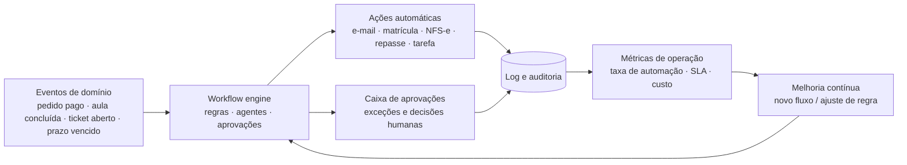
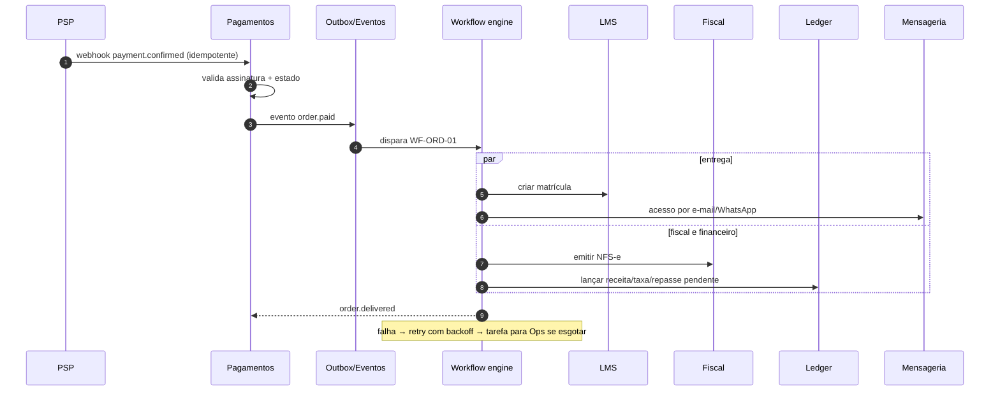
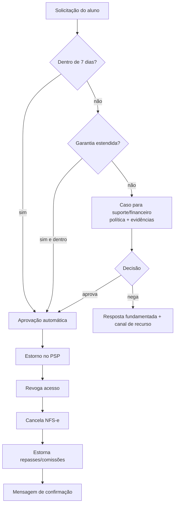
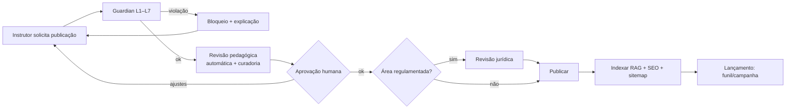

# 10 — Gestão Operacional e Administração (Operação Automatizada)

> **APEX Plataforma de Cursos Livres** · Documento 10 · v1.0 · 21/10/2026 · Status: **Rascunho para validação**
> Requisitos: RF-OPS, RF-PAY, RF-DAT no [Doc 05](05-requisitos-funcionais.md) · Agentes: [Doc 08](08-ia-arquitetura-e-agentes.md).
> **Metas de automação são propostas**, a calibrar com dados reais.

## 1. Tese: o sistema operacional do negócio

A operação da APEX é desenhada como **eventos → fluxos → ações**, com humanos cuidando de **exceções, decisões e relacionamento**:



**Princípios de automação**

1. **Automatizar o repetível; humanizar o excepcional.** Todo processo com volume recorrente e regra clara vira fluxo.
2. **Cada automação tem dono, limite, log e botão de pausa.**
3. **Aprovação por risco**, não por hábito: dinheiro, dados pessoais, menores e comunicação em massa exigem política explícita.
4. **Exceção é dado**: todo caso tratado manualmente alimenta a lista de candidatas a automação.
5. **Idempotência e reversibilidade**: refazer um fluxo não duplica efeito; ações críticas têm desfazer.
6. **Medir a automação**: taxa de automação, taxa de exceção, tempo de ciclo, custo por transação.

## 2. Modelo operacional

### 2.1 Equipe-núcleo sugerida (hipótese para a Fase 2)

| Função | Responsabilidade | Observações |
|---|---|---|
| **Líder de Operações** | Dono dos fluxos, SLAs, caixa de aprovações, melhoria contínua | 1 pessoa |
| **Suporte e Sucesso do Aluno** | Exceções de atendimento, relacionamento, mentorias de apoio | 1–2 pessoas (+ IA) |
| **Financeiro/Fiscal** | Conferência, repasses, fechamento com contador | Meio período + contador externo |
| **Produtor(a) de Conteúdo / Curadoria Pedagógica** | Pipeline de produção, revisão pedagógica | 1–2 pessoas |
| **Growth/Marketing** | Funis, mídia, experimentos | 1–2 pessoas |
| **Comercial B2B** | Propostas e contratos (Fase 3) | 1 pessoa |
| **DPO / Compliance** | Privacidade, DSAR, incidentes, monitor regulatório | Terceirizado ou meio período |
| **Plataforma (SRE/Dev)** | Estabilidade e evolução | Time técnico (Doc 19) |

### 2.2 Cadência operacional

| Ritual | Frequência | Pauta |
|---|---|---|
| **Caixa de aprovações** | Contínua (SLA ≤ 4 h úteis) | Itens pendentes por prioridade |
| **Torre de controle** | Diária (15 min) | Alertas, pagamentos, entregabilidade, fila de suporte, custo de IA |
| **Revisão semanal** | Semanal | Métricas, exceções recorrentes, novas automações, relatório do **Radar** |
| **Fechamento financeiro** | Mensal | Conciliação, DRE gerencial, repasses, impostos |
| **Revisão de compliance** | Trimestral | Termos, lista de termos proibidos, riscos, fornecedores |
| **Revisão de segurança e DR** | Semestral | Pentest, restauração, exercício de incidente |

### 2.3 RACI dos processos críticos

R = Responsável · A = Aprovador · C = Consultado · I = Informado

| Processo | Ops | Suporte | Financeiro | Conteúdo | Growth | DPO | Plataforma | IA (agente) |
|---|---|---|---|---|---|---|---|---|
| Pedido → Acesso → NFS-e | A | I | R | — | — | — | R | R |
| Reembolso (≤ 7 dias) | I | I | A | — | — | — | — | R |
| Reembolso (> 7 dias) | C | R | A | — | — | — | — | C |
| Publicação de curso | A | I | — | R | C | C | — | R (Studio/Guardian) |
| Onboarding de instrutor | A | — | R | R | — | C | — | C |
| Repasse a instrutor/afiliado | C | — | A/R | — | C | — | R | C |
| DSAR (titular) | C | R | — | — | — | A | R | C |
| Incidente de segurança | C | I | I | — | — | A | R | — |
| Campanha em massa | C | — | — | — | A/R | C | — | R (Growth) |
| Mudança de preço | C | — | C | — | A | — | — | — |

## 3. Catálogo de automações (workflows)

> Biblioteca-base do workflow engine (RF-OPS-006). **Gatilho → Ações → Exceção/Aprovação → KPI.** Fase indica quando entra no produto.

### 3.1 Pedido, acesso e entrega (WF-ORD)

| ID | Fluxo | Gatilho | Ações | Exceção / aprovação | KPI | Fase |
|---|---|---|---|---|---|---|
| WF-ORD-01 | Pagamento confirmado → entrega | `order.paid` | Pedido=pago → matrícula/ingresso → e-mail/WhatsApp de acesso → NFS-e → lançamento no ledger → evento de marketing | Falha em etapa → retry; após N → tarefa Ops | Tempo até acesso (≤ 30 s) | 1 |
| WF-ORD-02 | Pix/boleto pendente | `order.pending` por X min | Lembrete + reemissão | Limite de tentativas | Taxa de conversão do pendente | 2 |
| WF-ORD-03 | Reembolso ≤ 7 dias | `refund.requested` | Validar prazo → estorno PSP → revogar acesso → cancelar NFS-e → estornar repasse/comissão → mensagem | Falha PSP → Ops | Tempo de reembolso | 1 |
| WF-ORD-04 | Reembolso > 7 dias | `refund.requested` fora do prazo | Abre caso com política e evidências | Aprovação financeiro | % aprovado/negado | 2 |
| WF-ORD-05 | Chargeback | `chargeback.opened` | Montar evidências → notificar → prazo → registrar resultado | Aprovação do responsável | Taxa de ganho | 2 |
| WF-ORD-06 | Expiração de acesso | `enrollment.ends_at` próximo | Aviso D-30/D-7 + oferta de renovação | — | Taxa de renovação | 2 |
| WF-ORD-07 | Lista de espera | `seat.released` | Convida próximo da fila com prazo | Expira → próximo | Preenchimento de vagas | 2 |

### 3.2 Financeiro e fiscal (WF-FIN)

| ID | Fluxo | Gatilho | Ações | Exceção / aprovação | KPI | Fase |
|---|---|---|---|---|---|---|
| WF-FIN-01 | Conciliação diária | Agenda D+1 | PSP × ledger × banco → divergências viram tarefas | Divergência > limite | % conciliado sem intervenção | 2 |
| WF-FIN-02 | Liberação de repasses | Fim da garantia (+ margem) | Calcular splits → gerar lote → aprovar → pagar → extrato/comprovante | Dupla aprovação acima de limite | Repasses no prazo | 2 |
| WF-FIN-03 | Reserva para reembolsos | Agenda | Ajustar reserva por histórico | — | Cobertura de reserva | 2 |
| WF-FIN-04 | Inadimplência de assinatura | `invoice.past_due` | Régua D+1/3/7 → carência → suspensão gradual | Exceções manuais | Recuperação involuntária | 2 |
| WF-FIN-05 | Fechamento mensal | Dia útil X | Gerar DRE gerencial, impostos, conferência, pacote para contador | Aprovação do financeiro | Dias para fechar | 2 |
| WF-FIN-06 | Anomalias financeiras | Eventos | Detectar picos de reembolso, aprovação de cartão em queda, taxas fora do padrão | Alerta ao responsável | Tempo de detecção | 3 |
| WF-FIN-07 | NFS-e com falha | `nfse.failed` | Reprocessar → corrigir dados → fila | Ops/contador | % NFS-e automáticas | 1 |

### 3.3 Suporte e sucesso do aluno (WF-SUP)

| ID | Fluxo | Gatilho | Ações | Exceção / aprovação | KPI | Fase |
|---|---|---|---|---|---|---|
| WF-SUP-01 | Triagem de ticket | `ticket.created` | Classificar, priorizar, tentar resolução por IA | Se baixa confiança → humano com resumo | % resolvido por IA | 3 |
| WF-SUP-02 | 1ª resposta no SLA | Ticket sem resposta | Escalar por prioridade | Líder de Ops | % no SLA | 2 |
| WF-SUP-03 | Onboarding do aluno | `enrollment.created` | D0 boas-vindas · D1 "primeira aula" · D3 lembrete · D7 convite à comunidade | — | Ativação 24 h | 1–2 |
| WF-SUP-04 | Risco de evasão | Sem acesso por N dias | Mensagem do tutor/mentor + oferta de ajuda | Alto risco → contato humano | Reativação | 3 |
| WF-SUP-05 | Dúvidas sem resposta no curso | Pergunta aberta > 24 h | Tutor IA sugere; avisa instrutor | — | Tempo de resposta | 2 |
| WF-SUP-06 | CSAT/NPS | Ticket fechado / marco do curso | Pesquisa → ação em detratores | Detrator abre caso | CSAT/NPS | 2 |
| WF-SUP-07 | Atualização da base de conhecimento | Ticket resolvido recorrente | IA propõe artigo → humano aprova | Aprovação | Deflexão | 3 |

### 3.4 Acadêmico / secretaria (WF-ACA)

| ID | Fluxo | Gatilho | Ações | Exceção / aprovação | KPI | Fase |
|---|---|---|---|---|---|---|
| WF-ACA-01 | Emissão de certificado | Critérios atendidos | Gerar PDF + código + QR + registro público + e-mail | Falha → Ops | Tempo de emissão | 1 |
| WF-ACA-02 | Segunda via/declaração | Solicitação | Gerar e enviar (autoatendimento) | Identidade | % autoatendimento | 2 |
| WF-ACA-03 | Revogação | Fraude/erro | Revogar → atualizar página pública → notificar | Aprovação | — | 2 |
| WF-ACA-04 | Presença em eventos | `event.ended` | Calcular presença → emitir certificados de participação | — | % emitido | 2 |
| WF-ACA-05 | Matrícula em lote B2B | Planilha/SSO | Criar usuários, atribuir assentos, enviar convites | Erros de dados | Tempo de ativação | 3 |

### 3.5 Instrutores e conteúdo (WF-INS / WF-CON)

| ID | Fluxo | Gatilho | Ações | Exceção / aprovação | KPI | Fase |
|---|---|---|---|---|---|---|
| WF-INS-01 | Onboarding de instrutor | Candidatura aprovada | KYC/KYB → contrato eletrônico → dados bancários → acesso ao painel | Aprovação Ops/jurídico | Tempo de ativação | 2 |
| WF-INS-02 | Relatório mensal ao instrutor | Agenda | Vendas, alunos, avaliações, repasses, insights | — | Satisfação do instrutor | 2 |
| WF-CON-01 | Pipeline de produção | Novo projeto | Tarefas por etapa, prazos, checklists, alertas | Atraso → Ops | Lead time | 2 |
| WF-CON-02 | Publicação | Solicitação | Guardian → revisão pedagógica → aprovação → publicar → indexar RAG → divulgar | Reprovação volta ao autor | Tempo de aprovação | 1 |
| WF-CON-03 | Qualidade pós-publicação | 30 dias | Analisar retenção por aula, quizzes, dúvidas; sugerir melhorias | — | Conclusão | 2 |
| WF-CON-04 | Atualização de conteúdo | Nova versão | Notificar alunos, reindexar, manter progresso | — | — | 2 |

### 3.6 Compliance e privacidade (WF-CMP)

| ID | Fluxo | Gatilho | Ações | Exceção / aprovação | KPI | Fase |
|---|---|---|---|---|---|---|
| WF-CMP-01 | DSAR | `dsar.created` | Verificar identidade → coletar dados → revisar exceções → entregar/excluir → registrar | Aprovação DPO | Prazo ≤ 15 dias | 1 |
| WF-CMP-02 | Consentimento | Mudança de política | Novo aceite onde necessário; versionamento | — | % em dia | 1 |
| WF-CMP-03 | Incidente de segurança | Alerta crítico | Playbook: conter → avaliar → notificar (ANPD/titulares quando aplicável) → pós-incidente | DPO/CTO | Tempo de resposta | 2 |
| WF-CMP-04 | Retenção e descarte | Agenda | Aplicar tabela de retenção; relatório | — | Conformidade | 2 |
| WF-CMP-05 | Revisão de fornecedores | Anual / mudança | Reavaliar DPA, localização, SOC/ISO | — | — | 2 |
| WF-CMP-06 | Revisão de lista de termos proibidos | Trimestral | Atualizar dados do Guardian | Jurídico | — | 2 |
| WF-CMP-07 | Recertificação de acessos | Semestral | Revisar papéis e contas ativas | Gestores | Contas órfãs = 0 | 3 |

### 3.7 Growth ops e plataforma (WF-GRW / WF-TEC)

| ID | Fluxo | Gatilho | Ações | Exceção / aprovação | KPI | Fase |
|---|---|---|---|---|---|---|
| WF-GRW-01 | Pós-evento | `event.ended` | Replay + pesquisa + oferta + sequência | — | Conversão pós-evento | 2 |
| WF-GRW-02 | Relatório semanal de growth | Agenda | Radar produz resumo e recomendações | — | — | 3 |
| WF-GRW-03 | Higiene de lista | Agenda | Suprimir inativos, bounces e reclamações | — | Reclamação < 0,1% | 2 |
| WF-TEC-01 | Alerta de SLO | Burn rate | Abre incidente → runbook → status page | On-call | MTTR | 1 |
| WF-TEC-02 | Custo de IA/vídeo/live | Orçamento atingido | Alertar, limitar, notificar responsável | Aumento de teto exige aprovação | Custo/aluno | 1 |
| WF-TEC-03 | Backup e restauração | Agenda | Backup, verificação e teste de restauração | Falha → incidente | RPO/RTO | 1 |

## 4. Processos principais (fluxos)

### 4.1 Pedido → Acesso → NFS-e → Ledger



### 4.2 Reembolso



### 4.3 Publicação de curso



### 4.4 Incidente (DSAR e segurança têm *runbooks* próprios — §10)

## 5. Financeiro e fiscal

| Tema | Regra/Processo |
|---|---|
| **Ledger único** | Dupla entrada; receita, taxas do PSP, impostos, repasses, reservas; **soma zero** verificada diariamente |
| **Repasses** | Liberados após garantia (7 dias) + margem; extrato por produto; dupla aprovação acima de limite; comprovante |
| **Retenções/impostos de terceiros** | Parametrizáveis por tipo de beneficiário (PF/PJ/MEI); regra definida com contador |
| **NFS-e nacional** | Emissão automática na confirmação; cancelamento no reembolso; reprocessamento em falha (WF-FIN-07) |
| **IBS/CBS** | Campos e cálculo parametrizáveis (preparação — Doc 16 §8) |
| **E-books/produtos digitais** | Classificação fiscal por produto, **definida com o contador** |
| **Fechamento** | Mensal: conciliação, DRE gerencial, fluxo de caixa, pacote para contabilidade |
| **Controles** | Segregação de funções; limites de alçada; logs imutáveis; revisão trimestral |
| **Antifraude financeiro** | Regras de risco por pedido; revisão manual de pedidos suspeitos; monitorar *chargeback* |

## 6. Suporte e sucesso do aluno

**Taxonomia inicial de tickets:** Acesso/Login · Pagamento/Cobrança · Reembolso · Certificado · Conteúdo/Dúvida pedagógica · Técnico (vídeo/app) · Evento ao vivo · Conta/Privacidade (LGPD) · Parcerias/Afiliados · Outros.

| Item | Definição |
|---|---|
| **Canais** | Central de ajuda, chat, e-mail, WhatsApp (conversas de atendimento), formulário; telefone opcional |
| **SLA proposto** | 1ª resposta: IA ≤ 1 min; humano ≤ 2 h úteis · Resolução: P1 (acesso/pagamento) ≤ 4 h úteis; P2 ≤ 1 dia útil; P3 ≤ 3 dias úteis |
| **Resolução por IA (meta)** | ≥ 60% na Fase 3, evoluindo para ≥ 70% |
| **Base de conhecimento viva** | Artigos criados/atualizados a partir de tickets; revisão humana |
| **Voz do aluno** | Painel de temas recorrentes → backlog de produto |
| **Régua de sucesso** | D0 boas-vindas → D1 primeira aula → D3 lembrete → D7 comunidade → D14 check-in → alerta de inatividade |

## 7. Secretaria acadêmica e instrutores

- **Ficha do aluno:** matrículas, progresso, avaliações, certificados, pedidos, comunicações.
- **Documentos:** declaração de matrícula/conclusão; segunda via; validação pública do certificado.
- **Instrutor:** onboarding digital; painel com vendas e repasses; relatório mensal automático; SLA de resposta a dúvidas; avaliação de qualidade; revisões de conteúdo.
- **Qualidade de produção (checklist mínimo):** áudio limpo (ruído/loudness), vídeo 1080p, enquadramento, legenda revisada, slides acessíveis, direitos de uso de imagens/músicas, objetivos alinhados às avaliações.

## 8. Painel administrativo (estrutura)

```text
┌─────────────────────────────────────────────────────────────────────────┐
│  APEX Admin        🔎 Buscar…   [⌘K Copiloto Ops]            🔔  👤      │
├────────────┬────────────────────────────────────────────────────────────┤
│ Início     │  SAÚDE DO NEGÓCIO (hoje)                                    │
│ Aprovações │  Receita · Pedidos · Conversão · Reembolso · Aprov. PSP     │
│ Catálogo   │  ─────────────────────────────────────────────────────────  │
│ Alunos     │  CAIXA DE APROVAÇÕES (7)      ALERTAS (2)                   │
│ Pedidos    │  • Reembolso fora do prazo    ! Entregabilidade e-mail ↓    │
│ Financeiro │  • Cupom > limite             ! Custo de IA em 82% do teto  │
│ Marketing  │  • Publicar página (Growth)                                 │
│ Eventos    │  ─────────────────────────────────────────────────────────  │
│ CRM        │  AUTOMAÇÃO: 93% dos pedidos sem toque · 71% tickets por IA  │
│ Suporte    │  RESUMO DO RADAR (IA): "Conversão do funil FN-03 caiu 18%…" │
│ Instrutores│                                                              │
│ Conteúdo   │                                                              │
│ IA         │                                                              │
│ Compliance │                                                              │
│ Config.    │                                                              │
└────────────┴────────────────────────────────────────────────────────────┘
```

(Os números do exemplo são ilustrativos.)

## 9. Torre de controle — limiares e ações automáticas

| Indicador | Limiar de alerta (proposta) | Ação automática | Responsável |
|---|---|---|---|
| Taxa de aprovação de pagamentos | Queda > 10 p.p. vs. média 7 dias | Alerta + diagnóstico por bandeira/PSP + sugestão de roteamento | Financeiro/Plataforma |
| Entregabilidade de e-mail | Reclamação > 0,2% ou bounce > 3% | Pausar broadcast, limitar cadências, revisar lista | Growth |
| Fila de suporte | > X tickets > SLA | Reforço de IA/escala de plantão | Ops |
| Custo de IA | 80% / 100% do teto | Alerta / limitar agente | Plataforma |
| Reembolso | > 8% em 7 dias para um produto | Alertar, pausar vendas/ads sugerido | Growth/Conteúdo |
| *Chargeback* | > 0,5% | Revisão antifraude, endurecer regras | Financeiro |
| Latência/erros | Burn rate de SLO | Incidente + *runbook* | Plataforma |
| Leads quentes sem contato | > 5 min | Reatribuir/agente | Comercial |
| Evasão por turma | Queda de atividade > 20% | Ação do tutor/mentor | Conteúdo |

## 10. Runbooks (lista a produzir na Fase 1–2)

1. Falha de webhook do PSP / pagamentos pendentes sem confirmação
2. Fila de entrega travada (pedido pago sem acesso)
3. NFS-e rejeitada em lote
4. Vazamento/credencial exposta (incidente de segurança)
5. DSAR: acesso, correção, exclusão, portabilidade
6. Queda de provedor de vídeo/ao vivo (contingência e comunicação)
7. Reputação de e-mail/WhatsApp comprometida
8. Custo de IA descontrolado (*kill switch* e investigação)
9. *Chargeback* em massa / ataque de teste de cartões
10. Erro de conteúdo/alegação indevida publicada (retirada e comunicação)
11. Falha de repasse (pagamento duplicado ou incorreto)
12. Restauração de banco de dados (PITR)

## 11. Metas de automação (propostas)

| Processo | Meta de automação | Fase | Medição |
|---|---|---|---|
| Pedido → acesso → NFS-e | ≥ 95% sem intervenção | 1 → 2 | % de pedidos sem tarefa manual |
| Reembolso ≤ 7 dias | 100% automático | 1 | — |
| Conciliação | ≥ 90% automática | 2 | % de transações conciliadas |
| Repasses | ≥ 95% automáticos (com aprovação em lote) | 2 | — |
| Certificados | 100% automáticos | 1 | — |
| Tickets resolvidos por IA | ≥ 60% → ≥ 70% | 3 | Resolução sem humano |
| Triagem de tickets | ≥ 90% classificados por IA | 3 | — |
| Publicação de curso (checks de compliance) | 100% automáticos + revisão humana | 1 | — |
| Relatórios gerenciais | 100% agendados | 2–3 | — |
| DSAR | ≥ 70% das etapas automatizadas | 1–2 | Horas por DSAR |
| Onboarding de instrutor | ≥ 80% digital | 2 | Tempo de ativação |

## 12. Roadmap de operações

| Fase | Entregas |
|---|---|
| **1** | Motor de fluxos interno · WF-ORD-01/03 · WF-FIN-07 · WF-ACA-01 · WF-CON-02 · WF-CMP-01/02 · WF-TEC-01/02/03 · painel admin mínimo · ledger · NFS-e · DSAR |
| **2** | Helpdesk · caixa de aprovações · conciliação · repasses · onboarding de instrutor · pipeline de conteúdo · página de status · torre de controle |
| **3** | Construtor visual de fluxos · agentes Suporte/Ops/Radar/Finance · régua de sucesso · B2B · recertificação de acessos |
| **4** | Operação multi-tenant (outros operadores usando o motor) · portal do operador móvel |
