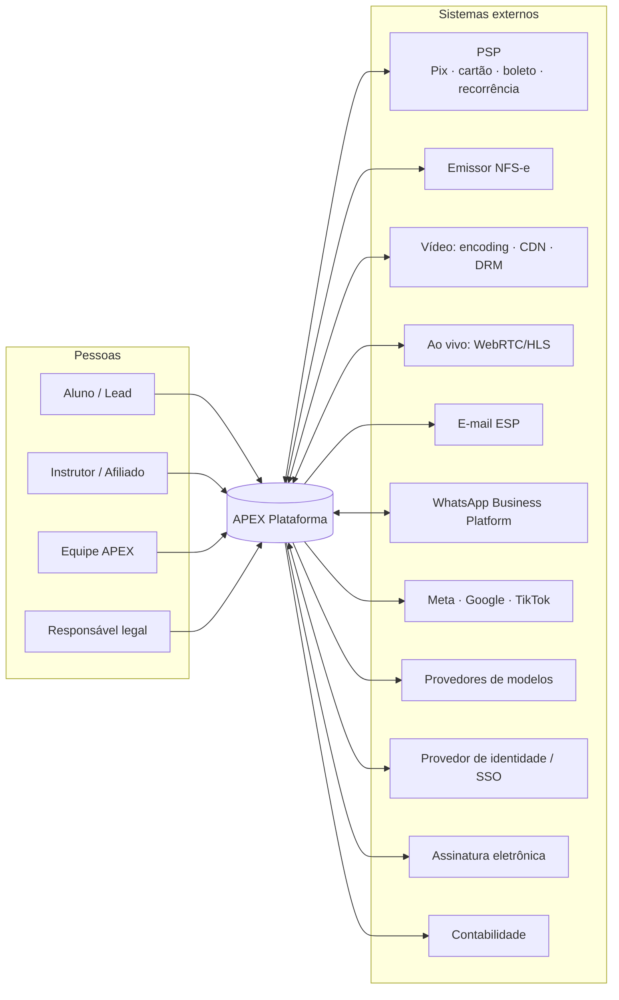
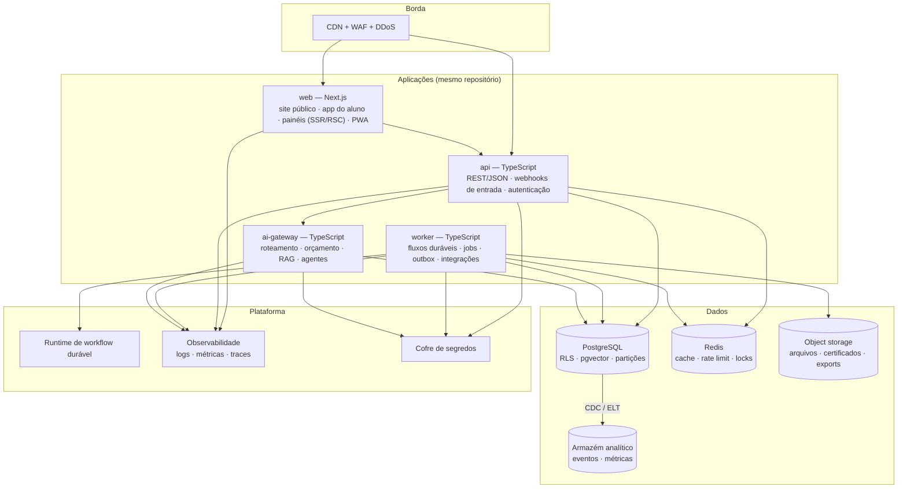
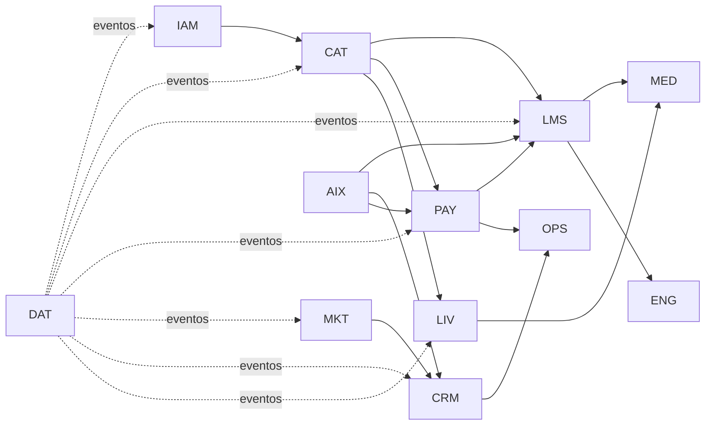
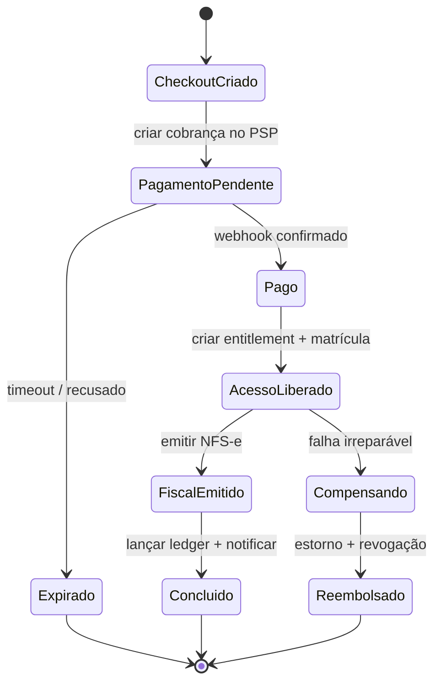
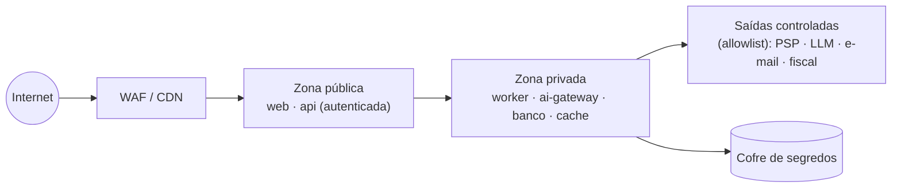

# 11 — Arquitetura Técnica

> **APEX Plataforma de Cursos Livres** · Documento 11 · v1.0 · 21/10/2026 · Status: **Proposta para validação em spikes (Fase 0)**
> Requisitos: [Doc 05](05-requisitos-funcionais.md) e [Doc 06](06-requisitos-nao-funcionais.md). Dados: [Doc 12](12-modelo-de-dados.md). API: [Doc 13](13-api-e-eventos.md).
> **Nota sobre preços e limites de fornecedores:** não foram verificados em fonte oficial nesta pesquisa. Toda escolha de fornecedor abaixo é **candidata**, sujeita aos spikes da §13.

## 1. Princípios arquiteturais

1. **Monólito modular primeiro.** Um código-base, módulos com fronteiras rígidas (um por módulo do produto), implantado como poucos processos. Microsserviços só quando houver dor comprovada (escala, equipe, ciclo de vida diferente). *Motivo:* equipe pequena, domínio fortemente transacional (pedido ↔ pagamento ↔ acesso ↔ fiscal).
2. **Orientada a eventos internamente.** Módulos publicam **eventos de domínio** (padrão *outbox*); fluxos de negócio (workflow engine) reagem a eles.
3. **Adapters para tudo que é externo.** PSP, vídeo, ao vivo, e-mail, WhatsApp, fiscal, LLM: interface no domínio + adaptador por fornecedor (RNF-POR-01).
4. **Multi-tenant desde o dia 1**, mesmo operando um único tenant (RLS) — evita reescrita na Fase 4.
5. **Segurança e privacidade por padrão** (RNF-SEC, RNF-PRV).
6. **Observável e operável**: nada vai a produção sem métricas, logs, alertas e *runbook*.
7. **Consistência onde há dinheiro; disponibilidade onde há conteúdo.** Pedido/pagamento/ledger: ACID e idempotência. Catálogo/vídeo/IA: tolerantes a degradação.
8. **Boring technology** para o núcleo; inovação concentrada em IA e experiência.

## 2. Contexto do sistema



## 3. Contêineres (visão de implantação lógica)



| Processo | Responsabilidade | Escala |
|---|---|---|
| **web** | Renderização, SEO, app do aluno, painéis; fala com a API (e BFF leve) | Horizontal, sem estado |
| **api** | Casos de uso síncronos; autenticação/autorização; recebimento de webhooks (valida, grava, enfileira) | Horizontal |
| **worker** | Consome eventos/outbox; executa fluxos; integrações assíncronas (e-mail, NFS-e, PSP, vídeo) | Por fila |
| **ai-gateway** | Único ponto de saída para modelos; RAG; orquestração de agentes | Por carga/orçamento |

## 4. Módulos e fronteiras

Cada módulo (Doc 03 §6) é um *bounded context* com: `domain/` (regras puras), `application/` (casos de uso), `infrastructure/` (repositórios, adaptadores), `api/` (rotas/DTOs) e um **esquema próprio no banco** (Doc 12).



**Regras de dependência**

- Módulos só conversam por **interfaces públicas** (portas) ou por **eventos**; nunca por acesso direto às tabelas de outro módulo (verificado em CI com regras de importação e `dependency-cruiser`).
- Leitura entre módulos para telas: *views* de leitura/projeções, não *joins* ad-hoc.
- **Entitlement** (direito de acesso) é o contrato entre PAY/CAT e LMS/LIV/ENG/AIX: quem concede é o comercial; quem consome é a entrega.

## 5. Stack de referência

Dois caminhos viáveis; recomendação **A** para as Fases 1–2, com *gatilhos de saída* para **B**.

| Camada | Caminho A — Velocidade (recomendado F1–F2) | Caminho B — Controle (F3–F4 se necessário) |
|---|---|---|
| **Frontend** | TypeScript · React · Next.js (App Router) · Tailwind · Radix/shadcn · TanStack Query · PWA · i18n | igual |
| **Backend** | Node.js 22 · TypeScript · framework modular (NestJS **ou** Fastify estruturado) · validação com Zod · OpenAPI gerado | igual |
| **Banco** | PostgreSQL gerenciado (ex.: Supabase/Neon) com RLS, `pgvector`, particionamento | PostgreSQL em nuvem de grande porte (RDS/Cloud SQL) com réplicas |
| **Cache/filas leves** | Redis gerenciado | Redis/ElastiCache |
| **Workflow durável** | Inngest **ou** Temporal Cloud (decidir no spike S-03) | Temporal (cloud ou *self-host*) |
| **Hospedagem** | Plataforma gerenciada (ex.: Vercel para web; contêineres gerenciados para api/worker) | Contêineres em nuvem (ECS/GKE/Cloud Run) + IaC |
| **Armazenamento** | Object storage S3-compatível | S3/GCS |
| **Busca** | Postgres FTS + `pg_trgm` | Typesense/Meilisearch/OpenSearch |
| **Analytics** | Eventos → armazém (BigQuery/ClickHouse) + camada de métricas (dbt) | idem |
| **Vídeo** | Mux **ou** Bunny Stream (adapter) | + DRM dedicado se necessário |
| **Ao vivo** | LiveKit Cloud (WebRTC) + HLS para audiências grandes | LiveKit *self-host* |
| **E-mail** | ESP transacional + marketing (SES/Postmark/Resend…) | idem |
| **WhatsApp** | Cloud API (direto ou via BSP) | idem |
| **IA** | Gateway próprio fino sobre SDKs dos provedores; `pgvector`; avaliação (ex.: Promptfoo/Langfuse) | + serviços de inferência dedicados se justificar |
| **Observabilidade** | OpenTelemetry → stack gerenciada (ex.: Grafana Cloud/Datadog) + Sentry para erros | idem |
| **Segredos** | Cofre do provedor/Doppler/1Password | AWS Secrets Manager/Vault |
| **IaC/CI** | Terraform (infra crítica) + GitHub Actions | idem |

> **Aderência ao ecossistema deste repositório:** o monorepo já usa Node/TypeScript, Supabase, Vercel e Sentry (ver `package.json`, `docs/deploy/vercel.md`, `SENTRY_SETUP.md`); o Caminho A reaproveita essa familiaridade operacional. **Isto é um ponto de partida, não uma obrigação** (ADR-003).

**Gatilhos para migrar partes do A para o B:** custo mensal de um componente gerenciado > limiar definido no [Doc 17](17-negocio-financeiro.md); necessidade de residência de dados específica; limites de conexões/throughput do banco; exigência de SLA contratual não atendida.

### 5.1 Critérios de escolha de fornecedores (a aplicar nos spikes)

| Categoria | Critérios eliminatórios | Critérios de pontuação |
|---|---|---|
| **PSP** | Pix, cartão com 3DS, boleto; **Pix Automático** (ou roadmap firme); *webhooks* idempotentes; split/subcontas (para Fase 4); antifraude | Taxas, prazo de recebimento, antecipação, API/SDK, suporte, estabilidade, contrato de saída |
| **Emissor NFS-e** | Padrão nacional; cancelamento; cobertura dos municípios-alvo | Preço por nota, API, reprocessamento, suporte, retenções |
| **Vídeo** | HLS adaptativo; URL assinada; restrição de domínio; marca d'água/DRM (ao menos em roadmap); legendas | Custo por minuto entregue/armazenado, latência no Brasil, analytics |
| **Ao vivo** | WebRTC com SFU; gravação; escala ≥ metas RNF-SCA-03; RTMP/HLS | Custo por participante-minuto, SDKs, qualidade em redes móveis |
| **E-mail** | DKIM/SPF/DMARC; *webhooks* de eventos; supressão | Entregabilidade, preço, IPs dedicados |
| **WhatsApp** | Cloud API oficial; templates; opt-in | Preço por conversa/mensagem (consultar tabela vigente), suporte |
| **Identidade** | Passkeys/MFA; SSO SAML/OIDC; exportação de usuários; *rate limit* | Preço por MAU em 200 mil MAU; residência de dados |
| **LLM** | Política de não treinamento com dados; retenção mínima/zero; qualidade em pt-BR; *tool use* | Latência, custo, estabilidade, SLAs |

## 6. Multi-tenancy e autorização

- **Isolamento**: coluna `tenant_id` em todas as tabelas de negócio + **RLS** (`tenant_id = platform.current_tenant()`), com a sessão do banco recebendo o tenant por `SET LOCAL app.tenant_id`. Papéis de aplicação **sem** `BYPASSRLS`.
- **Defesa em profundidade**: chaves compostas `(tenant_id, id)` nas relações críticas (impede associar registros de tenants diferentes); testes automatizados de vazamento entre tenants (RNF-SEC-08).
- **Autorização**: RBAC por tenant + escopos (`product`, `cohort`, `region`) → ABAC na Fase 3. Decisão centralizada em um *policy engine* do domínio (ex.: CASL/Cedar) — **nunca** apenas no cliente.
- **Impersonação** só com justificativa e auditoria (RF-IAM-016).

## 7. Eventos, consistência e *sagas*

### 7.1 Outbox transacional

1. O caso de uso grava o estado **e** insere o evento em `platform.outbox_events` na **mesma transação**.
2. Um publicador lê a outbox e entrega ao *workflow engine* e aos assinantes (*at-least-once*).
3. Consumidores são **idempotentes** (chave = `event_id` + passo).

### 7.2 Saga de compra (exemplo)



- Passos pós-pagamento são **repetíveis** (idempotentes). A falha de NFS-e **não** revoga acesso: gera tarefa/retentativa (RNF-AVL-05).
- **Webhooks de entrada** (PSP etc.): validar assinatura → gravar bruto → responder 2xx rápido → processar assíncrono → deduplicar por ID do provedor.

### 7.3 Reserva de vagas

Reserva com TTL (linha em `commerce.seat_holds`/contador transacional) liberada se o pagamento não confirmar; garante RNF-SCA-07 (sem *overselling*).

## 8. Segurança arquitetural

### 8.1 Zonas de confiança



### 8.2 Modelo de ameaças resumido (STRIDE) — fluxos críticos

| Fluxo | Ameaça principal | Controle |
|---|---|---|
| **Login/sessão** | Credential stuffing, sequestro de sessão | MFA/passkeys, *rate limit*, cookies `HttpOnly`/`SameSite`, rotação, detecção de anomalias |
| **Checkout** | Fraude de cartão, manipulação de preço no cliente, repetição | Preço **sempre** calculado no servidor; antifraude; idempotência; 3DS |
| **Webhooks de entrada** | Falsificação, *replay* | Assinatura/HMAC, *timestamp*, IP allowlist quando possível, deduplicação |
| **Acesso ao vídeo** | Compartilhamento de links, pirataria | URL assinada curta + domínio + marca d'água + DRM |
| **Painel admin** | Escalada de privilégio, insider | MFA obrigatório, mínimo privilégio, dupla aprovação, auditoria WORM |
| **IA/RAG** | Injeção de prompt, vazamento entre tenants/alunos | ACL no retrieval, ferramentas escopadas, HITL, *red team* (Doc 08 §8) |
| **Upload de arquivos** | Malware, XSS por arquivo | Varredura, tipos permitidos, domínios isolados de download |
| **API pública (F4)** | Abuso, enumeração | Escopos, cotas, IDs não sequenciais, monitoramento |

### 8.3 Dados e criptografia

- Campos sensíveis (CPF, dados bancários, segredos de MFA) **criptografados em nível de campo** (envelope encryption), com *hash* determinístico separado para busca/deduplicação.
- **Dados de cartão não passam pelos servidores APEX** (RNF-SEC-03).
- Ambientes não produtivos usam **dados sintéticos/anonimizados** (RNF-PRV-07).

## 9. Observabilidade e SRE

- **Logs estruturados** (JSON) com `trace_id`, `tenant_id`, `user_id` (pseudonimizado), `order_id`/`run_id` quando aplicável.
- **SLOs iniciais** (Doc 06): checkout 99,9%; API p95 ≤ 400 ms; início de vídeo p95 ≤ 2 s; tutor p95 ≤ 10 s.
- **Painéis**: negócio (aprovação de pagamentos, funil), plataforma (latência, erro, filas), IA (custo, recusa, citações), vídeo/ao vivo (qualidade, custo).
- **Alertas por *burn rate*** de SLO; escalonamento e *runbooks* (Doc 10 §10).
- **Status page** pública.

## 10. Ambientes, entrega e dados

| Item | Prática |
|---|---|
| **Ambientes** | `dev` (local/containers) · `preview` por PR · `staging` (dados sintéticos) · `prod` |
| **Fluxo** | *Trunk-based*; PRs pequenos; *feature flags*; migrações compatíveis (expand/contract) |
| **Pipeline CI** | Lint · tipos · testes unitários · contrato · integração (Postgres real em contêiner) · SAST · SCA · *secret scanning* · build · e2e (Playwright) · Lighthouse CI · testes de IA (*evals*) |
| **CD** | Implantação contínua em `staging`; promoção para `prod` com *smoke tests*; *rollback* em 1 comando |
| **Migrações** | Versionadas (ex.: Atlas/Flyway/Prisma Migrate/Drizzle Kit); revisão de DDL; *backfills* em lotes; sem *locks* longos |
| **Backups** | PITR contínuo; cópia diária cross-region; teste de restauração trimestral |
| **Retenção** | Política por tabela (Doc 12 §6) |

## 11. Desempenho e escala

- **Páginas públicas**: SSR/ISR + CDN; imagens otimizadas; orçamento de JS (RNF-PER-09).
- **Leitura pesada**: cache (Redis/CDN), projeções para telas (dashboard do aluno), réplicas de leitura.
- **Escrita pesada**: eventos de progresso em lote (*batching*) e *debounce* no cliente; tabela de eventos **particionada por mês**.
- **Lançamentos**: *pre-warm*, filas dedicadas, limites por usuário, página de contingência; teste de carga a 2× (RNF-SCA-06).
- **Vídeo**: entrega por CDN do provedor; início rápido com ABR.
- **Ao vivo**: SFU para interativo (dezenas/centenas), **HLS de baixa latência** para audiências grandes; separação de papéis (palestrante interativo × espectador).
- **IA**: filas, *streaming* de respostas, cache semântico, limites por usuário.

## 12. Estrutura de repositório proposta

```text
apex/
├─ apps/
│  ├─ web/            # Next.js (site, app do aluno, painéis)
│  ├─ api/            # HTTP API + webhooks de entrada
│  ├─ worker/         # workflows, jobs, outbox publisher
│  └─ ai-gateway/     # gateway de IA, RAG, agentes
├─ packages/
│  ├─ domain-iam/ domain-catalog/ domain-lms/ domain-commerce/ …   # módulos (domínio + aplicação)
│  ├─ adapters/       # psp-*, video-*, live-*, email-*, whatsapp-*, fiscal-*, llm-*
│  ├─ events/         # esquemas de eventos (versionados)
│  ├─ ui/             # design system (tokens + componentes)
│  ├─ config/         # lint, tsconfig, regras de dependência
│  └─ testing/        # fixtures, fakes de provedores, utilitários de contrato
├─ infra/             # Terraform
├─ db/                # migrações + seeds sintéticos
├─ docs/              # ADRs, runbooks, API
└─ .github/workflows/
```

## 13. Spikes da Fase 0 (reduzir risco antes de construir)

| ID | Spike | Pergunta | Saída / critério |
|---|---|---|---|
| S-01 | PSP | Pix Automático, split, antifraude, webhooks idempotentes funcionam em sandbox? | Prova de conceito de compra Pix+cartão ponta a ponta; decisão ADR-006 |
| S-02 | NFS-e | Emissão/cancelamento no padrão nacional para o município/regime da operadora | Nota emitida em homologação; custo por nota |
| S-03 | Workflow durável | Inngest vs. Temporal: DX, custo, observabilidade, limites | Fluxo WF-ORD-01 implementado nos dois; decisão ADR-005 |
| S-04 | Vídeo | Mux vs. Bunny: latência no Brasil, DRM/marca d'água, custo/min | Piloto com 10 aulas; decisão ADR-007 |
| S-05 | Ao vivo | LiveKit: 1 mil participantes em sala + HLS para 5 mil; gravação | Teste de carga; custo por participante-hora; decisão ADR-008 |
| S-06 | RAG | Qualidade e latência do tutor com 3 cursos reais; ACL por *entitlement* | *Golden set* ≥ metas RNF-AI-01/02/03; custo por interação |
| S-07 | Identidade | Provedor de identidade vs. módulo próprio: passkeys, SSO, custo a 200 mil MAU | Decisão ADR-004 |
| S-08 | RLS | Desempenho e segurança de RLS com 10 mi de linhas e *connection pooling* | Plano de índices; testes de vazamento |
| S-09 | E-mail/WhatsApp | Entregabilidade, aquecimento, aprovação de templates | Domínio verificado; templates aprovados |
| S-10 | Antipirataria | URL assinada + domínio + marca d'água: eficácia e UX | Relatório de risco residual |

## 14. Registro de decisões arquiteturais (ADRs)

> Todas **propostas**; estados: `Proposta` → `Aceita` → `Substituída`.

| ADR | Decisão | Alternativas consideradas | Estado |
|---|---|---|---|
| **ADR-001** | Operação própria inicial, arquitetura multi-tenant-ready; marketplace/white-label na Fase 4 | Marketplace desde o início · SaaS puro | Proposta (depende de Q-01) |
| **ADR-002** | Monólito modular TypeScript (web + api + worker + ai-gateway) | Microsserviços · plataforma LMS open source (Moodle/Open edX) | Proposta |
| **ADR-003** | *Build vs. buy*: **construir** catálogo, aprendizagem, pedido/ledger, CRM-lite, workflow, IA; **comprar** PSP, vídeo, ao vivo, e-mail, WhatsApp, fiscal, identidade | LMS open source como núcleo · comprar tudo-em-um | Proposta |
| **ADR-004** | Identidade: provedor gerenciado ou módulo próprio, decidido pelo spike S-07; sempre atrás de interface | — | A decidir |
| **ADR-005** | Workflow durável: Inngest ou Temporal (spike S-03); eventos via outbox | BullMQ puro · cron | A decidir |
| **ADR-006** | Pagamentos atrás de `PaymentGateway` (adapter); começar com 1 PSP, desenhar para 2 | PSP único acoplado | A decidir (S-01) |
| **ADR-007** | Vídeo atrás de `VideoProvider`; URL assinada + domínio + marca d'água na F1, DRM na F2 | DRM desde o início | A decidir (S-04) |
| **ADR-008** | Ao vivo: WebRTC (SFU) para interativo + HLS para audiência grande | Zoom/Meet embutidos | A decidir (S-05) |
| **ADR-009** | IA via Gateway próprio, agnóstico de provedor; RAG em `pgvector`; agentes com *tool registry* e HITL | Chamar SDK direto dos módulos | Proposta |
| **ADR-010** | Público 18+ no lançamento; menores só com conta de responsável (Fase 2–3) | Aberto a menores desde a F1 | Proposta (depende de Q-02) |
| **ADR-011** | Certificado: PDF + QR + página pública + revogação; Open Badges 3.0 na Fase 3 | Apenas PDF | Proposta |
| **ADR-012** | Identidade visual: família "ApeX" no conceito de ápice, marca própria (Doc 15) | Marca totalmente nova | Proposta (depende de Q-06) |
| **ADR-013** | Reembolso: 7 dias incondicional (CDC art. 49) + garantia estendida opcional | Reembolso condicionado ao uso | Proposta (revisão jurídica) |
| **ADR-014** | Eventos internos via *outbox* + entrega *at-least-once* + consumidores idempotentes | Chamadas síncronas entre módulos | Proposta |
| **ADR-015** | Observabilidade com OpenTelemetry; SLOs e alertas por *burn rate*; *feature flags* para tudo que é arriscado | Logs ad-hoc | Proposta |
| **ADR-016** | Reaproveitar `squads/education` (frameworks e checklists) como base de regras do Studio/Guardian, versionando uma cópia **dentro do produto** | Reescrever do zero · depender do repositório de squads em produção | Proposta |
| **ADR-017** | Dados sensíveis (CPF, bancários) criptografados por campo + hash determinístico para busca | Criptografia só em disco | Proposta |
| **ADR-018** | Armazém analítico separado do transacional; métricas definidas em camada semântica única | Relatórios direto no banco transacional | Proposta |

## 15. Riscos técnicos

| ID | Risco | Mitigação |
|---|---|---|
| RT-01 | Acoplamento acidental entre módulos | Regras de importação no CI; revisão de arquitetura |
| RT-02 | Complexidade do workflow engine | Começar com fluxos em código (F1); visual só na F3 |
| RT-03 | RLS degrada desempenho | Spike S-08; índices por tenant; *pooling* adequado |
| RT-04 | Custo de vídeo/ao vivo/IA escala mais que a receita | FinOps (RNF-FIN), créditos de IA, políticas de armazenamento |
| RT-05 | Dependência de fornecedor | Adapters, contratos, plano de saída |
| RT-06 | Picos de lançamento | Teste de carga, filas, página de contingência |
| RT-07 | Dívida técnica por velocidade | Orçamento de 15–20% para dívida (RNF-MNT-08) |
