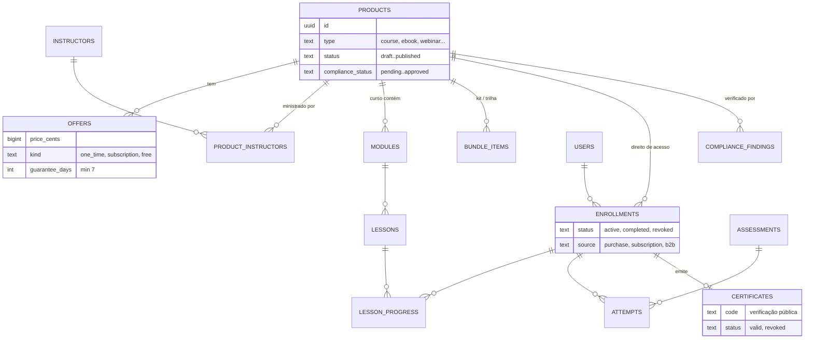
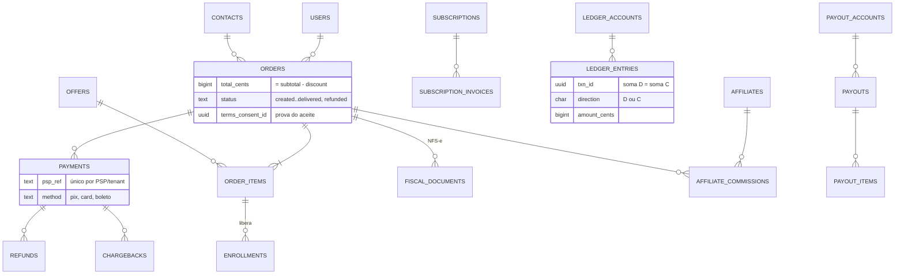
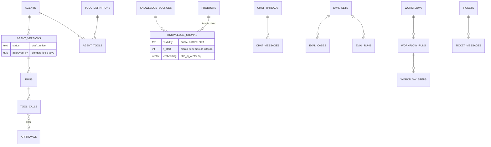

# 12 — Modelo de Dados

> **APEX Plataforma de Cursos Livres** · Documento 12 · v1.0 · 21/10/2026 · Status: **Rascunho técnico, DDL validado**
> Arquivos: [`sql/001_schema.sql`](sql/001_schema.sql) · [`sql/002_ai_vector.sql`](sql/002_ai_vector.sql) · [`sql/verify_001.sql`](sql/verify_001.sql) · [`scripts/verify-schema.sh`](scripts/verify-schema.sh)
> Convenção do projeto: **identificadores e comentários de código em inglês**; esta documentação em português.

## 1. Estado de validação (o que foi realmente executado)

| Verificação | Resultado |
|---|---|
| `001_schema.sql` carregado em **PostgreSQL 16.15** real, sem erros | ✅ |
| **33 verificações comportamentais** (`verify_001.sql`) executadas como o papel `apex_app` (sem `BYPASSRLS`) | ✅ 33/33 |
| `001_schema.sql` carregado também em outro motor (PGlite) | ✅ |
| `002_ai_vector.sql` (pgvector + busca com filtro de direito de acesso) validado no PGlite | ✅ — usuário matriculado recupera só o próprio curso; não matriculado recupera nada |
| Script reprodutível `verify-schema.sh` (modos `DATABASE_URL` e `--ephemeral`) | ✅ — recusa banco não vazio e execução como *root* |

**Números do schema:** 13 schemas · **124 tabelas** · 313 chaves estrangeiras · 240 restrições `CHECK` · 277 índices · **RLS ativo em 124/124 tabelas** (124 políticas).

> **Limites da validação:** valida **integridade e regras de segurança do banco**, não o desempenho em escala (spike S-08 do [Doc 11](11-arquitetura-tecnica.md)). A dimensão do vetor (1024) é uma **suposição** até a escolha do modelo de *embeddings* (S-06).

Para reproduzir:

```bash
# banco descartável já existente
DATABASE_URL=postgresql://postgres@localhost:5432/apex_verify docs/apex-cursos-livres/scripts/verify-schema.sh
# ou cluster temporário (não rodar como root)
docs/apex-cursos-livres/scripts/verify-schema.sh --ephemeral
```

## 2. Princípios de modelagem

| # | Princípio | Como aparece no DDL |
|---|---|---|
| 1 | **Um schema por módulo** (fronteiras claras) | `iam`, `catalog`, `media`, `crm`, `growth`, `commerce`, `lms`, `live`, `engage`, `ai`, `ops`, `analytics`, `platform` |
| 2 | **Multi-tenant com RLS** | `tenant_id` em toda tabela de negócio; política `tenant_isolation` (`tenant_id = platform.current_tenant()`); `FORCE ROW LEVEL SECURITY`; papel `apex_app` **sem** `BYPASSRLS`; **sem tenant definido ⇒ nenhuma linha** (falha fechada) |
| 3 | **Chaves compostas entre tenants** | Relações críticas usam `(tenant_id, id)`: impossível ligar um item de pedido de um tenant à oferta de outro (testado) |
| 4 | **Dinheiro em centavos** (`bigint`) + moeda ISO | `*_cents`, `currency char(3) default 'BRL'`; `CHECK total = subtotal − desconto` |
| 5 | **Ledger de dupla entrada, append-only** | `commerce.ledger_entries`; *constraint trigger* confere débito = crédito por `txn_id` no *commit*; `UPDATE/DELETE` bloqueados (correção por lançamento reverso) |
| 6 | **Idempotência por construção** | `payments (tenant_id, psp, psp_ref)` único; `workflow_runs (tenant_id, workflow_id, idempotency_key)` único; `platform.idempotency_keys` |
| 7 | **Outbox transacional** | `platform.outbox_events` gravada na mesma transação do estado |
| 8 | **Regras de negócio como restrições** | Ver §5 — o banco recusa o que a lei ou a política proíbe |
| 9 | **`text + CHECK` em vez de `ENUM`** | Evolução de valores sem `ALTER TYPE`; domínio explícito no DDL |
| 10 | **`timestamptz` sempre**; fuso de exibição por usuário (`America/Sao_Paulo` padrão) | — |
| 11 | **E-mail case-insensitive** (`citext`) | `iam.users.email`, `crm.contacts.email`, cupons |
| 12 | **Índices parciais** para estados "vivos" | Única matrícula ativa por pessoa/produto; única assinatura viva; fila de outbox; tarefas abertas |
| 13 | **Dados sensíveis cifrados pela aplicação** | `*_enc bytea` + `*_hash` determinístico para busca/deduplicação (ADR-017) |
| 14 | **Particionamento só onde há volume** | `analytics.events` por mês com partição *default* e função `ensure_month_partition()` |
| 15 | **UUID como chave** | `gen_random_uuid()` (v4). *Avaliar UUIDv7 para localidade de índice quando disponível no ambiente-alvo.* |

## 3. Inventário por schema

| Schema | Tabelas | Conteúdo |
|---|---:|---|
| `platform` (8) | `tenants`, `feature_flags`, `outbox_events`, `webhook_endpoints`, `webhook_deliveries`, `api_keys`, `audit_logs`, `idempotency_keys` | Tenancy, flags, eventos, webhooks, auditoria |
| `iam` (9) | `users`, `person_profiles`, `roles`, `memberships`, `consent_versions`, `consents`, `guardianships`, `sessions`, `mfa_factors` | Identidade, papéis, consentimentos versionados, responsável legal |
| `media` (1) | `assets` | Vídeo, áudio, imagem, documento, e-book, certificado, exportação |
| `catalog` (11) | `instructors`, `categories`, `products`, `product_categories`, `product_instructors`, `offers`, `bundle_items`, `coupons`, `reviews`, `compliance_terms`, `compliance_findings` | Produtos polimórficos, ofertas, cupons, avaliações verificadas, **Guardião de Compliance** |
| `crm` (9) | `contacts`, `companies`, `pipelines`, `pipeline_stages`, `deals`, `activities`, `conversations`, `conversation_messages`, `tasks` | CRM e caixa de entrada omnichannel |
| `growth` (12) | `affiliates`, `affiliate_links`, `affiliate_commissions`, `segments`, `campaigns`, `messages`, `landing_pages`, `funnels`, `attribution_touches`, `experiments`, `experiment_assignments`, `referrals` | Marketing, afiliados, atribuição, experimentos |
| `commerce` (16) | `payout_accounts`, `checkout_sessions`, `orders`, `order_items`, `payments`, `refunds`, `chargebacks`, `subscriptions`, `subscription_invoices`, `seat_holds`, `ledger_accounts`, `ledger_entries`, `fiscal_documents`, `payouts`, `payout_items`, `gift_cards` | Checkout, pagamentos, assinatura, ledger, fiscal, repasses |
| `lms` (15) | `courses`, `modules`, `lessons`, `track_items`, `cohorts`, `enrollments`, `lesson_progress`, `questions`, `assessments`, `assessment_questions`, `attempts`, `submissions`, `certificate_templates`, `certificates`, `lesson_comments` | Aprendizagem, avaliações, certificados |
| `live` (5) | `events`, `registrations`, `attendance`, `event_cues`, `mentoring_slots` | Webinars, workshops, mentorias |
| `engage` (8) | `spaces`, `posts`, `reactions`, `gamification_rules`, `points_ledger`, `badges`, `user_badges`, `notifications` | Comunidade, gamificação, notificações |
| `ai` (16) | `agents`, `agent_versions`, `tool_definitions`, `agent_tools`, `runs`, `tool_calls`, `chat_threads`, `chat_messages`, `knowledge_sources`, `knowledge_chunks`, `eval_sets`, `eval_cases`, `eval_runs`, `credit_wallets`, `credit_transactions`, `memory_items` | Agentes, RAG, avaliações, créditos, memória consentida |
| `ops` (13) | `workflows`, `workflow_runs`, `workflow_steps`, `approvals`, `tickets`, `ticket_messages`, `kb_articles`, `dsar_requests`, `processing_activities`, `vendors`, `incidents`, `content_projects`, `contracts` | Workflow engine, suporte, LGPD, fornecedores, contratos |
| `analytics` (1) | `events` (particionada) | Eventos de produto |

## 4. Diagramas (visão simplificada — atributos-chave)

### 4.1 Catálogo, ofertas e aprendizagem



### 4.2 Comercial, ledger e fiscal



### 4.3 IA, RAG e operação



## 5. Regras de negócio aplicadas no banco (testadas)

| Regra | Onde | Verificação |
|---|---|---|
| Produto **não** pode ser `published` sem `compliance_status = approved` (portão do Guardião) | `catalog.products` CHECK | `verify_001`: "cannot publish without compliance approval" |
| Garantia mínima de **7 dias** (CDC art. 49) em toda oferta | `catalog.offers.guarantee_days >= 7` | "guarantee below the 7-day legal minimum is rejected" |
| Oferta de assinatura exige intervalo de cobrança; oferta gratuita exige preço 0 | `catalog.offers` CHECK | "subscription requires a billing interval" |
| Total do pedido = subtotal − desconto; pedido tem usuário **ou** contato | `commerce.orders` CHECK | "total must equal subtotal − discount" · "need a user or a contact" |
| Item de pedido não aponta para oferta de outro tenant | FK composta | "order item cannot use another tenant's offer" |
| Referência do PSP é única (âncora de idempotência de *webhook*) | `payments` UNIQUE | "duplicate PSP reference rejected" |
| Reembolso automático só dentro da janela de arrependimento | `refunds` CHECK | "auto-approval only inside the withdrawal period" |
| Uma matrícula viva por pessoa e produto | índice único parcial | "one live enrollment per person and product" |
| Um certificado de conclusão por matrícula; revogação exige data | índice único + CHECK | "no duplicate completion certificate" · "revocation needs a timestamp" |
| Ledger balanceado por transação, no *commit*; append-only | *constraint trigger* + trigger | "unbalanced transaction is rejected" · "entries are append-only" |
| Auditoria imutável, inclusive para superusuário | trigger | "audit: trigger blocks updates even for superusers" |
| Campanha em massa só segue com aprovação humana | `growth.campaigns` CHECK | "mass send requires a human approval" |
| Versão de agente ativa exige aprovador | `ai.agent_versions` CHECK | "an active version needs an approver" |
| *Chunk* de RAG não público exige `product_id` (filtro por direito) | `ai.knowledge_chunks` CHECK | "non-public chunks must be bound to a product" |
| Artigo da base de conhecimento só publica com revisão humana | `ops.kb_articles` CHECK | "cannot be published without human review" |
| DSAR com prazo padrão de 15 dias; negativa exige motivo | `ops.dsar_requests` | "default deadline is 15 days" · "denial must record its reason" |
| Mentor não tem horários sobrepostos | `EXCLUDE USING gist` | "overlapping slots … rejected" |
| Isolamento entre tenants (leitura, escrita, falha fechada) | RLS | 4 verificações de RLS |

## 6. Dados pessoais, sensíveis e retenção

> **Proposta** — a tabela de retenção precisa de validação jurídica e contábil (Doc 16) antes de implementada. Prazos fiscais e contratuais **não** foram confirmados nesta pesquisa.

### 6.1 Dados sensíveis e proteção

| Dado | Onde | Proteção |
|---|---|---|
| CPF/CNPJ | `iam.person_profiles.document_enc` + `document_hash` | Cifra de campo (envelope) + HMAC para busca/duplicidade |
| Dados bancários/Pix de repasse | `commerce.payout_accounts.details_enc` | Cifra de campo; acesso restrito ao financeiro |
| Senha | `iam.users.password_hash` | Hash de senha moderno (ex.: Argon2id); nulo em contas sem senha |
| Segredos de MFA | `iam.mfa_factors.secret_enc` | Cifra de campo |
| IP e *user agent* | `iam.consents`, `iam.sessions`, `platform.audit_logs`, `commerce.orders.ip` | Mascaramento em analytics; retenção mínima |
| Nascimento / faixa etária | `iam.person_profiles.birth_date`, `age_status` | Minimização; uso apenas para elegibilidade/ECA Digital |
| Conteúdo de conversas com IA | `ai.chat_messages.content` | Redação de PII antes da retenção longa; exclusão a pedido |
| Memória de aprendizagem | `ai.memory_items` | Somente com consentimento (`consent_id`); apagável |

### 6.2 Retenção proposta

| Categoria | Prazo proposto | Observação |
|---|---|---|
| Registros de acesso a aplicações (logs) | **mínimo 6 meses** | Obrigação do Marco Civil (art. 15) para provedores de aplicações — confirmar escopo com o jurídico |
| Pedidos, pagamentos, ledger, documentos fiscais | Prazo fiscal/contábil (a confirmar com contador; referência usual de 5 anos) | Não apagar por DSAR enquanto houver obrigação |
| Contratos de instrutores/afiliados/B2B | Vigência + prazo prescricional (jurídico) | |
| Consentimentos (prova) | Enquanto vigentes + prazo de prova (jurídico) | Versionados |
| Auditoria de ações administrativas | Proposta: 5 anos | Imutável |
| Leads sem relacionamento e sem consentimento ativo | 24 meses sem interação ⇒ anonimizar | `crm.contacts.anonymized_at` |
| Sessões de checkout abandonadas | 90 dias | |
| Eventos brutos de analytics | 13 meses; agregados sem prazo | Partições antigas são descartadas |
| Execuções de IA (`ai.runs`) | 90 dias detalhado; agregados 24 meses | |
| Mensagens do tutor | 12 meses, com PII redigida | Exclusão a pedido do titular |
| Matrícula, progresso, notas | Enquanto a conta existir + período definido pelo jurídico | |

### 6.3 Certificados × exclusão de dados (decisão a registrar com o DPO)

O certificado é um **registro emitido** com verificação pública. Ao atender um pedido de exclusão, a política proposta é: **manter o mínimo necessário** (código, curso, carga horária, data, status) quando houver fundamento legal; **anonimizar `holder_name`** quando não houver; e **informar o titular** sobre o que foi mantido e por quê (`ops.dsar_requests.outcome`). A decisão final depende do jurídico.

## 7. Eventos de domínio (alimentam outbox, workflows e analytics)

Catálogo completo no [Doc 13](13-api-e-eventos.md) §6. Convenção: `<agregado>.<fato no passado>`, p. ex. `order.paid`, `enrollment.created`, `certificate.issued`, `refund.completed`, `dsar.received`. Todo evento carrega `event_id`, `tenant_id`, `occurred_at`, `version` e `payload` mínimo.

## 8. Índices, desempenho e crescimento

- **Índices por padrão de acesso** já incluídos (fila de outbox, caixa de entrada, fila de tickets, pedidos por usuário/estado, calendário de eventos, busca por trigramas em títulos).
- **Candidatas a particionamento quando crescerem:** `analytics.events` (já), `platform.audit_logs`, `growth.messages`, `ai.runs`, `ai.chat_messages`, `lms.lesson_progress`.
- **Escrita intensa de progresso:** agrupar em lotes (*batching*) e gravar *upsert* por `(enrollment_id, lesson_id)`.
- **Leitura:** projeções/visões materializadas para painel do aluno e relatórios; réplicas de leitura (Doc 11 §11).
- **RLS e desempenho:** índices começando por `tenant_id` nas tabelas grandes; medir no spike S-08.

## 9. Lacunas conhecidas do modelo (backlog de modelagem)

| Item | Motivo |
|---|---|
| Itens do carrinho persistidos (hoje em `checkout_sessions.items` JSONB) | Simplicidade na Fase 1; normalizar se houver análises de carrinho |
| Liquidações do PSP (*settlements*) e extrato bancário para conciliação | Necessário no WF-FIN-01 (Fase 2) |
| Regras fiscais por produto/município e retenções | Dependem das definições do contador (Q-04) |
| Catálogo de permissões e política ABAC | Fase 3 |
| Modelos de mensagens/*templates* e preferências de canal por usuário | Fase 2 |
| Conteúdo multilíngue (tradução de produtos/aulas) | Fase 4 |
| SCORM/xAPI, *proctoring* | Fase 3–4 |
| Faturamento B2B (propostas, assentos, faturas) | Fase 3 |
| Políticas de SLA configuráveis (hoje `sla_due_at` calculado pela aplicação) | Fase 2 |
| Unidades organizacionais dentro de um tenant (multi-marca) | Fase 4 |

## 10. Migrações

1. `001_schema.sql` — núcleo (idempotente apenas para extensões/schemas; as tabelas assumem banco vazio).
2. `002_ai_vector.sql` — requer `pgvector`; adiciona `embedding vector(1024)`, índice HNSW e `ai.search_chunks()`.
3. Evolução: migrações versionadas, revisadas por DDL, no padrão **expand → migrate → contract** (Doc 11 §10). O arquivo único aqui é **referência de modelagem**; em produção será dividido em migrações incrementais pela ferramenta escolhida.
