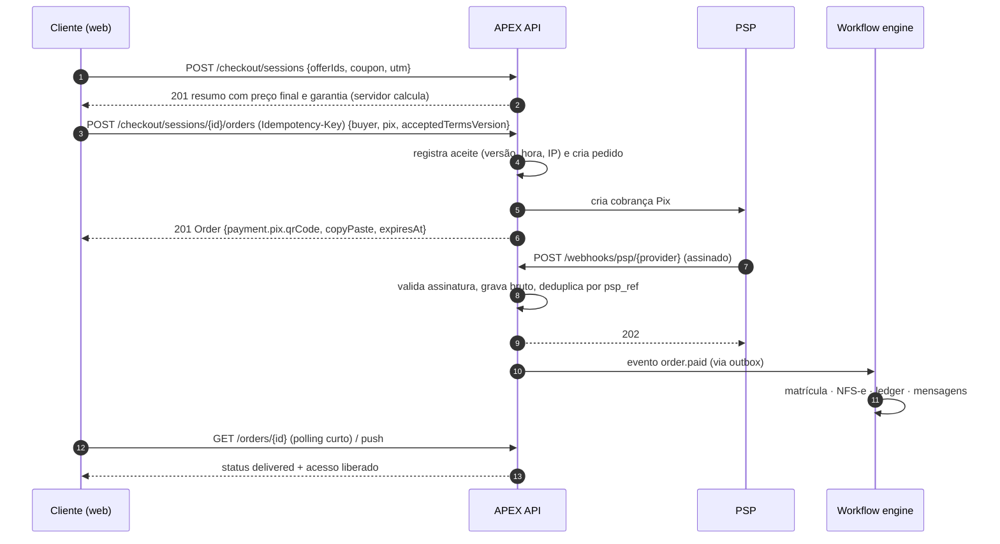

# 13 — API, Eventos e Integrações

> **APEX Plataforma de Cursos Livres** · Documento 13 · v1.0 · 21/10/2026 · Status: **Contrato inicial validado por linter**
> Contrato: [`api/openapi.yaml`](api/openapi.yaml) (OpenAPI 3.1) · Dados: [Doc 12](12-modelo-de-dados.md) · Arquitetura: [Doc 11](11-arquitetura-tecnica.md)

## 1. Estado de validação

| Verificação | Resultado |
|---|---|
| `openapi.yaml` validado com **Redocly CLI** (regras recomendadas) | ✅ válido, 0 avisos |
| Tamanho do contrato | 34 caminhos · 39 operações · 1 *webhook* de saída · `securitySchemes`, parâmetros e respostas reutilizáveis |
| Esquema de assinatura de *webhooks* (HMAC-SHA256 com *timestamp*) | ✅ testado: assinatura válida; corpo adulterado, segredo errado, *timestamp* expirado, cabeçalho malformado e *hex* curto são rejeitados |

> **Escopo do contrato:** cobre a superfície das Fases 1–2 (identidade, catálogo, checkout, aprendizagem, certificados, ao vivo, tutor IA, leads, aprovações). Rotas de CRM completo, afiliados detalhados, financeiro e workflow visual entram nas versões seguintes. **Não** é uma implementação — é o acordo entre *front-end*, parceiros e automações.

## 2. Convenções

| Tema | Regra |
|---|---|
| **Estilo** | REST/JSON sobre HTTPS; recursos no plural; ações não-CRUD como sub-recursos de verbo (`/orders/{id}/refund-requests`, `/products/{id}/publish`) |
| **Identificadores** | UUID em toda parte; produtos aceitam **UUID ou *slug*** em leitura pública. IDs nunca sequenciais expostos (o `number` do pedido é só exibição) |
| **Nomes** | `camelCase` nos campos JSON; rotas em `kebab-case`; enumerações em `snake_case` |
| **Tempo** | ISO 8601 em UTC (`date-time`); fuso de exibição é decisão do cliente (`America/Sao_Paulo` padrão do usuário) |
| **Dinheiro** | `{ "amountCents": 19900, "currency": "BRL" }` — inteiro em centavos; **o cliente nunca envia valores a cobrar**: o servidor recalcula tudo (RF-PAY) |
| **Erros** | RFC 9457 (`application/problem+json`) com `type`, `title`, `status`, `detail`, `code` estável e `errors[]` por campo. Bloqueio do Guardião devolve `422` com `findings[]` |
| **Paginação** | *Cursor*: `limit` (1–100, padrão 25) e `cursor`; resposta `{ data, nextCursor }` |
| **Filtros e busca** | Parâmetros simples (`type`, `level`, `category`, `q`); campos extras via `expand=` (planejado) |
| **Idempotência** | Cabeçalho `Idempotency-Key` **obrigatório** em operações que movimentam dinheiro (`placeOrder`, `requestRefund`); mesma chave ⇒ mesmo resultado por 48 h (`platform.idempotency_keys`) |
| **Limites** | Cabeçalhos `RateLimit-*` e `Retry-After` em `429`; limites por IP, usuário, chave e *tenant* |
| **Versionamento** | Prefixo `/v1`; mudanças compatíveis (campos novos opcionais) sem nova versão; *breaking changes* ⇒ `/v2` com período de convivência ≥ 6 meses e `Sunset` header |
| **Tenant** | Resolvido pelo *host* (domínio do tenant) ou pela chave de API; nunca por parâmetro do cliente |
| **Segurança por padrão** | Operações públicas declaram `security: []` explicitamente; o resto exige `bearerAuth` |

## 3. Autenticação e autorização

| Mecanismo | Uso | Detalhes |
|---|---|---|
| **Sessão por *bearer* (JWT curto) + *refresh* rotativo** | Aplicações web/PWA | Expiração curta; rotação do *refresh*; revogação por dispositivo (`iam.sessions`); `mfa_required` no login quando houver fator |
| **Chaves de API** (`X-Api-Key`) | Servidor-a-servidor (Fase 3+) | Só o *hash* é armazenado; escopos; expiração; revogação; limite por chave |
| **Webhooks de entrada** | PSP, e-mail, WhatsApp, fiscal, vídeo | Assinatura do provedor + *timestamp* + IP quando disponível |
| **Autorização** | Decisão no servidor | RBAC + escopo (`product`, `cohort`) via *policy engine*; **direito de acesso (*entitlement*)** para conteúdo, vídeo e IA |
| **Personificação (admin)** | Suporte | Justificativa obrigatória + aviso em tela + auditoria; sem acesso a segredos (RF-IAM-016) |

**Matriz de acesso resumida**

| Recurso | Público | Aluno | Instrutor | Staff | API key |
|---|:-:|:-:|:-:|:-:|:-:|
| Catálogo/produto publicado, eventos, verificação de certificado | ✅ | ✅ | ✅ | ✅ | ✅ |
| Checkout e pedido (próprio) | ✅ (sessão de checkout) | ✅ | ✅ | ✅ | escopo |
| Progresso, tentativas, certificados, tutor (próprios) | — | ✅ | — | ✅ (suporte) | — |
| Criar/editar produto | — | — | ✅ (próprios) | ✅ | escopo |
| Aprovações, agentes, kill switch | — | — | — | ✅ (papel) | — |

## 4. Mapa de recursos e rastreabilidade

| Grupo (tag) | Operações do contrato | Requisitos atendidos |
|---|---|---|
| **Auth** | `registerUser`, `login`, `logout` | RF-IAM-001, 004, 005, 008, 014, 018 |
| **Me** | `getMe`, `updateMe`, `listMyConsents`, `recordConsent`, `createDataRequest` | RF-IAM-007, 008, 009, 019; RF-OPS-029 |
| **Catalog** | `listProducts`, `getProduct`, `createProduct`, `updateProduct`, `requestProductPublication` | RF-CAT-001…005, 010, 011, 021 |
| **Compliance** | `scanText` | RF-CAT-021, RF-AIX-024 |
| **Checkout** | `createCheckoutSession`, `placeOrder`, `listMyOrders`, `getOrder`, `requestRefund`, `cancelSubscription` | RF-PAY-001…016, 022, 033 |
| **Learning** | `listMyEnrollments`, `saveLessonProgress`, `startAttempt`, `listMyCertificates`, `verifyCertificate` | RF-LMS-003, 008, 009, 013, 016, 027 |
| **Media** | `getPlaybackToken` | RF-MED-003, 004, 006 |
| **Live** | `listEvents`, `registerForEvent` | RF-LIV-001…004 |
| **AI** | `createTutorThread`, `sendTutorMessage`, `rateTutorMessage`, `setAgentKillSwitch` | RF-AIX-009…011, 015, 016, 018 |
| **Growth** | `captureLead`, `applyAsAffiliate` | RF-MKT-003, 011; RF-CRM-001, 004 |
| **Admin** | `listApprovals`, `decideApproval` | RF-OPS-003, RF-AIX-036 |
| **Webhooks** | `receivePspWebhook`, `listWebhookEndpoints`, `createWebhookEndpoint`, `deliverDomainEvent` (saída) | RF-PAY-014, RF-PLT-003, 004 |

## 5. Fluxos-chave

### 5.1 Compra com Pix (visão de API)



### 5.2 Tutor com streaming e citações

1. `POST /ai/tutor/threads` — devolve `disclosure` (aviso de que é IA) e modo.
2. `POST /ai/tutor/threads/{id}/messages` — resposta **SSE**: eventos `delta` (texto), `citation` (aula + tempo), `handoff` (encaminhar a humano) e `done` (custo/uso agregados, sem expor *prompts*).
3. `POST /ai/messages/{id}/feedback` — 👍/👎 com motivo, usado nos *evals*.

### 5.3 Reprodução protegida

`GET /lessons/{id}/playback` ⇒ valida *entitlement*, aplica limite de dispositivos, devolve URL **assinada, curta e vinculada** ao espectador e ao domínio, com *marca d'água* quando configurada. O *player* renova o token antes de expirar.

### 5.4 Reembolso de 7 dias

`POST /orders/{id}/refund-requests` (com `Idempotency-Key`) ⇒ se dentro da janela, `autoApproved=true` e o fluxo `WF-ORD-03` estorna no PSP, revoga acesso, cancela NFS-e e estorna repasses. Fora da janela, vai à **caixa de aprovações** (`/admin/approvals`).

## 6. Catálogo de eventos de domínio

**Formato (envelope)** — ver `EventEnvelope` no OpenAPI: `id`, `type`, `version`, `tenantId`, `occurredAt`, `data`. Convenção: `<agregado>.<fato no passado>`; eventos são **fatos imutáveis**; mudança incompatível ⇒ novo `version`. *Payload* mínimo (IDs e campos que consumidores precisam); dados pessoais só quando indispensáveis.

| Domínio | Evento | Quando | Payload mínimo (`data`) | Consumidores |
|---|---|---|---|---|
| **Identidade** | `user.registered` | Cadastro concluído | `userId`, `source` | Boas-vindas, CRM, analytics |
| | `user.email_verified` | E-mail confirmado | `userId` | Onboarding |
| | `consent.granted` / `consent.revoked` | Mudança de consentimento | `userId\|contactId`, `kind`, `version` | Mensageria, CRM, DPO |
| | `guardian.verified` | Responsável confirmado | `guardianId`, `minorId` | IAM, compliance |
| | `dsar.received` / `dsar.completed` | Pedido do titular | `dsarId`, `kind`, `dueAt` | WF-CMP-01 |
| **Catálogo** | `product.submitted` | Pedido de publicação | `productId`, `version` | Guardian, curadoria |
| | `product.published` / `product.paused` / `product.archived` | Mudança de estado | `productId` | RAG, SEO, marketing |
| | `compliance.finding_created` | Achado do Guardião | `targetType`, `targetId`, `severity`, `layer` | Revisão jurídica |
| | `offer.activated` / `offer.ended` | Vigência de oferta | `offerId`, `productId` | LPs, CRM |
| **Comercial** | `checkout.started` / `checkout.abandoned` | Sessão iniciada / abandonada | `sessionId`, `offerIds`, `contactId` | Recuperação |
| | `order.created` | Pedido criado | `orderId`, `total` | Antifraude, analytics |
| | `payment.pending` | Cobrança criada | `paymentId`, `method` | Lembretes (Pix/boleto) |
| | **`order.paid`** | **Pagamento confirmado** | `orderId`, `paymentId`, `items[]` | **WF-ORD-01**, afiliados, CAPI |
| | `order.delivered` | Acesso/ingresso entregue | `orderId` | Marketing, sucesso do aluno |
| | `refund.requested` / `refund.approved` / `refund.completed` | Ciclo de reembolso | `refundId`, `orderId`, `autoApproved` | WF-ORD-03, financeiro |
| | `chargeback.opened` / `chargeback.resolved` | Contestação | `chargebackId`, `paymentId`, `dueAt` | WF-ORD-05 |
| | `subscription.started` / `renewed` / `past_due` / `canceled` | Ciclo de assinatura | `subscriptionId`, `userId` | Acesso, dunning, métricas |
| | `invoice.paid` / `invoice.past_due` | Cobrança recorrente | `invoiceId`, `subscriptionId` | WF-FIN-04 |
| | `payout.scheduled` / `payout.paid` | Repasse | `payoutId`, `beneficiaryId` | Instrutor/afiliado |
| | `fiscal.nfse_issued` / `nfse_failed` / `nfse_canceled` | Ciclo fiscal | `orderId`, `documentId` | WF-FIN-07 |
| | `affiliate.commission_created` / `commission_reversed` | Comissão | `affiliateId`, `orderId`, `amount` | Afiliados, financeiro |
| **Aprendizagem** | `enrollment.created` / `completed` / `revoked` / `expiring` | Ciclo da matrícula | `enrollmentId`, `userId`, `productId` | Onboarding, certificados, RAG (ACL) |
| | `lesson.started` / `lesson.completed` | Progresso | `enrollmentId`, `lessonId` | Gamificação, analytics, evasão |
| | `assessment.attempt_submitted` / `passed` / `failed` | Avaliação | `attemptId`, `score` | Certificado, tutor |
| | `certificate.issued` / `certificate.revoked` | Credencial | `certificateId`, `code` | E-mail, perfil, badges |
| | `review.submitted` | Avaliação do curso | `reviewId`, `productId` | Moderação, SEO |
| **Ao vivo** | `event.scheduled` / `started` / `ended` | Ciclo do evento | `eventId` | Lembretes, replay |
| | `event.registration_created` | Inscrição | `registrationId`, `eventId`, `contactId` | CRM, funil |
| | `event.attendance_recorded` | Presença calculada | `registrationId`, `secondsPresent` | Certificado, scoring |
| | `event.offer_shown` | CTA exibido na sala | `eventId`, `offerId` | Atribuição |
| | `event.recording_ready` | Replay disponível | `eventId`, `assetId` | Pós-evento |
| **Engajamento** | `post.created`, `points.awarded`, `badge.awarded` | Comunidade/gamificação | `userId`, ... | Moderação, notificações |
| **CRM/Growth** | `lead.captured` | Lead com consentimento | `contactId`, `source` | Nutrição |
| | `contact.score_changed`, `deal.stage_changed` | Vendas | `contactId\|dealId` | Roteamento |
| | `message.sent` / `delivered` / `bounced` / `complained` | Mensageria | `messageId`, `channel` | Higiene de lista |
| | `campaign.sent`, `referral.qualified` | Campanhas/indicação | `campaignId\|referralId` | Relatórios |
| **Suporte** | `ticket.created` / `resolved` / `sla_breached` | Atendimento | `ticketId`, `category` | WF-SUP |
| **IA** | `ai.run_completed` | Execução finalizada | `runId`, `agentId`, `costMicros` | FinOps, qualidade |
| | `ai.tool_call_proposed` | Ação de agente a aprovar | `toolCallId`, `approvalId` | Caixa de aprovações |
| | `approval.requested` / `approval.decided` | HITL | `approvalId`, `kind` | Workflow engine |
| | `agent.budget_threshold_reached`, `agent.kill_switch_changed` | Governança | `agentId`, `percent` | Alertas |
| **Mídia** | `asset.ready` / `asset.failed` | Processamento | `assetId` | Publicação, qualidade |
| **Plataforma** | `webhook.delivery_failed` | Entrega externa falha | `endpointId`, `eventId` | Alertas |

> **Consistência dos nomes:** `order.paid` é o **evento de domínio** que dispara o `WF-ORD-01`. O *webhook* do PSP (entrada) é traduzido para ele pelo módulo de pagamentos após validação e deduplicação.

## 7. Webhooks de saída (para parceiros e automações)

| Aspecto | Regra |
|---|---|
| **Cadastro** | `POST /webhook-endpoints` com `url` (HTTPS) e lista de `events`; o **segredo de assinatura é exibido uma única vez** |
| **Assinatura** | Cabeçalho `X-Apex-Signature: t=<unix>,v1=<HMAC-SHA256("t.body", segredo)>` |
| **Janela anti-*replay*** | Rejeitar se `|agora − t| > 300 s` |
| **Entrega** | *At-least-once*; tentativas com recuo exponencial (ex.: 1 min, 5 min, 30 min, 2 h, 12 h, 24 h) e então *dead letter*; painel de entregas e **repetição manual** (RF-PLT-003) |
| **Idempotência do consumidor** | Deduplicar por `id` do evento |
| **Ordem** | **Não garantida** entre eventos; usar `occurredAt` e `version` do agregado quando houver |
| **Resposta esperada** | `2xx` em até 10 s; processar de forma assíncrona |

**Verificação no consumidor (Node.js) — trecho testado**

```js
import { createHmac, timingSafeEqual } from "node:crypto";

export function verifyApexSignature(secret, header, rawBody, toleranceSeconds = 300) {
  const parts = Object.fromEntries(header.split(",").map((kv) => kv.split("=", 2)));
  const t = Number(parts.t);
  if (!Number.isInteger(t) || !parts.v1) return false;
  if (Math.abs(Math.floor(Date.now() / 1000) - t) > toleranceSeconds) return false; // replay window
  const expected = createHmac("sha256", secret).update(`${t}.${rawBody}`).digest();
  const given = Buffer.from(parts.v1, "hex");
  return given.length === expected.length && timingSafeEqual(given, expected);     // constant time
}
```

> Use sempre o **corpo bruto** (não o JSON reserializado) para calcular a assinatura.

## 8. Webhooks de entrada (dos provedores para a APEX)

| Provedor | Eventos | Tratamento |
|---|---|---|
| **PSP** | Pix confirmado/expirado, cartão autorizado/recusado, boleto pago/vencido, estorno, *chargeback*, assinatura (cobrança/inadimplência) | Validar assinatura → gravar bruto → `202` rápido → deduplicar por `(psp, psp_ref)` → traduzir para eventos de domínio |
| **E-mail (ESP)** | Entregue, aberto, clicado, *bounce*, reclamação, descadastro | Atualizar `growth.messages`; suprimir endereços; alertar entregabilidade |
| **WhatsApp** | Status de mensagem, mensagens recebidas, qualidade/limite do número | Atualizar `crm.conversation_messages`; respeitar janela de 24 h; opt-out |
| **Fiscal (NFS-e)** | Autorizada, rejeitada, cancelada | `commerce.fiscal_documents`; WF-FIN-07 |
| **Vídeo** | Processamento concluído/falho, legendas prontas | `media.assets`; publicação |
| **Ao vivo** | Participante entrou/saiu, gravação pronta | `live.attendance`; replay |
| **Assinatura eletrônica** | Documento assinado/recusado | `ops.contracts` |

Todos: **assinatura verificada, corpo bruto retido (retenção curta), idempotência, resposta rápida e processamento assíncrono**.

## 9. Segurança da API

| Ameaça (OWASP API Top 10) | Controle |
|---|---|
| Quebra de autorização em nível de objeto (BOLA) | Toda consulta por ID filtra por dono/*entitlement*/*tenant* (RLS como segunda barreira); testes automatizados de acesso cruzado |
| Autenticação quebrada | MFA/passkeys, *rate limit*, rotação de *refresh*, mensagens genéricas |
| Exposição excessiva de dados | DTOs explícitos por papel; sem retorno de campos internos; CPF mascarado |
| Consumo irrestrito de recursos | Limites por IP/usuário/chave/*tenant*; tamanho máximo de corpo; paginação obrigatória; custo de IA com orçamento |
| Autorização em nível de função | Rotas `/admin/*` exigem papel; operações sensíveis com aprovação |
| Falsificação de requisição no servidor (SSRF) | *Allowlist* de hosts para URLs de *webhook*/imagens; sem seguir redirecionamentos para redes internas |
| Configuração incorreta | Cabeçalhos de segurança, CORS restritivo, `security: []` explícito só onde é público |
| Gestão inadequada de inventário | OpenAPI como fonte única; *deprecation* e `Sunset`; versões antigas monitoradas |
| Consumo inseguro de APIs de terceiros | Validação de respostas, *timeouts*, *circuit breaker*, segredos no cofre |
| Preço/valores no cliente | O servidor **sempre** recalcula (checkout); nunca confia no cliente |

## 10. Governança do contrato

- **Fonte única**: `api/openapi.yaml`; clientes e *mocks* gerados a partir dele; **lint no CI** (Redocly) e verificação de quebra (`oasdiff`/equivalente) em cada PR.
- **Testes de contrato** contra o contrato (Schemathesis/Dredd ou equivalente) e *mocks* gravados dos provedores (RNF-MNT-03).
- **Sandbox**: ambiente com dados sintéticos e provedores em modo teste, para parceiros.
- **SDKs**: TypeScript primeiro; outros sob demanda (Fase 4).
- **Política de mudança**: compatível ⇒ aviso em *changelog*; incompatível ⇒ nova versão + `Sunset`.
- **Documentação publicada**: portal de API com exemplos, *playground* e guia de *webhooks* (Fase 3–4).

## 11. Pendências do contrato

| Item | Fase |
|---|---|
| Rotas de CRM (contatos, negócios, conversas), mensagens e campanhas | 2 |
| Afiliados (links, relatórios, saques), cupons e referral | 2 |
| Financeiro (repasses, extratos, conciliação) e fiscal | 2 |
| Workflow (listar/rodar/pausar), agentes (versões, *evals*) e créditos de IA | 3 |
| Mentorias, B2B (assentos, propostas) e SSO | 3 |
| Parâmetro `expand`, filtros avançados e *bulk endpoints* | 2–3 |
| Esquemas JSON por evento (um para cada `type`) | 2 |
