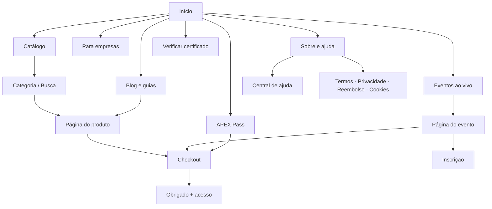
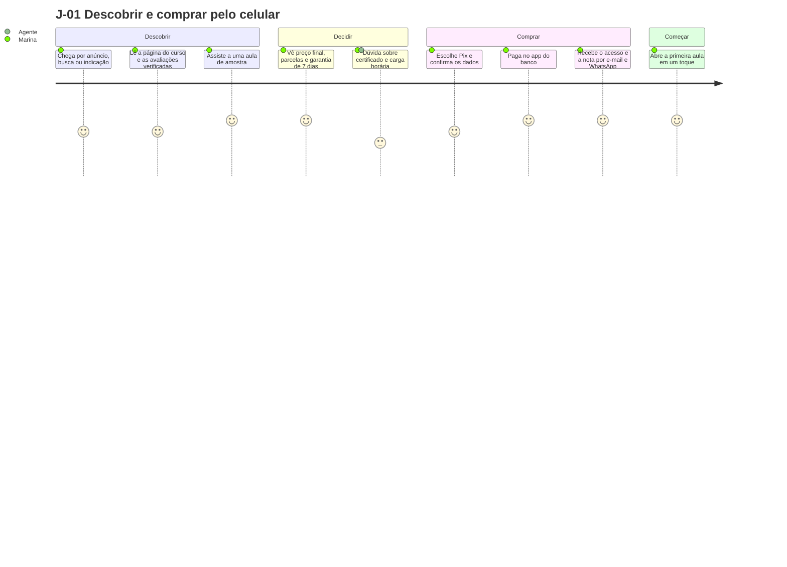
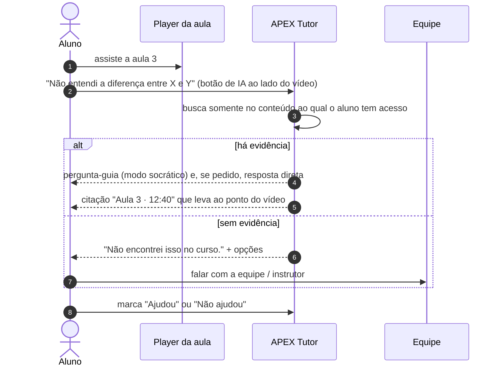
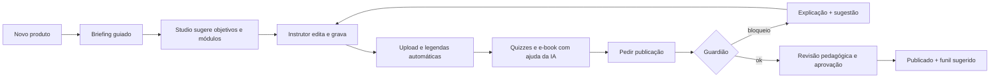

# 14 — UX: Jornadas, Arquitetura de Informação e Telas

> **APEX Plataforma de Cursos Livres** · Documento 14 · v1.0 · 21/10/2026 · Status: **Rascunho para validação com usuários**
> Identidade e componentes: [Doc 15](15-identidade-visual-apex.md) · Requisitos: [Doc 05](05-requisitos-funcionais.md) · Jurídico: [Doc 16](16-juridico-compliance.md)
> Personas (P1–P9) estão no [Doc 03](03-visao-produto-estrategia.md) §4 e são **hipóteses a validar**.

## 1. Princípios de UX

1. **Do desejo ao acesso em minutos.** Cada tela entre "quero" e "estou assistindo" precisa justificar sua existência.
2. **Pix primeiro, celular primeiro.** O fluxo de compra e de estudo é desenhado para uma mão e rede móvel.
3. **Sempre sei onde parei.** "Continuar" é a ação mais visível do app do aluno.
4. **IA visível, humilde e citável.** Rótulo "IA", fonte da resposta e saída para um humano em qualquer ponto.
5. **Transparência comercial.** Preço final, garantia de 7 dias, prazo de acesso e cancelamento claros antes de pagar (CDC).
6. **Sem padrões enganosos.** Nada de contagem falsa, cancelamento escondido ou consentimento pré-marcado.
7. **Acessível por padrão.** Teclado, leitor de tela, legendas e contraste AA em todas as jornadas críticas.
8. **Estados reais.** Todo componente tem estado vazio, carregando, erro e sucesso desenhados.
9. **Calma operacional.** Painéis de equipe priorizam o que exige decisão, com o resto automatizado.

## 2. Arquitetura de informação

### 2.1 Site público e vitrine



### 2.2 Área do aluno (app/PWA)

| Menu | Conteúdo | Requisitos |
|---|---|---|
| **Início** | Continuar de onde parei, próximos eventos, recomendações, metas da semana | RF-LMS-027, 028 |
| **Meus cursos** | Cursos, trilhas, e-books, progresso, filtros | RF-LMS |
| **Agenda** | Aulas ao vivo, prazos, encontros da turma, ICS | RF-LIV, RF-ENG-011 |
| **Comunidade** | Espaços dos meus produtos, desafios, ranking (quando ativo) | RF-ENG |
| **Certificados** | PDF, compartilhar, validar, credenciais | RF-LMS-013…018 |
| **Pedidos e assinatura** | Recibos, NFS-e, reembolso, cancelar assinatura | RF-PAY |
| **Perfil e privacidade** | Dados, consentimentos, meus dados (LGPD), dispositivos | RF-IAM |
| **Ajuda** | Central de ajuda, tutor, falar com a equipe | RF-OPS-016, 017 |

### 2.3 Painéis de operação

| Painel | Perfis | Seções principais |
|---|---|---|
| **Instrutor** | Instrutor, coprodutor | Visão geral · Meus produtos · Studio (IA) · Alunos e dúvidas · Vendas e repasses · Avaliações |
| **Admin** | Operações, financeiro, conteúdo, suporte | Início/aprovações · Catálogo · Alunos · Pedidos · Financeiro · Marketing · Eventos · CRM · Suporte · Instrutores · Conteúdo · IA · Compliance · Configurações |
| **Afiliado** | Afiliados | Links e cupons · Desempenho · Comissões e pagamentos · Materiais |
| **Responsável** *(Fase 3)* | Responsável legal | Menores vinculados · Autorizações · Progresso · Privacidade |

## 3. Jornadas principais

### 3.1 Resumo

| ID | Jornada | Persona | Momento da verdade | Métrica |
|---|---|---|---|---|
| J-01 | **Descobrir e comprar** (Pix, celular) | P1 | Ver preço final e garantia → pagar → acesso em segundos | Conversão do checkout; tempo até acesso |
| J-02 | **Primeira aula** (ativação) | P1, P2 | Começar a 1ª aula em < 24 h; primeira pergunta ao tutor | Ativação 24 h |
| J-03 | **Estudar com o tutor** | P1 | Resposta com a aula exata citada | CSAT; taxa de conclusão |
| J-04 | **Concluir e provar** | P1 | Certificado emitido e verificável | Emissão; compartilhamentos |
| J-05 | **Evento ao vivo** (webinar → oferta) | P1, P2 | Entrar sem fricção; oferta clara; replay | Comparecimento; conversão |
| J-06 | **Pedir reembolso** (7 dias) | P1 | Pedido em poucos toques; confirmação imediata | Tempo de reembolso; NPS do pedido |
| J-07 | **Publicar um curso** | P4 | Studio gera a base; Guardião explica bloqueios; revisão | Tempo roteiro→publicação |
| J-08 | **Operar o dia** | P5 | Caixa de aprovações resolvida; alertas tratados | Tempo de resposta; taxa de automação |
| J-09 | **Afiliar-se e vender** | P8 | Link pronto, comissão transparente | Cliques→vendas; pagamentos no prazo |
| J-10 | **Comprar para a equipe** (B2B) | P3 | Cotação clara; atribuição de assentos; relatório | Tempo de ativação; renovação |

### 3.2 J-01 — Descobrir e comprar (detalhe)



**Pontos de atrito conhecidos e respostas de design**

| Atrito provável | Resposta de design |
|---|---|
| Desconfiança em comprar online | Avaliações verificadas, CNPJ no rodapé, garantia de 7 dias em destaque, selo de pagamento seguro, canal humano |
| Dúvida sobre o que o certificado vale | Texto padrão: "Curso livre. Comprova conclusão e carga horária. Não substitui graduação, pós ou curso técnico." |
| Formulário longo no celular | Campos mínimos, máscara e validação de CPF, autopreenchimento, compra sem criar senha |
| Pix: sair do app e perder o fio | Copia-e-cola e QR, temporizador real, polling curto e confirmação automática; reenvio por WhatsApp |
| Cartão recusado | Mensagem genérica segura, tentar outro cartão ou Pix sem refazer dados |
| Não sei se vou conseguir estudar | Plano semanal sugerido, aulas curtas, tutor 24 h |

### 3.3 J-03 — Estudar com o tutor (detalhe)



### 3.4 J-06 — Pedir reembolso (7 dias)

1. **Meus pedidos** → pedido com selo "Dentro do prazo de 7 dias" e botão visível **"Pedir reembolso"** (não escondido).
2. Pergunta opcional de motivo (não obrigatória) e confirmação em **uma etapa**.
3. Resultado imediato: *"Reembolso aprovado. O valor volta pelo mesmo meio de pagamento em até X dias."* (prazo do PSP/banco).
4. Acesso encerra; certificado e dados permanecem conforme política; e-mail de confirmação.

### 3.5 J-07 — Publicar um curso (instrutor)



## 4. Mapa de telas

> `S-<área>-NN`. Fase = fase de entrega do conjunto principal.

### 4.1 Público e conversão

| ID | Tela | Requisitos | Fase |
|---|---|---|---|
| S-PUB-01 | Início (vitrine) | RF-CAT-009, 016 | 1 |
| S-PUB-02 | Catálogo com busca e filtros | RF-CAT-010 | 1 |
| S-PUB-03 | Página de produto (curso, e-book, trilha, assinatura) | RF-CAT-011, 013, 018 | 1 |
| S-PUB-04 | Página de evento (webinar, workshop) e inscrição | RF-LIV-001…004 | 2 |
| S-PUB-05 | Checkout (1 página) | RF-PAY-001…012 | 1 |
| S-PUB-06 | Pix: QR/copia-e-cola e confirmação | RF-PAY-003 | 1 |
| S-PUB-07 | Obrigado + próximos passos | RF-PAY-018 | 1 |
| S-PUB-08 | Verificação pública de certificado | RF-LMS-016 | 1 |
| S-PUB-09 | Página do instrutor | RF-CAT-015 | 1 |
| S-PUB-10 | Landing pages de funil (LP builder) | RF-MKT-001 | 2 |
| S-PUB-11 | Termos, Privacidade, Reembolso, Cookies, Central de ajuda | RF-OPS-017 | 1 |

### 4.2 Aluno

| ID | Tela | Requisitos | Fase |
|---|---|---|---|
| S-ALU-01 | Cadastro, login, recuperação, 2FA | RF-IAM | 1 |
| S-ALU-02 | Início do aluno | RF-LMS-027 | 1 |
| S-ALU-03 | Meus cursos e progresso | RF-LMS-003 | 1 |
| S-ALU-04 | Player de aula (vídeo, texto, anexos, comentários, tutor) | RF-MED, RF-LMS-020, RF-AIX-016 | 1 |
| S-ALU-05 | Avaliação (quiz) e resultado | RF-LMS-008, 009 | 1 |
| S-ALU-06 | Certificados | RF-LMS-013…017 | 1 |
| S-ALU-07 | Pedidos, recibos, NFS-e, reembolso | RF-PAY-022 | 1 |
| S-ALU-08 | Perfil, privacidade e "meus dados" | RF-IAM-019 | 1 |
| S-ALU-09 | Sala ao vivo e replay | RF-LIV-005…009 | 2 |
| S-ALU-10 | Comunidade e desafios | RF-ENG | 2 |
| S-ALU-11 | Assinatura (gerenciar e cancelar) | RF-PAY-031…034 | 2 |
| S-ALU-12 | Agenda | RF-ENG-011 | 2 |

### 4.3 Instrutor, afiliado e admin

| ID | Tela | Requisitos | Fase |
|---|---|---|---|
| S-INS-01 | Visão geral do instrutor | RF-OPS-026 | 2 |
| S-INS-02 | Editor de curso (módulos, aulas, quizzes) | RF-LMS-001…009 | 1 |
| S-INS-03 | APEX Studio | RF-AIX-020…023 | 2 |
| S-INS-04 | Resultado do Guardião e pedido de publicação | RF-CAT-021 | 1 |
| S-INS-05 | Alunos, dúvidas e desempenho do curso | RF-LMS-029 | 2 |
| S-INS-06 | Vendas e repasses | RF-PAY-043 | 2 |
| S-AFI-01 | Painel do afiliado | RF-MKT-011 | 2 |
| S-ADM-01 | Início e caixa de aprovações | RF-OPS-003 | 1–2 |
| S-ADM-02 | Catálogo e compliance | RF-CAT | 1 |
| S-ADM-03 | Pedidos, reembolsos, chargebacks | RF-PAY | 1–2 |
| S-ADM-04 | Financeiro: ledger, conciliação, repasses | RF-PAY-040…046 | 1–2 |
| S-ADM-05 | Marketing: LPs, funis, campanhas, afiliados | RF-MKT | 2 |
| S-ADM-06 | CRM e caixa de entrada | RF-CRM | 2 |
| S-ADM-07 | Suporte e base de conhecimento | RF-OPS-016…021 | 2 |
| S-ADM-08 | Eventos e salas | RF-LIV | 2 |
| S-ADM-09 | IA: agentes, orçamento, auditoria, kill switch | RF-AIX | 1–3 |
| S-ADM-10 | Compliance: DSAR, consentimentos, incidentes, fornecedores | RF-OPS-029…034 | 1–2 |
| S-ADM-11 | Workflows e execuções | RF-OPS-001…008 | 3 |
| S-ADM-12 | Torre de controle e relatórios | RF-DAT | 2 |

## 5. Wireframes das telas-chave

> Esboços de baixa fidelidade para alinhar estrutura e prioridade. Não definem estilo visual (ver [Doc 15](15-identidade-visual-apex.md)).

### 5.1 Página de produto (S-PUB-03)

```text
┌──────────────────────────────────────────────────────────────────────┐
│ APEX   Catálogo  Eventos  APEX Pass  Para empresas     🔎   Entrar    │
├──────────────────────────────────────────────────────────────────────┤
│ Cursos › Escritório › Excel                                           │
│                                                                       │
│ [CURSO LIVRE]                         ┌───────────────────────────┐   │
│ Excel para Rotinas                    │  ▶ Aula de amostra         │   │
│ Administrativas                       │                           │   │
│ ★ 4,8 (avaliações verificadas)        └───────────────────────────┘   │
│ 8 h · Iniciante · Certificado         ┌───────────────────────────┐   │
│ de conclusão · Acesso por 12 meses    │ R$ 99,00                   │   │
│                                       │ ou em até 12x no cartão    │   │
│ O que você vai aprender               │ [ Quero este curso ]       │   │
│  • objetivo 1  • objetivo 2           │ ✓ Garantia de 7 dias       │   │
│  • objetivo 3                         │ ✓ Pix, cartão ou boleto    │   │
│                                       │ ✓ Nota fiscal e recibo     │   │
│ Programa (módulos e aulas)  ▾         └───────────────────────────┘   │
│ Instrutor · Avaliações · Dúvidas frequentes                           │
│ Certificado: "Curso livre. Comprova conclusão e carga horária.        │
│ Não substitui graduação, pós ou curso técnico."                       │
├──────────────────────────────────────────────────────────────────────┤
│ [Quero este curso]  (barra fixa no celular)                           │
└──────────────────────────────────────────────────────────────────────┘
```

### 5.2 Checkout em uma página (S-PUB-05)

```text
┌─────────────────────────────────────┐   ┌──────────────────────────┐
│ 1  Seus dados                        │   │ Resumo                    │
│ Nome  [____________________]         │   │ Excel para Rotinas...     │
│ E-mail[____________________]         │   │            R$ 99,00       │
│ CPF   [___.___.___-__]  Tel [______] │   │ Cupom [______] [Aplicar]  │
│                                      │   │ Desconto         − R$ 0   │
│ 2  Pagamento                         │   │ ─────────────────────────│
│ ( • ) Pix   (  ) Cartão   (  ) Boleto│   │ Total          R$ 99,00   │
│  Pix: aprovação na hora              │   │                           │
│                                      │   │ ✓ Garantia de 7 dias      │
│ ☐ Oferta adicional (order bump)      │   │ ✓ Acesso por 12 meses     │
│   "E-book de atalhos  + R$ 19,00"    │   │ ✓ Nota fiscal             │
│                                      │   └──────────────────────────┘
│ ☐ Li e aceito Termos e Privacidade   │
│ ☐ Quero receber novidades (opcional) │   (consentimentos NÃO pré-marcados)
│ [ Pagar com Pix  R$ 99,00 ]          │
└─────────────────────────────────────┘
```

### 5.3 Início do aluno (S-ALU-02)

```text
┌──────────────────────────────────────────────────────────────────────┐
│ Olá, Marina.                                          🔔  Ajuda  (M) │
│ ┌──────────────────────────────────────────────────────────────────┐ │
│ │ CONTINUAR  Excel para Rotinas · Módulo 2 · Aula 3 de 8            │ │
│ │ ██████████████░░░░░░░░ 62%                       [ Continuar ▶ ]  │ │
│ └──────────────────────────────────────────────────────────────────┘ │
│ Esta semana                      Próximo ao vivo                      │
│  Meta: 3 aulas   ● ● ○            Workshop de tabelas dinâmicas       │
│  (plano sugerido pelo tutor)      Qui 19h · [Lembrar] [Entrar]        │
│                                                                       │
│ Meus cursos            Recomendado para você                          │
│  [card] [card] [card]  [card]  [card]                                 │
└──────────────────────────────────────────────────────────────────────┘
```

### 5.4 Player de aula com tutor (S-ALU-04)

```text
┌────────────────────────────────────────────┬─────────────────────────┐
│ ▶ ───────────────────────────── 12:40/18:05│ Conteúdo do curso        │
│  vídeo (legendas, velocidade, qualidade)   │ ▾ Módulo 1  ✓✓✓          │
│                                            │ ▾ Módulo 2  ✓✓● ○ ○      │
├────────────────────────────────────────────┤    ● Aula 3 (agora)      │
│ Resumo · Materiais · Comentários · Notas   ├─────────────────────────┤
│                                            │ APEX Tutor  [IA]         │
│ [ Marcar como concluída ]  [ Próxima ▶ ]   │ Pergunte sobre esta aula │
│                                            │ [___________________] ➤  │
│                                            │ ↳ citação: Aula 3 · 12:40│
│                                            │ [Ajudou] [Não ajudou]    │
│                                            │ [Falar com a equipe]     │
└────────────────────────────────────────────┴─────────────────────────┘
```

### 5.5 Sala ao vivo (S-ALU-09)

```text
┌──────────────────────────────────────────────┬───────────────────────┐
│  [ palco: vídeo do palestrante + tela ]       │ Chat · Perguntas · Enq.│
│                                              │ (moderado)             │
│  Rótulo: AO VIVO  ·  1.284 assistindo         │ ...                    │
│  (ou "GRAVAÇÃO" em webinar evergreen)         │ [mensagem] [enviar]    │
├──────────────────────────────────────────────┴───────────────────────┤
│ Materiais da sessão   │  ┌ Oferta da sessão ──────────────────────┐   │
│ Slides · Links        │  │ Trilha Excel · R$ 197  [Ver oferta]    │   │
│                       │  └─────────────────────────────────────────┘  │
└──────────────────────────────────────────────────────────────────────┘
```

### 5.6 Studio do instrutor (S-INS-03)

```text
┌─────────────────────────────────────────────────────────────────────┐
│ APEX Studio · Excel para Rotinas Administrativas       Créditos: 420 │
├───────────────┬─────────────────────────────────────────────────────┤
│ 1 Briefing ✓  │ Objetivos de aprendizagem (sugeridos)                │
│ 2 Objetivos ● │  1. Criar planilhas com fórmulas básicas   [editar]  │
│ 3 Módulos     │  2. Aplicar PROCV e ÍNDICE+CORRESP          [editar]  │
│ 4 Roteiros    │  3. ...                                              │
│ 5 Quizzes     │                                                     │
│ 6 E-book      │ ┌ Revisão pedagógica ────────────────────────────┐   │
│ 7 Venda       │ │ ✓ Objetivos mensuráveis  ! Carga alta no mód. 2 │   │
│ 8 Publicar    │ └────────────────────────────────────────────────┘   │
│               │ [ Gerar módulos ]  [ Aprovar e seguir ]              │
│ Guardião: 0 bloqueios · 1 aviso                                       │
└───────────────┴─────────────────────────────────────────────────────┘
```

### 5.7 Verificação de certificado (S-PUB-08)

```text
┌────────────────────────────────────────────┐
│  APEX · Verificação de certificado         │
│  Código [ APX-2026-0001-XXXX ] [Verificar] │
│                                            │
│  ✓ CERTIFICADO VÁLIDO                      │
│  Nome: Nome da Pessoa                      │
│  Curso: Excel para Rotinas Administrativas │
│  Carga horária: 8 horas · Emitido: 21/10/26│
│  Este é um certificado de curso livre e    │
│  não equivale a ensino regulamentado.      │
└────────────────────────────────────────────┘
```

## 6. Padrões de interação

| Padrão | Regra |
|---|---|
| **Estados vazios** | Dizem o que aparecerá e como começar, com uma ação ("Você ainda não tem cursos. Veja o catálogo.") |
| **Carregamento** | Esqueleto de conteúdo; nunca tela em branco; indicador de progresso em operações longas (upload, processamento de vídeo) |
| **Erros** | Dizem o que houve e o que fazer; mantêm o que a pessoa digitou; sem códigos técnicos soltos |
| **Confirmações** | Ações destrutivas ou financeiras pedem confirmação clara e permitem desfazer quando possível |
| **Notificações** | Prioridade por valor ao aluno (lembrete de aula > promoção); limites de frequência; preferências por canal |
| **Onboarding do aluno** | D0 acesso → D1 primeira aula → D3 lembrete → D7 comunidade; checklist leve de 3 passos |
| **Onboarding do instrutor** | Assistente em etapas: identidade → contrato → pagamento → primeiro produto com Studio |
| **Offline (PWA)** | Cache de aulas permitidas e retomada; fila de progresso sincronizada |
| **Teclado e foco** | Ordem lógica, foco visível, atalhos do player (espaço, setas, `F`, `C`) |
| **Gamificação** | Opcional por produto; nunca bloqueia o acesso básico; desligada por padrão para menores |

## 7. Conteúdo e IA na interface

| Elemento | Regra |
|---|---|
| **Rótulo de IA** | Selo "IA" em toda mensagem do tutor, do agente de vendas e de conteúdo gerado exibido ao usuário |
| **Citações** | Chip "Aula 3 · 12:40" abre o ponto exato do vídeo/texto |
| **Feedback** | "Ajudou / Não ajudou" + motivo opcional; alimenta os *evals* |
| **Saída humana** | "Falar com a equipe" sempre disponível, com resumo da conversa enviado junto |
| **Sem evidência** | Mensagem fixa: "Não encontrei isso no curso." + opções |
| **Consentimento de memória** | Pedido separado, explicado, desativável, com tela "O que o tutor lembra de mim" |
| **Limites** | Uso intensivo mostra saldo de créditos antes de acabar, com opções claras |
| **Agente de vendas** | Identifica-se como assistente virtual; "Falar com uma pessoa" em um toque; "parar" encerra |

## 8. Compliance na experiência (o que a interface precisa mostrar ou evitar)

| Exigência | Onde |
|---|---|
| Preço final, parcelas e prazo de acesso antes de pagar | Página de produto e checkout |
| Garantia de 7 dias e como usá-la | Produto, checkout, e-mail de recibo, painel |
| Aceite de Termos e Privacidade **ativo** (não pré-marcado) | Checkout e cadastro |
| Consentimentos de marketing **separados e opcionais**, por canal | Checkout, formulários, perfil |
| Cancelamento de assinatura em ≤ 2 interações | Painel de assinatura |
| Texto de curso livre no certificado e na página do produto | Certificado, verificação pública, produto |
| Sem símbolos de governo, sem "MBA/pós/técnico/reconhecido pelo MEC" | Todas as peças (Guardião) |
| Escassez e contagem regressiva só quando reais | Páginas de venda e eventos |
| Webinar gravado rotulado como gravação | Sala ao vivo |
| Declaração de maioridade e, quando houver, fluxo de responsável | Cadastro |
| Acesso ao "meus dados" (exportar/excluir) | Perfil e privacidade |
| Declaração de acessibilidade e canal de feedback | Rodapé |

## 9. Acessibilidade e mobile

- **WCAG 2.2 AA** nas jornadas J-01…J-06: foco visível, rótulos programáticos, mensagens de erro associadas aos campos, alvos de toque ≥ 44 px, contraste verificado (Doc 15), `prefers-reduced-motion` e `prefers-color-scheme`.
- **Vídeo:** legendas obrigatórias, transcrição, controle de velocidade, atalhos; **Libras** em eventos selecionados (RF-LIV-028).
- **Mobile:** barra fixa de ação na página de produto; checkout com teclado numérico para CPF/telefone; Pix com copia-e-cola; player em tela cheia com gestos; modo economia de dados.
- **Formulários:** `autocomplete`, `inputmode`, validação em linha após o campo perder o foco (não a cada tecla), resumo de erros no envio.

## 10. Pesquisa e validação

| Atividade | Quando | Resultado esperado |
|---|---|---|
| Entrevistas com 8–10 pessoas por persona prioritária (P1, P2, P4) | Fase 0 | Confirmar/ajustar jornadas e hipóteses do Doc 03 |
| Teste de usabilidade moderado do checkout e do player (5 pessoas por rodada, mobile) | Antes de cada marco | Taxa de sucesso ≥ 90% nas tarefas-chave |
| Teste de entendimento do certificado e das mensagens de "curso livre" | Fase 1 | Pessoas entendem o que o certificado é e não é |
| Teste com pessoas que usam leitor de tela e teclado | Fase 1 | Sem bloqueadores nas jornadas críticas |
| Pesquisa SUS e NPS contínuas | A partir da Fase 1 | SUS ≥ 80; NPS ≥ 60 (metas a calibrar) |
| Análise de gravações/mapas de calor (com consentimento) | Contínuo | Backlog de melhorias |

## 11. Inventário de componentes do design system

| Grupo | Componentes | Fase |
|---|---|---|
| **Fundamentos** | Tokens (cor, tipo, espaço, raio, sombra, movimento), grid, ícones | 0–1 |
| **Ações** | Botões (primário, acento, secundário, fantasma, perigo), links, menu de ações | 1 |
| **Formulário** | Campo de texto, máscara CPF/telefone, senha, seleção, caixa de seleção, opção, interruptor, upload, busca | 1 |
| **Feedback** | Selo de estado, alerta, *toast*, banner, diálogo, esqueleto, progresso (barra com marcador de ápice) | 1 |
| **Navegação** | Cabeçalho, menu lateral, abas, *breadcrumb*, paginação, barra fixa móvel | 1 |
| **Conteúdo** | Cartão de curso, cartão de evento, lista de aulas, acordeão do programa, avaliação por estrelas, depoimento, FAQ | 1 |
| **Aprendizagem** | Player, controle de velocidade, legendas, chip de citação, quiz, resultado, certificado | 1 |
| **Comércio** | Resumo de compra, seletor de pagamento, bloco Pix, selo de garantia, cupom, *order bump* | 1 |
| **IA** | Mensagem do tutor, rótulo "IA", feedback, *handoff*, saldo de créditos | 1–2 |
| **Dados** | Tabela, filtros, gráfico (paleta categórica do Doc 15), KPI, linha do tempo | 2 |
| **Operação** | Caixa de aprovações, editor de fluxo, kanban, fila de tickets | 2–3 |
| **Comunidade** | Postagem, comentário, reação, ranking, selo | 2 |
