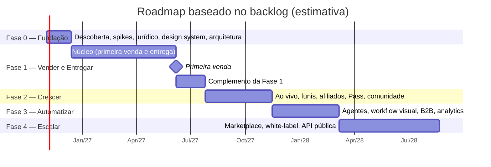

# 19 — Roadmap, Backlog, Equipe e Riscos

> **APEX Plataforma de Cursos Livres** · Documento 19 · v1.0 · 21/10/2026 · Status: **Rascunho para decisão do patrocinador (Q-05, Q-09)**
> Backlog: [`backlog/backlog-fase1.csv`](backlog/backlog-fase1.csv) · Verificação: [`scripts/estimate_backlog.py`](scripts/estimate_backlog.py) · Requisitos: [Doc 05](05-requisitos-funcionais.md) · Financeiro: [Doc 17](17-negocio-financeiro.md)

> ⚠️ **As estimativas aqui são grosseiras** (camisetas S/M/L convertidas em pessoas-dia) e servem para **expor o risco de escopo versus prazo**, não para comprometer datas. Devem ser recalibradas com o time real após os *spikes* da Fase 0.

## 1. Achado principal

**O escopo especificado para a Fase 1 não cabe em 17 semanas com a equipe prevista.** O backlog cobre **96/96 requisitos *Must* e 13/13 *Should* da Fase 1** e soma **619 pessoas-dia** (**492** no núcleo da primeira venda). Com 6 engenheiros e 65% de foco, são **~32 semanas** (**~25** para o núcleo); para fechar em 17 semanas seriam necessários **~11 engenheiros** (~9 só para o núcleo). O roadmap foi **reestimado de baixo para cima** (Doc 04 §5) e o modelo financeiro usa essa linha do tempo (Doc 17).

## 2. Roadmap

| Fase | Duração | Equipe (pessoas) | Marco de saída | Portão (Doc 17 §6) |
|---|---:|---:|---|---|
| **0 — Fundação** | 6 semanas | 4–8 (ramp-up) | Spikes concluídos, marca consultada, ADRs aprovados, equipe contratada | **G0** |
| **1 — Vender e Entregar** | ~32 semanas (núcleo ~25) | 8 | Fluxo ponta a ponta em produção; **primeira venda** ao fim do núcleo | **G1** |
| **2 — Crescer** | 16 semanas | 10 | Evento ao vivo com ≥ 200 pessoas; funil evergreen; Pass | **G2** |
| **3 — Automatizar** | 16 semanas | 12 | ≥ 60% dos tickets por IA; workflow visual; piloto B2B | **G3** |
| **4 — Escalar** | 24 semanas | 14 | Instrutor externo vende sem a equipe; API pública | **G4** |

**Total: ~94 semanas (~22 meses)**, com a data de início ilustrativa (02/11/2026). A decisão entre **prazo, equipe e escopo** está em aberto (Q-09).

## 3. Fase 0 — ações (backlog de descoberta)

| ID | Ação | Entregável | Responsável | Relação |
|---|---|---|---|---|
| B-01 | **Concluir a análise do site de referência** (liberar acesso ou enviar material) | Doc 02 preenchido; matriz de rastreabilidade | Produto | Q-07, R-12 |
| B-02 | **Busca de anterioridade no INPI** (classes 9, 35, 41, 42) e checagem de domínio/perfis | Relatório e decisão de nome | Jurídico | R-10, Q-06 |
| B-03 | **Parecer sobre ECA Digital e público 18+** (verificação etária proporcional) | Parecer e decisão ADR-010 | Jurídico/DPO | Q-02 |
| B-04 | **Benchmark por conta de teste** (checkout, recuperação, *order bump*, afiliados, certificado, app) de Hotmart, Kiwify e outras | Relatório comparativo | Produto | Doc 01 §5 |
| B-05 | Baixar e ler o **Censo EAD.BR** (ABED) e fontes de tamanho de mercado de infoprodutos | Resumo de mercado | Produto | Doc 01 §5 |
| B-06 | **Entrevistas** (8–10 por persona P1, P2, P4) | Personas validadas | UX | Doc 03 §4 |
| B-07 | **Pesquisa de demanda e SEO** para as áreas iniciais | 2–3 áreas priorizadas | Produto/Growth | Q-03 |
| B-08 | **Executar os spikes S-01…S-10** (PSP, NFS-e, workflow, vídeo, ao vivo, RAG, identidade, RLS, e-mail/WhatsApp, antipirataria) | Decisões ADR-004…008 | Tech lead | Doc 11 §13 |
| B-09 | **Escolher PSP, ESP, emissor fiscal, vídeo e ao vivo** pelos critérios do Doc 11 §5.1 | Contratos e contas | Tech lead/Financeiro | D1, D3 |
| B-10 | **Contador:** regime, CNAE, NFS-e, tratamento de e-book/curso/assinatura, retenções | Parecer fiscal | Financeiro | Q-04 |
| B-11 | **Nomear DPO**, ROPA inicial e plano de RIPD | Política e registros | DPO | RNF-PRV-02 |
| B-12 | **Design system v0** (tokens, componentes-base) | Biblioteca de UI | UX/Front | Doc 15 |
| B-13 | **Montar equipe e orçamento** (Q-05, Q-09) | Plano de contratação | Patrocinador | Doc 17 |
| B-14 | **Testes de funil** (3 temas): CPL, comparecimento, conversão | Dados para o portão G0 | Growth | Doc 17 §6 |
| B-15 | **Decisões abertas** Q-01…Q-09 | Registro de decisões | Patrocinador | Doc 04 §10 |

## 4. Backlog da Fase 1

Fonte única: [`backlog/backlog-fase1.csv`](backlog/backlog-fase1.csv). **Núcleo** = o que é indispensável para a **primeira venda e entrega** (cadastro → compra → acesso → aula → certificado → nota fiscal → reembolso → LGPD). **Fora do núcleo** = complementos da Fase 1 (tutor IA, busca, e-book, boleto, comentários, login social etc.).

> Épicos do backlog: **EP-00** fundação de produto e qualidade (design system, *shell*, testes finais) · **EP-01** conta, acesso e consentimento · **EP-02** catálogo e páginas · **EP-03** aprendizagem e mídia · **EP-04** checkout e pagamentos · **EP-05** operação mínima e plataforma · **EP-06** tutor IA e gateway (numeração alinhada ao [Doc 04](04-prd.md) §4).

> Pesos: **S = 4**, **M = 8**, **L = 15 pessoas-dia** (inclui desenvolvimento e testes; exclui produto e design). O tutor de IA (EP-06) é **diferencial**, mas **não é necessário para a primeira venda**.

<!-- BACKLOG:START -->
> Verificação automática (`scripts/estimate_backlog.py`): **63 histórias; 96/96 requisitos *Must* da Fase 1 cobertos; 13/13 *Should* da Fase 1 cobertos.**

#### Histórias

| ID | Épico | História | Requisitos | Tam. | Núcleo |
|---|---|---|---|:-:|:-:|
| US-001 | EP-01 | Cadastro, login por e-mail e senha, verificação de e-mail, recuperação segura e proteção contra força bruta | IAM-001, IAM-004, IAM-018 | M | ✔ |
| US-002 | EP-01 | Login social com Google | IAM-002 | S |  |
| US-003 | EP-01 | 2FA (TOTP e passkeys), obrigatório para equipe e instrutores | IAM-005 | M | ✔ |
| US-004 | EP-01 | Perfil da pessoa com CPF validado e preferências de comunicação (descadastro em 1 clique) | IAM-007, IAM-009 | M | ✔ |
| US-005 | EP-01 | Consentimentos versionados com prova (versão, data/hora, IP) | IAM-008 | M | ✔ |
| US-006 | EP-01 | RBAC por tenant, papéis padrão e convite de equipe | IAM-010, IAM-013 | M | ✔ |
| US-007 | EP-01 | Gestão de sessões e dispositivos com limite de sessões | IAM-006 | S |  |
| US-008 | EP-01 | Declaração de maioridade e bloqueio de menor sem responsável | IAM-014 | S | ✔ |
| US-009 | EP-01 | Auditoria de autenticação e autorização | IAM-017 | S | ✔ |
| US-010 | EP-01 | Autoatendimento do titular (exportar, corrigir, revogar consentimento, solicitar exclusão) | IAM-019 | M | ✔ |
| US-011 | EP-02 | Produto polimórfico: tipos, ciclo de vida, versionamento e metadados | CAT-001, CAT-002, CAT-003 | L | ✔ |
| US-012 | EP-02 | Ofertas, regras de acesso (vitalício/prazo) e cupons por produto | CAT-005, CAT-017, CAT-020 | M | ✔ |
| US-013 | EP-02 | Mídia de vitrine, categorias e coleções | CAT-004, CAT-009 | S | ✔ |
| US-014 | EP-02 | Busca e filtros do catálogo | CAT-010 | M |  |
| US-015 | EP-02 | Página pública de produto com SSR, dados estruturados, sitemap e imagens OG | CAT-011, CAT-012 | M | ✔ |
| US-016 | EP-02 | Guardião de Compliance v1 (termos proibidos, checklist de curso livre, fila de revisão e portão de publicação) | CAT-021, AIX-024 | L | ✔ |
| US-017 | EP-02 | Política de reembolso por produto e conteúdo gratuito com captura | CAT-018, CAT-019 | S | ✔ |
| US-018 | EP-02 | Página do instrutor e FAQ por produto | CAT-014, CAT-015 | S |  |
| US-019 | EP-03 | Estrutura curso, módulos e aulas com editor | LMS-001, LMS-002 | L | ✔ |
| US-020 | EP-03 | Progresso, retomada do ponto exato e conclusão | LMS-003 | M | ✔ |
| US-021 | EP-03 | Liberação gradual (drip) por data, dias ou conclusão | LMS-004 | S |  |
| US-022 | EP-03 | Quizzes: banco de questões, tipos, nota mínima e correção automática | LMS-008, LMS-009 | L | ✔ |
| US-023 | EP-03 | Certificado: regras, layout, PDF, código e QR, verificação pública e revogação | LMS-013, LMS-015, LMS-016, LMS-017 | L | ✔ |
| US-024 | EP-03 | Matrícula automática e manual, prazo de acesso, suspensão e cancelamento | LMS-023, LMS-024, LMS-025 | M | ✔ |
| US-025 | EP-03 | Painel do aluno (continuar, próximos passos, certificados, pedidos) | LMS-027 | M | ✔ |
| US-026 | EP-03 | Comentários e dúvidas por aula | LMS-020 | S |  |
| US-027 | EP-03 | Materiais complementares e downloads com controle de acesso | LMS-021 | S |  |
| US-028 | EP-03 | Portão de acessibilidade: publicação de vídeo exige legenda e transcrição | LMS-035 | S | ✔ |
| US-029 | EP-03 | Upload retomável, transcodificação adaptativa e player responsivo | MED-001, MED-002, MED-003 | L | ✔ |
| US-030 | EP-03 | Proteção de reprodução (URL assinada, restrição de domínio) e limite de streams | MED-004, MED-007 | M | ✔ |
| US-031 | EP-03 | Legendas automáticas, transcrição pesquisável e capítulos | MED-008, MED-009 | M | ✔ |
| US-032 | EP-03 | Leitor de e-book na web e PDF baixável com marca d'água | MED-011 | M |  |
| US-033 | EP-03 | Biblioteca de ativos, política de retenção e CDN com failover | MED-012, MED-019, MED-014 | S | ✔ |
| US-034 | EP-03 | Central de notificações (in-app e e-mail) com preferências e limites | ENG-008 | M | ✔ |
| US-035 | EP-04 | Checkout em 1 página, sessão de checkout, preço calculado no servidor e resumo pré-contratual | PAY-001, PAY-002, PAY-012 | L | ✔ |
| US-036 | EP-04 | Pagamento por Pix (QR, copia-e-cola, expiração e confirmação em tempo real) | PAY-003 | L | ✔ |
| US-037 | EP-04 | Pagamento por cartão com tokenização, 3DS e parcelamento | PAY-004, PAY-025 | L | ✔ |
| US-038 | EP-04 | Pagamento por boleto | PAY-005 | M |  |
| US-039 | EP-04 | Pedido, máquina de estados, idempotência e webhooks do PSP | PAY-014, PAY-015 | L | ✔ |
| US-040 | EP-04 | Entrega automática, mensagens transacionais e página de agradecimento | PAY-016, PAY-017, PAY-018 | M | ✔ |
| US-041 | EP-04 | Cupons no checkout | PAY-007 | S |  |
| US-042 | EP-04 | Registro de aceite dos termos e antifraude básico | PAY-011, PAY-013 | M | ✔ |
| US-043 | EP-04 | Reembolso de 7 dias automático com estorno e revogação de acesso | PAY-010, PAY-022 | L | ✔ |
| US-044 | EP-04 | Ledger de dupla entrada | PAY-040 | L | ✔ |
| US-045 | EP-04 | E-mail transacional e higiene de entrega (SPF, DKIM, DMARC, supressão) | MKT-007 | M | ✔ |
| US-046 | EP-04 | Banner e gestão de consentimento de cookies | MKT-019 | S | ✔ |
| US-047 | EP-06 | Gateway de IA com orçamento, logs com redação de PII e kill switch | AIX-001, AIX-002, AIX-003, AIX-015 | L |  |
| US-048 | EP-06 | Prompts versionados, avaliações (evals) e guardrails | AIX-004, AIX-005, AIX-006 | L |  |
| US-049 | EP-06 | RAG: ingestão, indexação incremental e controle de acesso por direito | AIX-009, AIX-010 | L |  |
| US-050 | EP-06 | RAG: recuperação híbrida, citações e verificação de ancoragem | AIX-011 | L |  |
| US-051 | EP-06 | APEX Tutor v1: modos, encaminhamento a humano, rótulo de IA e privacidade | AIX-016, AIX-018, AIX-007, AIX-008 | L |  |
| US-052 | EP-05 | Motor de fluxos interno: eventos, execução durável e idempotência | OPS-001, OPS-002 | L | ✔ |
| US-053 | EP-05 | NFS-e automática, cancelamento e regras fiscais por produto | OPS-009, OPS-010 | L | ✔ |
| US-054 | EP-05 | DSAR automatizado | OPS-029 | M | ✔ |
| US-055 | EP-05 | Retenção e guarda de logs; ficha acadêmica do aluno | OPS-032, OPS-022 | M | ✔ |
| US-056 | EP-05 | Painel administrativo mínimo, configurações e feature flags | OPS-035, PLT-011 | L | ✔ |
| US-057 | EP-05 | Esquema de eventos de produto e coleta com consentimento | DAT-001 | S | ✔ |
| US-058 | EP-05 | Multi-tenant com RLS e migrações sem indisponibilidade | PLT-001, PLT-014 | L | ✔ |
| US-059 | EP-05 | Catálogo de eventos de domínio e outbox | PLT-004 | M | ✔ |
| US-060 | EP-05 | Observabilidade, backups com restauração testada e CI/CD | PLT-012, PLT-013 | L | ✔ |
| US-061 | EP-00 | Design system v1: tokens e componentes da Fase 1 | — | L | ✔ |
| US-062 | EP-00 | Shell do aplicativo (aluno, painéis) e PWA básico | — | L | ✔ |
| US-063 | EP-00 | Testes ponta a ponta, carga, teste de invasão e auditoria de acessibilidade (portão de lançamento) | — | L | ✔ |

#### Esforço por épico

| Épico | Histórias | S | M | L | Pessoas-dia | Núcleo (pessoas-dia) |
|---|---:|---:|---:|---:|---:|---:|
| EP-00 | 3 | 0 | 0 | 3 | 45 | 45 |
| EP-01 | 10 | 4 | 6 | 0 | 64 | 56 |
| EP-02 | 8 | 3 | 3 | 2 | 66 | 54 |
| EP-03 | 16 | 5 | 7 | 4 | 136 | 116 |
| EP-04 | 12 | 2 | 4 | 6 | 130 | 118 |
| EP-05 | 9 | 1 | 3 | 5 | 103 | 103 |
| EP-06 | 5 | 0 | 0 | 5 | 75 | 0 |
| **Total** | **63** | **15** | **23** | **25** | **619** | **492** |

#### Esforço × capacidade

Pesos: S = 4, M = 8, L = 15 pessoas-dia. Capacidade = engenheiros × 5 dias × fator de foco (65%).

| Escopo | Pessoas-dia | Engenheiros | Capacidade em 17 semanas | Semanas necessárias | Engenheiros para 17 semanas |
|---|---:|---:|---:|---:|---:|
| Fase 1 completa | 619 | 6 | 332 | 32 | 11.2 |
| Fase 1 completa | 619 | 4 | 221 | 48 | 11.2 |
| Somente o núcleo (primeira venda e entrega) | 492 | 6 | 332 | 25 | 8.9 |
| Somente o núcleo (primeira venda e entrega) | 492 | 4 | 221 | 38 | 8.9 |
| Fora do núcleo | 127 | 6 | 332 | 7 | 2.3 |
| Fora do núcleo | 127 | 4 | 221 | 10 | 2.3 |
<!-- BACKLOG:END -->

### 4.1 Ondas de execução (núcleo)

Trabalho em paralelo, respeitando dependências. As semanas são relativas ao início da Fase 1.

| Onda | Semanas | Foco | Histórias | Dependências |
|---|---|---|---|---|
| **1 — Fundação técnica** | 1–6 | Multi-tenant e RLS, CI/CD e observabilidade, eventos/outbox, motor de fluxos, design system, *shell* do app, eventos de produto | US-058, 059, 060, 052, 061, 062, 057 | Spikes S-03, S-07, S-08 |
| **2 — Identidade e catálogo** | 5–12 | Conta, 2FA, consentimentos, papéis, produto e ofertas, páginas SEO, Guardião v1 | US-001, 003–006, 008–010, 011–013, 015–017 | Onda 1 |
| **3 — Aprendizagem e mídia** | 9–18 | Cursos, progresso, quizzes, matrícula, painel do aluno, upload e player, proteção, legendas, notificações | US-019, 020, 022, 024, 025, 028–031, 033, 034 | Ondas 1–2; spike S-04 |
| **4 — Comércio** | 11–22 | Checkout, Pix, cartão, pedidos e webhooks, entrega, aceite e antifraude, reembolso, ledger, e-mail e cookies | US-035–037, 039, 040, 042–046 | Ondas 1–2; spike S-01 |
| **5 — Certificado, fiscal e conformidade** | 17–25 | Certificado verificável, NFS-e, DSAR, retenção, painel admin, testes finais, pentest, acessibilidade | US-023, 053–056, 063 | Ondas 3–4; spike S-02 |
| **Primeira venda** | **~25** | Portão **G1** parcial: compras reais de baixo valor, reembolso e NFS-e automáticos | | |
| **6 — Complemento** | 26–32 | Tutor IA, busca, e-book, boleto, comentários, login social, sessões | US-002, 007, 014, 018, 021, 026, 027, 032, 038, 041, 047–051 | Núcleo no ar |

## 5. Decisão Q-09: prazo × equipe × escopo

| Opção | O que significa | Prazo da Fase 1 | Efeito no caixa (Doc 17) | Riscos |
|---|---|---|---|---|
| **A — Manter a equipe prevista** | 6 engenheiros, escopo completo | **~32 semanas** (núcleo ~25) | Cenário base do Doc 17 | Receita só a partir do mês 8; fôlego de caixa maior |
| **B — Ampliar a equipe** | ~11 engenheiros para 17 semanas (~9 só para o núcleo) | ~17 semanas | Equipe quase 2× maior na fase de construção; **custo total maior** | Onboarding e coordenação de muita gente nova; ganho de prazo menor que o proporcional |
| **C — Cortar escopo e comprar mais** | Adotar identidade/SSO gerenciados, *helpdesk* e *emails* de mercado; adiar tutor, busca, e-book, boleto e login social | Núcleo em **~25 semanas** com 6 engenheiros, ou menos com componentes prontos | Menor custo de construção; mais custo recorrente de fornecedores | Dependência de fornecedores; menos diferenciação no início |
| **D — A + C (recomendação para discussão)** | Fase 0 de 6 semanas para validar demanda (G0); depois núcleo com 6 engenheiros, comprando identidade e *helpdesk*; complemento depois da primeira venda | Primeira venda ~**mês 8** | Base do Doc 17 com menos custo de construção | Aceitar que o tutor IA chega depois da primeira venda |

> **A recomendação é uma proposta para o patrocinador**, não uma decisão. O Doc 17 mostra que **mais atraso custa caro** e que a **economia unitária precisa ser provada antes de investir em escala**.

## 6. Equipe

### 6.1 Composição proposta (Fases 0–1: 8 pessoas, 6 engenheiros)

| Papel | Qtd. | Responsabilidade |
|---|---:|---|
| Product Manager / Owner | 1 | Backlog, priorização, portões, relação com negócio e jurídico |
| UX/UI Designer | 1 | Pesquisa, design system, fluxos críticos, acessibilidade |
| **Tech Lead** | 1 | Arquitetura, ADRs, revisões, spikes, segurança |
| Engenheiros full-stack | 3 | Catálogo, LMS, checkout, painéis |
| Engenheiro de IA/dados | 1 | Gateway, RAG, avaliações, eventos e métricas |
| QA + DevOps/SRE | 1 | Automação de testes, CI/CD, observabilidade, carga, segurança |

**Terceirizados/parceiros:** jurídico (consultivo e contratos), contador, DPO, produção de conteúdo/estúdio, *pentest*.

### 6.2 Crescimento por fase (cenários genéricos do Doc 17)

| Fase | Pessoas | Entradas |
|---|---:|---|
| 0–1 | 8 | Composição acima |
| 2 | 10 | + Growth/marketing; + Suporte e operações |
| 3 | 12 | + Curadoria pedagógica; + Comercial B2B |
| 4 | 14 | + Engenheiro de plataforma/marketplace; + Sucesso do cliente/instrutores |

> No **cenário-alvo** do Doc 17 a equipe **permanece em 8**: operação e crescimento são sustentados por automação, fornecedores e terceirização. Isso é uma **condição a provar** (C5), não uma previsão.

## 7. Riscos e dependências do projeto

> Continuam valendo os riscos **R-01…R-12** do [Doc 04](04-prd.md) §8 e **RJ-01…RJ-12** do [Doc 16](16-juridico-compliance.md) §11.

| ID | Risco | Prob. | Impacto | Mitigação | Dono |
|---|---|---|---|---|---|
| R-13 | **Capacidade de engenharia insuficiente** para o escopo (619 pessoas-dia na Fase 1) | **Alta** | Alto | Decisão Q-09; núcleo × complemento; *buy-over-build* | Patrocinador/TL |
| R-14 | Estimativas grosseiras subestimam integração com PSP, fiscal e vídeo | Média | Alto | Spikes S-01…S-05; reestimar após Fase 0 | TL |
| R-15 | Dependência de pessoa-chave (TL) | Média | Alto | Documentação, ADRs, revisão em pares, par técnico | TL |
| R-16 | Aprovação do PSP/WhatsApp/emissor fiscal demora | Média | Médio | Abrir contas na Fase 0; plano B de fornecedor | Financeiro/TL |
| R-17 | Catálogo inicial insuficiente no lançamento | Média | Alto | Contratar conteúdo cedo; instrutores convidados; Studio | Produto |
| R-18 | Custo de IA/vídeo/ao vivo acima do orçado | Média | Médio | FinOps, orçamentos por agente, créditos (Doc 08 §11) | TL |
| R-19 | Mudança de decisão sobre marca depois de investir em identidade | Média | Médio | Decidir B-02 antes de registrar domínio/peças | Patrocinador |
| R-20 | Atrasos acumulam custo de equipe sem receita | Alta | Alto | Marcos curtos, portões, priorização do núcleo (Doc 17 §5.4: 3 meses de atraso ≈ +R$ 0,4 mi) | PM |

**Dependências externas:** D1 PSP aprovado · D2 *templates* de WhatsApp aprovados (Fase 2) · D3 emissor de NFS-e (obrigatória para optantes do Simples a partir de 01/11/2026, conforme fontes consultadas; confirmar) · D4 marca consultada no INPI.

## 8. Definição de pronto e de preparado

**Definition of Ready (história)**
- Requisitos (RF) e critério de aceite (Gherkin para fluxos críticos) vinculados · desenho de UX aprovado · dependências identificadas · estimativa feita · riscos de segurança/privacidade avaliados.

**Definition of Done (história)**
- Código revisado e testado (unidade + contrato; e2e nos fluxos críticos) · sem vulnerabilidades críticas/altas abertas · acessibilidade verificada (WCAG 2.2 AA nas telas novas) · métricas, logs e alertas instrumentados · documentação e *runbook* atualizados · *feature flag* e *rollback* testados · critérios de aceite demonstrados ao PM.

## 9. Cerimônias e governança

| Cerimônia | Frequência | Observação |
|---|---|---|
| Planejamento de sprint | Quinzenal | Sprints de 2 semanas; ~16 sprints na Fase 1 |
| Revisão e retrospectiva | Quinzenal | Demonstração ao patrocinador |
| Revisão de arquitetura | Quinzenal | ADRs novos ou alterados |
| Revisão de riscos | Quinzenal | RAID atualizada |
| **Portões G0–G4** | Fim de cada fase | Critérios do Doc 17 §6; decisão de continuar, ajustar ou parar |
| Revisão jurídica/compliance | Mensal | Doc 16; termos; lista do Guardião |
| Revisão de custos (FinOps) | Mensal | IA, vídeo, ao vivo, PSP |
